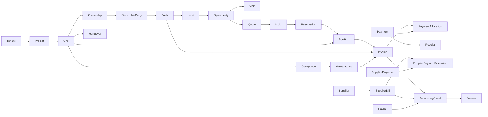

# PropertyOS — Unified Master Blueprint V2.0

**Date:** 26 October 2026  
**Status:** UI/UX prototype implementation authorized; production business backend **not yet authorized**.  
**Codename:** PropertyOS (public brand is not selected; JOR was a suggestion, not a settled trademark).  
**Audience:** Product owner, Claude Fable, Astra, design, engineering, QA.

---

## 1. Product mission

Build an ultra-professional, multi-tenant, white-label real-estate developer and property management SaaS that manages the entire lead-to-living lifecycle and developer company operations:

**Public discovery → lead → follow-up → site visit → unit exploration → quotation → hold → reservation → booking → buyer/co-buyer → payment plan → fees/invoices → collections → agreement/documents → construction → handover → ownership/transfer → occupancy → resident services → maintenance/visitors/parking/amenities.**

In parallel manage **finance, suppliers, utilities, expenses, payroll, procurement, banks, general ledger, budgets, accounting and reports**.

It is not a brochure website and not an isolated CRM. It is a connected operating platform with a premium customer experience.

### Applications / experiences
1. **Developer Backoffice:** CRM, sales, property inventory, customer 360°, finance, operations, HR, reporting.
2. **Customer/Owner/Resident application:** one responsive **web + installable PWA** codebase, adapting across phone/tablet/desktop.
3. **Luxury public websites:** SEO-aware cinematic, interactive property discovery, white-label per tenant/project; live published data from common domain service/API.
4. **Platform SaaS HQ:** tenants, plans, branding, domain, subscriptions, support and lifecycle.

**No separate React Native and website implementation in V1.** Revisit Capacitor/native wrapper only if app store distribution or platform-specific mobile capabilities become important. Native wrappers still need separate packaging/testing and may require native plugins.

---

## 2. Experience principles — permanent product rules

- Every user knows **where they are, what they can do now, what happens next, and how to go back**.
- A record (customer, project, unit, booking, supplier, employee, invoice, maintenance case) opens a **360° workspace**: key metrics, contextual tabs, related drawer, activity timeline, next-action buttons and help.
- Main sidebar is brief. **Related work is one click away in context**, not hidden in long menus.
- Ctrl+K searches **routes + actual records + allowed actions**; on phone this is a prominent search action.
- Desktop shows dense tables/multiple panels; mobile shows sensible cards/stacked panes/bottom sheets. **Same business features, adaptive composition**, not identical pixel geometry.
- Actions provide immediate feedback: local loaders, skeletons, subtle progress, clear errors and success confirmation. No meaningless full-page reloads.
- Large selects are async searchable; dependent project→tower→floor→unit inputs show context and constraints.
- Routine short operations use drawers/bottom sheets; complex operations use wizards; significant destructive operations require confirmation and reason.
- Inactive/missing permissions are never bypassed in the backend; hidden UI is not a security control.
- One-tap/click language change for English/Urdu with real layout mirroring where appropriate.
- Full keyboard and screen-reader usability is a mandatory acceptance criterion, not a decorative option.
- Sound feedback is OFF by default, opt-in, low volume, and never the only feedback method.
- User-created draft data survives back/forward navigation and does not vanish on validation error.

---

## 3. Internationalization and localization (design now, before components)

### Languages
V1: `en-PK` and `ur-PK`. Architecture must permit additional BCP 47 locales later, such as Arabic or English variants. It must not require new components for each language.

### Locale switch
- Visible top-header language selector desktop; accessible menu on mobile and login.
- Switching updates all visible UI copy, buttons, forms, table headings, help, confirmations, toasts, validation, navigation and accessibility names without logout.
- Preserve current screen, record, tab, search/filter selections and unsaved data while switching.
- Save preference per user; for anonymous public visitors, store a local preference; server may honor locale preference on first render.
- Set document `<html lang="ur-PK" dir="rtl">` for Urdu, `lang="en-PK" dir="ltr"` for English.
- CSS uses logical properties (`margin-inline-start`, `padding-inline-end`, `inset-inline-start`) rather than fixed left/right.
- Tabs, navigation, breadcrumbs, drawers, stepper and directional arrows mirror correctly for RTL. Do **not** mirror logos, photographs, QR codes, maps, charts, phone numbers or Latin identifiers blindly.
- Wrap IBAN, transaction IDs, invoice numbers, URLs, email addresses, phone numbers in explicit direction/bidi isolation (`dir="ltr"`, `<bdi>`, or CSS `unicode-bidi: isolate` as appropriate) so Urdu does not scramble references.
- Test Urdu text expansion, line wrapping and Urdu form errors; never use truncated labels as the only label.
- Support English and Urdu search terms; transliteration/phonetic search is a separate future improvement.
- User-entered free text remains in its original language unless an explicitly approved translation feature is later added.
- Money remains PKR and **amount values do not change with locale**; only formatting and reading change. Timezone, date locale, grouping and numeral presentation must be consistent and tested.
- Store translation **keys**, not database records' translated display text, for statuses and permissions; store localized authored marketing/help content separately.

### Typography
- Backoffice English: Geist Sans or Inter, choose one.
- Urdu interface: professionally tested readable Naskh-style UI font with full Urdu glyph support (e.g. Noto Naskh Arabic), not tiny or decorative Nastaliq in tables.
- Customer luxury headings: brand-selectable display serif (e.g. Instrument Serif for English); for Urdu display, a licensed/readable Urdu typeface appropriately sized.
- Minimum practical body: desktop 14–16px for data-heavy admin, 16px+ for customer, with generous line heights; support browser zoom to 200% and text resize.
- Translation files organized by area: `common`, `nav`, `crm`, `inventory`, `finance`, `payments`, `maintenance`, `errors`, `help`, `public`.

### Sample dictionaries
```json
// en-PK
{ "nav.payments": "Payments", "payment.awaitingVerification": "Awaiting verification", "action.receivePayment": "Receive payment" }

// ur-PK
{ "nav.payments": "ادائیگیاں", "payment.awaitingVerification": "تصدیق کا انتظار", "action.receivePayment": "ادائیگی وصول کریں" }
```

---

## 4. Accessibility standard — WCAG 2.2 AA target

- Semantic landmarks: header, navigation, main, complementary, contentinfo; one logical page H1.
- Keyboard works throughout: Tab/Shift+Tab/Enter/Space/Escape/arrow keys in the applicable controls; no keyboard traps.
- Visible high-contrast focus outlines; focus moves correctly into/out of drawers, dialogs and route transitions.
- Screen-reader names/roles/states for all buttons, toggles, selects, fields, tables and status updates; no unlabeled icon-only controls.
- Status is communicated via **text + shape/icon**, not only color.
- Standard body contrast **≥4.5:1**, large text **≥3:1**, non-text essential controls/borders **≥3:1**.
- Prefer 44×44 CSS px touch targets on phone; WCAG 2.2 minimum target size requirements still apply even if a specific compact table cannot reach 44.
- Keep full functionality at 200% zoom and narrow/mobile viewport; no critical horizontal scrolling across the page (data tables may scroll within a labeled region when necessary).
- Forms have persistent labels, examples, required states, field-level errors, summary on submit where needed, and easy correction.
- User can choose reduced motion; scroll-driven hero must have equivalent readable non-animated content and keyboard-accessible units/CTAs.
- All interactive unit grids, floor explorers, drag-and-drop Kanban, calendar widgets and charts have **nonvisual/list/table alternative operation**.
- No sound-only confirmations. UI can provide visual plus accessible live-region announcements; sounds opt-in.
- Videos have captions for meaningful speech, transcripts where needed, and autoplay is muted/pausable.
- Accessible authentication: do not require remembering complex information; support password managers/autofill and usable MFA.
- Screen readers to test: NVDA + Chrome on Windows; VoiceOver + Safari on iOS/macOS; TalkBack + Chrome on Android. Include at least one hands-on blind/low-vision user test before release if possible.
- Accessibility applies equally to third-party payment checkout and uploaded/downloadable documents; where provider checkout is inaccessible, surface the limitation and an accessible alternate payment route.

---

## 5. Responsive design system — same product, different composition

### Layout references (test, not fixed-only breakpoints)
- 360/390/430 CSS px phones (portrait and landscape).
- 768–1024 tablets and foldables.
- 1280/1440/1920 desktop.
- Test at 320 CSS px where WCAG reflow is relevant and 200% zoom.

### Backoffice desktop
- Header ~64px; sidebar expanded ~256px, collapsed ~72px; fluid content.
- Page header → breadcrumbs → context header → primary actions → tabs → panels.
- Tables can use filtering, column controls, pinned columns, bulk actions, saved views, row quick view.
- Finance is predominantly desktop/tablet-focused but critical approvals/lookups still usable by phone.

### Backoffice mobile
- Sidebar becomes menu sheet; global search stays prominent.
- Header and action density reduce, not information integrity.
- Tabs become horizontal scroll or categorized More menu; do not place 16 tiny tab labels in one line.
- Tabular finance content gets responsive cards for simple lists and labeled scrollable table for comparison/ledgers.
- Right drawer becomes full-height sheet; footer sticks; buttons remain thumb-accessible.
- Charts expose a data table/accessible summaries.

### Customer PWA
- Mobile home bottom nav: `Home | Property | Payments | Services | Profile` (localized).
- On desktop, transform to side/top navigation, spacious two-column property/finance cards and accessible right-hand context panels.
- One customer can own multiple units and switch property context.
- Every invoice/payments/documents/maintenance function must be available on both viewport classes.
- Installable PWA requires secure HTTPS, manifest, icons, caching and appropriate service worker strategy. Sensitive financial data should not be blindly persisted offline; offline support is selective and privacy-aware.

### Luxury public websites
- Larger hero and editorial text, professional imagery/video, pinned storytelling, master plan and unit explorer.
- Heavy animations are progressive enhancement; mobile uses lighter assets/effects.
- No scroll hijacking; user must be able to read and navigate with touch, keyboard and reduced-motion settings.
- SEO-friendly project pages; structured metadata and accessible textual unit listings alongside visual selector.

---

## 6. UI visual standards

### Two personalities, shared principles
**Backoffice:** calm, neutral, efficient, trustworthy, dense if needed; no unnecessary animation.  
**Customer/public:** premium, cinematic, tasteful typography, architectural photography, storytelling — but payment and document screens switch to high-clarity fintech UI.

### Color approach
- Neutrals dominate: clean light background, readable charcoal text, subtle borders.
- One configurable branded primary accent. Tenant-brand color must pass text/button contrast or be adjusted for accessible use.
- Semantic states: success, warning, danger, info. Labels/icons accompany status color.
- High-contrast preference should be supported; dark mode not required for initial launch but tokens must not block it.
- Illustrative tokens, **subject to actual contrast test**:
```css
:root {
  --background: #F8FAFC;
  --surface: #FFFFFF;
  --text: #111827;
  --text-muted: #475569;
  --border: #CBD5E1;
  --primary: #1D4ED8;
  --success: #166534;
  --warning: #92400E;
  --danger: #B91C1C;
  --focus: #1D4ED8;
}
```
- Do not assume semantic text colors are always contrast-safe when placed on branded backgrounds. Test exact pairs.

### Components
AppShell, Sidebar, Header, Breadcrumb, WorkspaceHeader, EntitySummary, Tabs, RelatedDrawer, Search/CommandPalette, QuickCreate, ActivityTimeline, HelpDrawer, Toast, ConfirmDialog, Drawer/BottomSheet, Wizard, Skeleton, ErrorState, EmptyState, DataTable, FilterBar, SavedView, AsyncSelect, MultiSelect, Combobox, CurrencyInput, DateTimeInput, Phone/CNIC fields, FileUploader, FilePreview, MoneyDisplay, StatusLabel, InvoiceTable, LedgerView, Calendar, UnitMatrix, FloorPlanViewer, ResponsiveChart, AccessibleLiveAnnouncer, LocaleSwitcher, PermissionGate.

### Interaction standard
- Hover/focus/active/disabled/loading/error/empty/success defined for all primitives.
- Asynchronous actions show local loading immediately; no duplicate submits.
- Success for routine action = toast; important final transaction = full completion summary with reference.
- Error = what happened, whether anything changed, recovery action, safe reference.
- Do not show scary SweetAlert for ordinary saves; use accessible dialogs for destructive changes.
- Optional quiet sound feedback OFF by default; opt-in settings with separate accessible controls.
- Searchable selects display context (customer name + ID + phone, unit code + type + price + availability).
- Preserve list filters and scroll where reasonable when opening a related record and returning.

---

## 7. Core backoffice information architecture

### Main sidebar
Home · Sales · Projects · Customers · Finance · Procurement · HR · Operations · Residents · Reports · Administration

### Persistent header
Tenant switcher | Project context | Global search (Ctrl+K) | Quick create | Language | Notifications | Help | User

### Entity 360 workspaces
- **Customer:** Overview, CRM, visits, quotes, bookings, properties, ownership, payments, ledger, docs, handover, maintenance, visitors, parking, communications, activity.
- **Project:** Overview, leads, units, bookings, collections, finance, expenses, suppliers, construction, handover, residents, maintenance, documents, analytics, activity.
- **Unit:** Overview, physical specs, pricing versions, availability, holds, reservations, booking, owners, invoices, docs, construction, handover, occupancy, maintenance, parking, activity.
- **Booking:** Overview, buyers/co-buyers, unit, commercials, payment plan versions, invoices, payments/credits, ledger, docs, approvals, amendments, handover, activity.
- **Supplier:** Overview, bills, payments, purchase orders, contracts, projects, ledger, documents, activity.
- **Employee:** Overview, employment, attendance, payroll, advances, expenses, docs, assets, activity.
- **Invoice:** Overview, lines, allocations, payments, accounting status, documents, activity.
- **Maintenance:** Overview, work orders, schedule, SLA, resident, unit, docs, charges, messages, activity.

### Context navigation
Breadcrumbs are actual links. Related drawer links to any connected record. Primary actions always have clear outcomes and are gated by role/scope. All pages and tabs have deep-link URLs, not ephemeral-only client state.

---

## 8. Complete functional module map

**SaaS Platform:** tenants/developers, company/legal details, subscription, plans/feature limits, white-label themes/domains, admins, tenant support/usage, central billing.

**Identity/RBAC:** authentication, optional MFA, tenant membership, roles, permissions, assigned-record/project/team/cost-center scopes, temporary delegation, sessions, audit.

**Organization:** departments, branches, teams, employee links, cost centers, business units, project-context settings.

**Party:** individual and company identity; contacts, emails/phones/WhatsApp, CNIC/passport, addresses, relationship and KYC, broker/customer/employee/supplier roles.

**CRM:** lead sources/campaigns, leads, opportunities, reminders, calls/messages, follow-up tasks, site visits/calendars, pipeline, quotation and lost reasons.

**Project/Inventory:** project → phase/block → tower → floor → unit (flexible, optional levels); unit type, area, master plan, availability, parking/storage, media, price versions and time-limited holds.

**Commercial/Sales:** pricing components, discounts/approvals, quote versions, payment templates and plans, reservation/token, booking/co-buyers, agreements, amendment/cancellation/transfer.

**Customer Finance:** installments, charges, due dates, invoices, payment intents, receipt, payment allocations, credit/overpayment, refund, recovery/aging and reminders.

**Company Finance:** chart of accounts, periods, GL journal, posting/reversal, AR/AP, banks/reconciliation, supplier bills, utilities, expenses, petty cash, budgets, taxes, cost center/project dimensions, financial statements.

**Procurement:** vendors, purchase request, RFQ comparison, purchase orders, goods/service receipt, bill matching.

**HR/Payroll:** employees, salary components, allowances/tax/deductions, attendance, advances, payroll runs, approval, disbursement, GL posting.

**Documents:** secure document manager, versioning, per-entity links, visibility, customer download, templates and expiration.

**Construction/Handover:** progress milestones/photos/video, customer updates, clearance, inspection, snag, key/access card/meter checklist, possession docs.

**Residents/Facilities:** occupancy (owner != resident), maintenance requests/work orders/SLA, recurring community charges, announcements, visitor QR passes/check-in, vehicles/parking/amenity reservations.

**Communications/Approvals:** email/SMS/WhatsApp/push/in-app, provider statuses, action templates, central approvals, audits/activity.

**Reports:** dashboards per role, sales conversion, inventory, collections, GL, P&L, balance sheet, AP/AR aging, budgets vs actual, project profitability, payroll, resident services.

---

## 9. Domain, business logic and ERD summary

### Identity rules
`User` is authentication identity. `Party` is a real person/legal entity. A lead, buyer, co-owner, resident, supplier, employee or broker is a **role/relationship** of Party, not necessarily a separate unrelated identity. Parties do not need logins until portal access is activated.

### Property hierarchy
`Tenant` → `Project` → optional `Phase` → optional `Cluster/Block` → optional `Building/Tower` → optional `Floor` → `Unit`. Works for plots and villas without towers/floors. Parking and storage are separate assets with allocation histories.

### Key states
- Unit: draft → available → held → reserved → booked → allocated → handover-ready → handed-over → occupied; exceptions blocked, disputed, withdrawn and cancellation/release path.
- Lead: new → assigned → contacted → qualified → converted; exits dormant/lost/unqualified.
- Opportunity: qualified → visit → quotation → negotiation → hold/reservation → won; or lost.
- Quote: draft → approval → sent → accepted; or expired/rejected/superseded.
- Hold: active → converted/expired/released/cancelled. Avoid double-selling via transactional locks.
- Booking: draft → approved → confirmed → active → completed; amendments/cancellation/transfer separate controlled actions.
- Payment intent: created → pending → processing → succeeded/failed/expired.
- Manual proof: submitted → review → verified/rejected/needs-info.
- Invoice issuance state separate from settlement status; overdue is derived from due date/unpaid balance.
- Supplier bill approval, accounting posting and settlement tracked separately.
- Journal: draft → approval → posted; posted corrections via reversal.
- Payroll: draft → calculated → reviewed → approved → finalized → disbursed.
- Handover: clearances → inspection → snags → ready → scheduled → handed-over.
- Maintenance: new → triaged → assigned → in-progress → resolved → closed, with reopen/wait/escalation exceptions.

### Relationship commitments
- `Unit` must not have only one mutable `customer_id` ownership pointer. Use `Ownership` + `OwnershipParty` + effective dates. Booking is not legal ownership; occupancy is also separate.
- A customer can have many properties; co-buyers can share one booking/ownership; corporate buyer supported.
- Unit price changes create `UnitPriceVersion`; confirmed terms use quotation snapshots and booking amendments.
- One payment can settle many invoices and one invoice can receive many payments through `PaymentAllocation`. Unallocated credit is valid.
- Posted finance/confirmed business history must not be silently deleted or edited.
- Shared Documents/Approvals/Communications/Audit domains, not separate modules reinventing each feature.
- Accounting posting follows configured tenant policies; booking confirmation does **not** automatically imply full revenue recognition.

### High-level master ERD

*The diagram illustrates relationships, not an implementable SQL migration. Cross-database central tenant references require explicit application boundaries.*

### Tenancy
Central platform DB for tenants/domains/plans/global identities/memberships; separate operational DB per tenant. A tenant context must be established and verified before operational queries. Runtime data isolation tests are mandatory. Tenant-specific migrations are tracked independently; secrets not in DB URLs/logs.

### IDs, money and dates
ULID business record IDs; tenant-scoped human document sequences; fixed decimal for money (`DECIMAL(20,2)` default for amounts), explicit currency; distinguish transaction, due, posting, created and effective dates; UTC storage for instants and localized display.

### Reliability
Transactions for booking/holds/payments/allocations/journals/transfers; row locks for unit; idempotent gateway callbacks and outbox event consumers; audit immutable accounting actions; background queues for notifications/report generation; no pretending queued side effects completed instantly.

---

## 10. Payment gateway and collection design (Pakistan)

### V1 integration strategy
**Start with two payment experiences, not five individual gateways:**
1. **Manual bank transfer / IBAN:** bank/beneficiary instructions, invoice reference, upload evidence, review/verification, receipt. A screenshot is not proof that money settled until verified.
2. **Safepay gateway adapter:** staged sandbox checkout for supported rails; must confirm exact accepted methods, merchant/settlement structure, onboarding and production approval with provider.

Raast can be enabled through a bank or payment provider rather than building a direct SBP integration. Direct Meezan/JazzCash/Easypaisa/PayFast are candidate future adapters based on customer banking requirements, not V1 deliverables.

**Funds separation:** property/maintenance collections should settle to the developer or authorized community merchant/collection account, not silently be mixed with PropertyOS SaaS subscriptions. SaaS subscription revenue is separate. Do not implement marketplace fee splitting or third-party collection custody without explicit licensed-provider/legal agreement.

### Mock payment screens (UI prototype)
- Invoice display: customer, property, unit, invoice type, amount, charges, due date, reference, developer identity.
- Choose: Card/Wallet/Raast **only if configured/available**, or manual transfer.
- Manual: beneficiary, bank, account/IBAN, unique reference, copy, screenshot/file upload, bank transaction ID/date/amount, review status, rejection/re-upload, receipt on verification.
- Automated: gateway redirect/modal demo, processing, cancelled, failed, unknown/pending, paid only after verified backend status (simulation in prototype explicitly labeled `DEMO`).
- Maintenance charges and property installments have different rail/transaction-size policies and fees; high-value transfer may be preferred for real-estate installment amounts.
- Finance reconciliation, payment allocation, refunds/chargebacks, webhook idempotency, gateway outage/retry paths are separate workflows.
- Never store actual PAN/CVV. Saved card UI is **provider tokenization only**, subject to merchant/provider support.

### Company finance link
Customer invoice/payment accounting connects to GL by accounting events. Supplier AP, employee payroll, expenses and utility bills also post via GL rules. Per-project/cost-center reporting must be first-class. Approval and period-lock rules prevent unauthorized postings.

---

## 11. Connected UI: reusable flows and screens

### Key interaction journeys
**J1:** Public project enquiry → CRM lead → salesperson → site visit → unit quick view → quote → hold → reservation → booking → customer portal.

**J2:** Booking → payment schedule → invoice → receive/manual proof → finance verification → allocated payment → receipt → customer ledger → accounting event.

**J3:** Developer project → expense → supplier bill → approval → supplier payment → bank reconciliation → GL/report.

**J4:** Customer owner → construction update → clearance → inspection/snags → handover → ownership/occupancy → resident home.

**J5:** Resident mobile app → maintenance request/photos → operations ticket → technician/work order → resolved → resident confirmation → optional invoice/payment.

**J6:** Resident → visitor pass → security QR check-in/check-out → event history.

**J7:** Language `EN→اردو` in mid-workflow; layout mirrors; form values and active screen are preserved, status labels translated, bank reference remains legible.

**J8:** Keyboard/screen reader completes customer lookup → invoice open → simulated payment evidence upload → status review without mouse.

**J9:** Sales user restricted to one project sees only permitted records in tables, related drawer, actions and Ctrl+K.

**J10:** Phone↔desktop resize retains data and allows task completion without different products/apps.

### Reusable screen template families
- Index table/list with filters/saved views.
- Entity 360 detail/workspace with tab sections.
- Action drawer/bottom sheet.
- Complex wizard/stepper with summary panel.
- Approval detail/decision.
- Calendar/scheduler.
- Visual inventory grid with accessible list alternative.
- Report/dashboard with underlying accessible data table.
- Finance split reconciliation view.
- Cinematic section + accessible static alternative.

The comprehensive route inventory is repeated below; `06_SCREEN_REGISTER.csv` provides machine-readable IDs, intended surface and prototype route. Those prototype URLs are placeholders—not final API/production route contracts.

---

## 12. Complete screen inventory
**GLOBAL — Global interface (10 views):** Command palette, Unified search results, Quick create, Notifications, Recent records, Favorites, Context help, Profile & preferences, Language switcher, Accessibility preferences.

**AUTH — Authentication (6 views):** Login, Forgot password, Reset password, Second factor optional, Tenant selection, Customer portal login.

**SAAS — SaaS operator (10 views):** Platform dashboard, Tenants list, Tenant 360 workspace, Create tenant, Plans & entitlements, Subscription billing, Domains, Platform roles/users, Support/audit, Usage and limits.

**HOME — Backoffice (5 views):** Role-aware dashboard, My tasks, My approvals, Work queue, Recent activity.

**CRM — Sales (18 views):** Sales home, Leads list, Lead 360 workspace, New lead drawer, Lead quick view, Lead assignment, Opportunities pipeline, Opportunity 360 workspace, Site visits calendar, Schedule visit drawer, Visit workspace, Quotation list, Quotation builder, Quotation workspace, Hold list, Hold unit drawer, Reservation list, Reservation workspace.

**PRJ — Property projects (9 views):** Projects list, Project 360 workspace, Project setup, Phase/block/tower explorer, Building/tower create, Floor create, Unit types, Project construction overview, Project analytics.

**INV — Inventory (10 views):** Unit matrix, Unit quick view, Unit 360 workspace, Create unit, Bulk create/import units, Unit price history, Edit price drawer, Live availability, Parking inventory, Storage inventory.

**COM — Commercial (5 views):** Payment plan templates, Payment plan builder, Pricing policies, Fees and discounts, Approval rules.

**BKG — Booking (8 views):** Bookings list, Booking 360 workspace, New booking wizard, Manage buyers, Amend booking, Cancel booking flow, Booking payment plan, Booking document review.

**CUS — Customer/party (8 views):** Customers list, Customer quick view, Customer 360 workspace, Identity/KYC, Relationships, Owned properties, Customer communications, Customer ledger.

**OWN — Ownership (5 views):** Ownership workspace, Ownership history, Transfers list, Transfer review/approval, Occupancy history.

**COL — Collections (6 views):** Collections dashboard, Receivables list, Recovery queue, Customer statement, Aging breakdown, Promise-to-pay tracker.

**FIN — Finance (12 views):** Finance dashboard, Invoices list, Invoice workspace, Create invoice, Payment list, Payment workspace, Receive payment drawer, Unverified transfers queue, Transfer proof review, Refund flow, Customer credit/overpayments, Maintenance billing.

**ACC — Accounting (10 views):** Chart of accounts, Account workspace, Journal entries, Create journal, Reverse journal, Trial balance, Profit and loss, Balance sheet, Accounting periods, Posting rules.

**BANK — Banking (6 views):** Bank accounts, Bank account 360 workspace, Bank transaction feed, Reconciliation workspace, Bank import, Transfers.

**SUP — Suppliers/AP (8 views):** Suppliers list, Supplier 360 workspace, Supplier bills list, Supplier bill workspace, New supplier bill, Supplier payment drawer, Supplier ledger, Utilities bills register.

**EXP — Expenses/budget (9 views):** Expenses list, New expense, Expense workspace, Expense approvals, Petty cash, Employee expenses, Budget list, Budget workspace, Budget vs actual.

**PROC — Procurement (8 views):** Procurement overview, Purchase request list, Purchase request workspace, RFQ list, Supplier quotation comparison, Purchase orders list, Purchase order workspace, Goods/service receipt.

**HR — Human resources (9 views):** HR dashboard, Employees list, Employee 360 workspace, New employee, Attendance, Leave/attendance adjustments, Employee advances, Employee advance settlement, Employee documents.

**PAY — Payroll (7 views):** Payroll dashboard, Payroll periods, Payroll run workspace, Employee pay breakdown, Payroll finalization, Payroll disbursement status, Payroll accounting.

**DOC — Documents (6 views):** Document center, Document preview, Upload drawer, Document versions, Expiring documents, Templates and policies.

**APR — Approvals (5 views):** My approvals, Approval 360 view, Approve/reject drawer, Approval settings, Delegation.

**CON — Construction (6 views):** Construction dashboard, Milestones, Construction update list, New update, Customer publication preview, Media timeline.

**HND — Handover (9 views):** Handover dashboard, Handover queue, Handover 360 workspace, Finance clearance, Legal clearance, Inspection checklist, Snag board, Handover scheduler, Complete handover flow.

**MNT — Maintenance (8 views):** Maintenance dashboard, Maintenance list, Maintenance 360 workspace, New request, Assign work order, Technician board, SLA dashboard, Resident confirmation.

**RES — Residents (6 views):** Resident dashboard, Occupancy list, Occupancy 360 workspace, Household members, Community announcements, Resident notices.

**VIS — Visitors (6 views):** Visitor dashboard, Visitor passes, Pass detail, Gate check-in, Visitor history, Scan QR.

**PARK — Parking (6 views):** Parking overview, Parking inventory, Parking space workspace, Allocate parking, Vehicle registry, Guest parking.

**AMN — Amenities (5 views):** Amenity list, Amenity calendar, Amenity bookings, Amenity booking details, Amenity rules.

**NOT — Communication (6 views):** Communication center, History, Send message, Templates, Failure queue, Notification preferences.

**RPT — Reports (17 views):** Report center, Sales funnel, Inventory availability, Customer outstanding, Collection report, GL detail, Trial balance, P&L, Balance sheet, Cash flow, AR aging, AP aging, Project profitability, Budget vs actual, Payroll summary, Construction progress, Maintenance SLA.

**ADM — Tenant administration (21 views):** Administration home, Users list, User workspace, Invite user, Roles list, Role workspace, Permission matrix, Company profile, Departments, Teams, Branches, Cost centers, Finance settings, Numbering sequences, Payment settings, Bank transfer settings, Safepay sandbox settings, Payment method rules, Document rules, Notification rules, Audit explorer.

**PORTAL — Customer/owner/resident PWA (27 views):** Home, My properties, Property 360 workspace, Payments dashboard, Invoice detail, Pay online mock, Bank transfer details, Upload proof mock, Payment history, Receipt, Documents, Construction updates, Handover status, Handover appointment, Services home, Maintenance list, Create maintenance, Maintenance workspace, Visitor passes, Create visitor pass, Parking, Amenities, Community notices, Profile, Household, Vehicles, Accessibility preferences.

**WEB — Luxury public website (18 views):** Cinematic landing, Project story, Architecture, Master plan, Tower explorer, Floor explorer, Unit explorer, Unit detail, Floor plan zoom, 360 tour, Amenities story, Location, Construction progress, Payment plan calculator, Book site visit, Enquire, Contact, Legal pages.

---

## 13. First 24 high-fidelity patterns to validate

1. Backoffice shell and responsive navigation.
2. Locale selector and RTL shell.
3. Management dashboard.
4. Lead list and filter presets.
5. Lead 360 workspace.
6. Schedule site visit drawer.
7. Project 360 workspace.
8. Inventory matrix + list alternative.
9. Unit quick view and 360 workspace.
10. Quotation builder.
11. Reservation workspace.
12. Booking wizard and booking 360 workspace.
13. Customer 360 workspace.
14. Payment plan and installments.
15. Invoice workspace.
16. Receive payment drawer (demo).
17. Proof review and ledger.
18. Finance dashboard.
19. Supplier 360 workspace.
20. Supplier bill entry.
21. Bank reconciliation split view.
22. Handover workspace.
23. Maintenance workspace.
24. Command palette / Related drawer / Help drawer.

**Customer prototype set:** customer home, property detail, payment dashboard, invoice, pay/transfer upload, documents, construction, handover, maintenance, visitor pass, profile/settings.

**Public prototype set:** cinematic hero, project narrative, master-plan, tower/floor/unit selector with list alternative, unit detail, amenities, location, visit booking.

---

## 14. Proposed production architecture (not yet implemented)

### Backend
Laravel modular monolith, PHP/MySQL/Redis/queues/scheduler/object storage, central platform DB + per-tenant DB. PHP/Laravel framework versions must be checked against the actual environment when scaffolding; avoid pinning undocumented extensions and untested versions.

### Frontend code reuse — architectural choice
- **Backoffice:** Laravel + Inertia + React + TypeScript + Tailwind; responsive in the *same app* on desktop/tablet/mobile.
- **Customer PWA:** React + TypeScript responsive web application designed to run as a PWA. Both desktop browser and mobile browser/install use **the same components and source**. Uses versioned Laravel API and shared types. Optional Capacitor packaging later.
- **Public luxury website:** Next.js or equivalent SEO-friendly React application (distinct user experience; shared contracts/tokens/primitives), because cinematics and public SEO requirements differ from the ERP. This does **not** mean developing a separate native mobile website.
- **Shared packages:** `ui`, `design-tokens`, `i18n`, `domain-contracts`, `fixtures`, accessibility/test utilities where build tooling permits. Avoid premature monorepo tooling complexity.

Example target shape (may adapt to actual repo):
```text
apps/
  backoffice/           # Laravel/Inertia React, responsive
  customer-web/         # React PWA, same code desktop+phone
  public-sites/         # SEO/cinematic React site
packages/
  ui/
  tokens/
  i18n/
  contracts/
  fixtures/
  testing/
docs/
  blueprint/
  ui/
  qa/
```

The UI-first prototype may start as a **standalone React/Vite preview** for speed only if components/pages are structured to be moved to the intended apps without rewrite. Claude must explicitly choose and justify the route/library strategy on Stage 0; do not create a disposable demo that cannot connect to Laravel later.

### Product/backend rules
- Domain actions/services, not controllers owning complex operations.
- Never place business validation only on frontend.
- Backend owns authorization, monetary calculations, accounting, booking, inventory locks, state transitions and compliance.
- Distinguish mock actions from live backend actions.
- API/mobile error contract, idempotency keys and request correlation IDs defined before payment implementation.
- No client-side storage of bank secrets, PII demos or actual gateway tokens during prototyping.

---

## 15. UI-first implementation — approved order

**Stage 0 — Repo intake and architecture choice:** inspect actual repo, existing code and versions; write technical ADR for UI approach; document build/run commands; create route inventory and mock contract plan. Avoid rewrites without reason.

**Stage 1 — Design system and mobile+desktop shell:** tokens, fonts, responsive layout, reusable controls, locale provider, LTR/RTL, keyboard focus, command/search framework, toasts, skeletons, drawers, help; Storybook/component gallery optional.

**Stage 2 — Complete screen coverage:** generate all screen routes in register using real shared templates and realistic fixture data; none dead/blank. Mark `Prototype/Mock` visibly where actions simulate.

**Stage 3 — Core business workflows:** fully clickable connected CRM→inventory→quotation→reservation→booking→finance→handover→maintenance and company finance supplier/AP/GL examples.

**Stage 4 — Customer responsive PWA:** same app component tree phone and desktop, with payments/manual proof simulated, documents, property progress and resident services.

**Stage 5 — Luxury public marketing:** one polished example project with cinematic motion, accessible fallback/list selector, site-visit form into mock lead service.

**Stage 6 — Accessibility, RTL, usability & performance audit:** fix navigation, focus, announcements, contrast, translations, 200% zoom, 320px reflow, reduced-motion, mobile/tablet, empty/error/loading, dead actions. Produce screenshots/videos/evidence.

**Stage 7 — Sign-off / backend contract lock:** every screen assigned to an entity/API/permission, states reconciled, designer/owner signs off on visual system. Only then approve backend migrations and implementation vertical slice.

### UI-first caveat
Do not build 250 individual polished screens. **Build all route shells via 8–10 templates**, then finish the ~24 signature screens and ~10 cross-module journeys. That maximizes completeness without creating 250 unrelated components.

---

## 16. Prototype acceptance (must be demonstrated)

- Every screen in CSV resolves to an intentional route/view (not 404 or one undifferentiated placeholder).
- No principal CTA is a dead button: it navigates, opens a functioning mock, or is explicitly visibly disabled with explanation.
- All 10 journeys can be demonstrated end-to-end on deterministic fixtures.
- English and Urdu both work on core journeys. Direction, typography, labels, errors, tables, pay screens and focus are correct.
- Test 390×844 mobile, 768×1024 tablet, 1440×900 desktop plus 320px reflow and 200% zoom.
- Color never sole indicator; contrast check reports pass/fail.
- Keyboard journey and screen-reader journey pass, including search, dialogs, unit grid alternative, payment evidence flow.
- Reduced motion removes nonessential animation without hiding project/unit content.
- Loading, empty, 404, denied, invalid, offline/interrupted demo states are intentional.
- Permission-aware UI and search can be demonstrated with at least Sales, Finance, Manager and Resident demo identities.
- All financial/personal information shown is fictional. Payment screens cannot initiate real bank transfers/gateway calls without later explicit authorization.
- Each stage ships a file list, route coverage %, QA results, remaining gaps and screenshots in `docs/status/`.

---

## 17. Decisions still requiring explicit implementation verification

- Legal company and product name/trademark/domain; PropertyOS is temporary.
- Exact repo stack/packages after Fable inspects environment.
- Whether mobile store distribution is needed at launch; PWA is the default.
- Whether customer app should include offline drafts; sensitive records must not be cached indiscriminately.
- Tenant-level branding and locale scope / translation ownership.
- Sandbox merchant access, rails offered per merchant, provider settlement agreement, transaction fees, refund/chargeback specifics.
- Final accounting treatment by customer type and accounting policy, taxes and Pakistan compliance.
- Accessibility audit results; compliance must be demonstrated, never promised solely by this design text.

## 18. Primary external reference standards
- W3C WCAG 2.2: https://www.w3.org/TR/WCAG22/
- W3C bidi/RTL guidance: https://www.w3.org/International/questions/qa-html-dir
- Capacitor docs: https://capacitorjs.com/docs
- SBP Raast merchant guidance: https://www.sbp.org.pk/our-subsidiaries/raast/join-raast
- Safepay Raastwire docs: https://safepay.mintlify.app/


---

## 19. Guided Onboarding & Interactive Training — V2.1 addendum

**Official UX requirement:** a first-login opt-in game-style guided tour, with a visual spotlight, subtle dim overlay, anchored explanatory card, step counter and Back/Next/Skip; role-appropriate module walkthroughs; `? Help → Take a Tour` replay; safe fictional practice tasks; per-tenant/user/app/tour-version progress; EN/Urdu RTL and responsive/mobile targets; accessible text-only equivalent, keyboard/screen-reader semantics and reduced motion.

Stage 1 must implement reusable `GuidedTourProvider`, `TourOverlay`, `TourPopover`, registry and tour definitions for the six-step Backoffice Essentials guide. Stage 3 adds Sales/Inventory/Finance/Operations tours; Stage 4 adds Customer/Resident PWA tour. No real payments, booking changes or security access from demo practice. See **`09_INTERACTIVE_GUIDED_ONBOARDING.md`** for screen specs, technical contract, tests and acceptance criteria.

**END — Master Blueprint V2.1**
