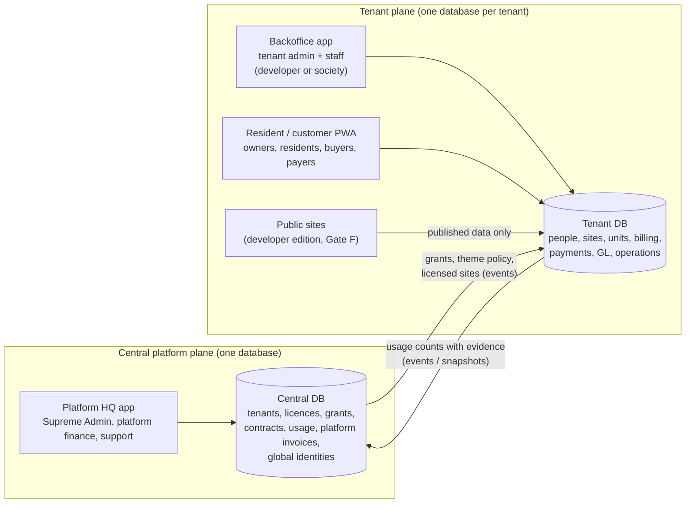

# A1. Product map, demo tenants, access model and module entitlements

**Gate A output items 1 and 3.** This is a logical design for owner approval, not an implementation. Decisions are marked **D-n**; the open ones are listed in `GATE_A_REPORT.md` §9.

## 1. Planes and applications

PropertyOS has three control planes (V3.1 doc 01) and four applications.

| Application | Who uses it | Data it may touch | Prototype today |
|---|---|---|---|
| **Platform HQ** | Supreme Admin, platform billing, platform support | Central DB only. Tenant data only via an audited, time-limited, tenant-consented support grant | Not built; register rows SAAS-001..010 are planned placeholders inside the backoffice app |
| **Backoffice** | Tenant admin and staff | The tenant DB, within effective access (§4) | Built for the developer tenant: shell, dashboard, Sales CRM |
| **Resident/customer PWA** | Owners, residents, buyers, payers | Only the units and billing accounts the person is linked to | Built for a developer buyer (instalments) |
| **Public sites** | Anonymous visitors | Published project and inventory data | Not started (Gate F) |

**D-1 (recommended): build Platform HQ as a third app, `apps/platform-hq`**, rather than a shell inside the backoffice app as ADR-0001 §2.2 allowed.
- **Why:**
  - Platform operators are a different security principal from tenant staff: separate sign-in, mandatory MFA, no tenant DB connection by default.
  - A separate app and bundle makes "Supreme Admin silently browses tenant records" structurally impossible in the prototype, and later in production (its own domain and auth guard).
  - It reuses every shared package (`ui`, `tokens`, `i18n`, `contracts`, `fixtures`).
- **Cost:** a third Vite app on port 5175, plus its Playwright project. The register routes `/saas/saas/*` move to `/hq/*`.

## 2. Editions are presets; grants decide access

V3.1 lists four business editions. **D-2:** an edition is a *named preset of module grants*. Code never checks "is this a society tenant?"; it checks effective module grants. This makes Custom Modular a non-special case and stops edition `if`-statements spreading through screens.

| Edition preset | Tenant type | Modules granted by the preset (keys in §5) | Typical add-ons |
|---|---|---|---|
| **Full Developer ERP** | `developer` | core, crm, projects, inventory, sales, construction, handover, receivables, residents, resident_portal, maintenance, visitors, parking, amenities, communications, reports, accounting, payables, procurement, hr, payroll, banking | online_payments, public_website, white_label, api_access |
| **Community / Building-only** | `association` | core, residents, resident_portal, receivables, dues, maintenance, visitors, parking, amenities, communications, reports, banking | online_payments, accounting, payables, white_label |
| **Portfolio Manager** | `portfolio_manager` | The Community preset plus the `core.multi_entity` feature: several sites, each with its own legal entity, books and bank | As Community |
| **Custom Modular** | `custom` | Any set that passes the dependency check (§6) | Any |

The tenant type sets **vocabulary and defaults**, never access:
- the context switcher says "Projects" or "Sites";
- the people directory says "Customers" or "Owners & residents";
- the dashboard composition differs.

## 3. The two demonstration tenants

Both are fictional and always shown with "(Demo)".

| | **Larkspur Estates (Demo)**: Full Developer | **Al-Noor Residency (Demo)**: maintenance-only society |
|---|---|---|
| Status today | Exists (Stage 1–1.5R fixtures, `tnt_larkspur`) | New in Gate C. The owner's illustrative name from V3.1 doc 03 is kept so the worked pricing example matches (open decision **D-12**) |
| Sites | Larkspur Heights (3 towers, Lahore) and Larkspur Gardens (plots, Islamabad). Each project sits on a managed site (§A2 4.3) | One managed site: Block A and Block B, 5 floors × 8 flats each, **80 flats** (A-101 … B-508) |
| Legal entity / payee | Larkspur Estates (Pvt) Ltd (fictional): instalments and service charges | Al-Noor Residency Owners' Association (fictional): dues settle to its own verified account |
| Modules | Full Developer preset (all modules), so **the current UI is unchanged** | Community preset. **No CRM, projects, inventory, sales, construction or handover** |
| Personas | Existing: developer manager, sales executive, finance officer, resident (Usman Tariq) | New: building manager (prepares billing), committee treasurer (approves billing runs), accounts officer (verifies proofs), security guard (visitors only), owner-resident of A-101, tenant-occupant payer of A-102 |
| Signature journeys | Lead → visit → unit hold (built); quote → booking → instalments → handover (Gate E) | Import flats → people and payers → charges → monthly run → resident transfer proof → verification → receipt → reconciliation (Gate C) |
| Pricing example (HQ) | Hybrid: per-module plus staff seats (illustrative) | V3.1 example: PKR 0 base + PKR 40 × 80 eligible flats + PKR 500 per site + PKR 15,000 one-time onboarding = **PKR 18,700 first month, PKR 3,700 after** (A3 §5) |

**Platform personas (Gate B):**
- Supreme Admin: full platform rights.
- Platform support agent: can view tenant licensing and usage, but cannot open tenant records without a support grant. Used to prove the denial.

## 4. Access decision: the intersection

An action on a record is allowed only when **all six layers** allow it. The mock transport (now) and the backend (later) evaluate the layers in this order, and the first failure decides the reason:

| # | Layer | Question | Source | Failure reason code |
|---|---|---|---|---|
| 1 | Tenant lifecycle | Is the tenant `trial`, `active` or `grace`? (`suspended` means read-only for finance history, no operations) | central `tenants.status` | `tenant_inactive` |
| 2 | Module grant | Is the module granted and inside its effective dates? | `tenant_module_grants` | `module_not_licensed` |
| 3 | Site / feature entitlement | Is this site inside the grant, and the feature granted? | `tenant_site_grants`, `tenant_feature_grants` | `site_not_licensed` / `feature_not_licensed` |
| 4 | Permission | Does one of the user's roles hold the permission? | `user_roles` → `role_permissions` | `permission_missing` |
| 5 | Data scope | Is the record inside the user's scopes (legal entity, site, building, project, team, assigned) or, for residents, a **verified** ownership / occupancy / billing-account link? | `access_scopes`, `party_user_links` | `out_of_scope` |
| 6 | Workflow state | Does the record's state allow the action? (Posted invoices cannot be edited; the maker cannot approve their own run) | the record | `state_locked` / `separation_of_duties` |

**Rules**
- **The same function decides everything:**
  - lists, record reads and mutations;
  - Ctrl+K results, related-record drawers and linked-record previews;
  - quick-create menus, dashboard widgets and notifications.
  - Hiding a menu item is presentation only. The API must refuse.
- **The reason drives a distinct, honest screen.** It is never a raw 403 and never a dead link:

| Reason | What the user sees |
|---|---|
| `module_not_licensed` | No nav item, no search hit. A deep link opens **"Not part of this workspace's plan"**, naming the module, with "Ask your administrator" for staff (tenant admins see "Contact your provider"). Nothing about other tenants is revealed |
| `site_not_licensed` | The site is absent from the context switcher. A deep link opens "This site is not included" |
| `permission_missing` | The action is visible but disabled with "Your role can't …" where knowing it exists helps; otherwise hidden |
| `out_of_scope` | Treated as not found (404 semantics), so the existence of other people's records is not confirmed |
| `state_locked` | The action is disabled with the reason ("Posted invoices are corrected with a credit note") and the correct alternative action |
| Prototype "planned" | A separate, labelled **planned** page. Never confused with the four above |

- **Tenant admin limits.**
  - The role editor lists only permissions belonging to granted modules.
  - When a grant ends, role rows are kept but become inert, because effective access is the intersection, so nothing is deleted.
  - Re-granting restores access without re-configuration.
- **Supreme Admin limits.**
  - HQ reads tenant **metadata**: licensing, grants, counts, invoices, health.
  - It never reads tenant records (people, flats' occupants, payments).
  - A **support grant** is requested with a reason, consented by a tenant admin, time-limited (open decision **D-9**: proposed 4 h default, 24 h max), read-only by default, and every read is audited and visible to the tenant.
  - "Preview as tenant role" runs in a **simulation**: it shows the navigation, menus and empty states that role would see, using the tenant's grants. It shows no tenant records.

## 5. Module catalogue and dependency table

**Scope levels**
- `tenant`: granted for the whole tenant.
- `site`: can be granted to selected sites only. "All sites" means current and future sites.

**Dependency kinds**
- **Requires (hard):** enabling fails until the required module is also granted. The check offers a one-click "also enable X".
- **Integrates (soft):** the module works alone; extra links and postings appear when both are granted.

| Key | Module | Scope | Requires | Integrates with | Dev | Comm | Metered / priced dimensions | Register families |
|---|---|---|---|---|:-:|:-:|---|---|
| `core` | Identity, roles, people, sites and units, documents, approvals, notifications, audit, help/tours, personalization | tenant | — | — | ✓ | ✓ | staff seats; storage | GLOBAL, AUTH, HOME, CUS*, SITE, DOC, APR, ADM, GUIDE |
| `crm` | Leads, opportunities, site visits, follow-ups | tenant | core | sales, communications, public_website | ✓ | — | — | CRM-001..011 |
| `projects` | Development projects on sites, phases, analytics | tenant | core | construction, accounting | ✓ | — | per project (optional) | PRJ |
| `inventory` | Sales inventory, unit matrix, price versions, holds | site | projects | crm, sales | ✓ | — | — | INV, CRM-015/016 |
| `sales` | Quotes, reservations, bookings, buyers, payment plans, amendments, transfers | tenant | inventory, receivables | crm, accounting | ✓ | — | — | CRM-012..018, COM, BKG, OWN-003/004 |
| `construction` | Milestones, updates, customer publication | site | projects | resident_portal | ✓ | — | — | CON, PRJ-008 |
| `handover` | Clearances, inspection, snags, handover | site | sales | construction, residents | ✓ | — | — | HND |
| `receivables` | Billing accounts, invoices, payment submissions and verification, payments, allocations, receipts, credits, refunds, statements, aging, collections | tenant | core | accounting, banking, online_payments | ✓ | ✓ | — | FIN, COL, BILL-001/002 |
| `dues` | Charge categories, rate versions, charge rules and overrides, billing runs, exemptions, utility meters | site | receivables, residents | accounting, communications | opt. | ✓ | per eligible unit (commercial) | BILL-003..015 |
| `residents` | Ownerships, occupancies, households, resident roster | site | core | dues, maintenance, visitors | ✓ | ✓ | occupied / eligible units | RES, OWN-001/002/005 |
| `resident_portal` | Resident/owner PWA access | site | residents | receivables, maintenance, visitors, amenities, construction | ✓ | ✓ | active portal users (optional) | PORTAL |
| `online_payments` | Merchant connections, payment intents, gateway webhooks | site | receivables | resident_portal | add-on | add-on | authorized gateway events (SaaS fee only, see A3 §6) | BILL-011, PORTAL-006 |
| `banking` | Bank accounts, beneficiary profiles, bank feeds/imports, reconciliation | tenant | core | receivables, payables, accounting | ✓ | ✓ | — | BANK, BILL-010 |
| `accounting` | Chart of accounts, periods, journals, statements | tenant | core | receivables, payables, payroll, banking | ✓ | opt. | per legal entity (optional) | ACC |
| `payables` | Suppliers/vendors, bills, supplier payments, utilities register, expenses | tenant | core | accounting, procurement, maintenance | ✓ | opt. | — | SUP, EXP |
| `procurement` | Purchase requests, RFQ, PO, receipts | tenant | payables | projects | ✓ | — | — | PROC |
| `hr` | Employees, attendance, advances | tenant | core | payroll | ✓ | — | employees (optional) | HR |
| `payroll` | Payroll runs, disbursement status, posting | tenant | hr | accounting | ✓ | — | — | PAY |
| `maintenance` | Requests, work orders, technicians, SLA, building assets, preventive schedules | site | core | residents, resident_portal, payables, dues | ✓ | ✓ | — | MNT |
| `visitors` | Visitor passes, gate check-in, history | site | residents | resident_portal | ✓ | ✓ | — | VIS |
| `parking` | Spaces, allocations, vehicles, guest parking | site | core | residents, dues | ✓ | ✓ | — | PARK |
| `amenities` | Amenities, rules, bookings | site | residents | dues | ✓ | ✓ | — | AMN |
| `communications` | Notices, messages, templates, delivery status | tenant | core | everything | ✓ | ✓ | SMS, WhatsApp, push (usage) | NOT, RES-005 |
| `reports` | Report centre. Each report also needs its source module | tenant | core | all | ✓ | ✓ | — | RPT |
| `public_website` | Luxury project sites, enquiry → lead | tenant | projects, inventory | crm | add-on | — | per published project (optional) | WEB |
| `white_label` | Custom domain and branded theme (within accessibility guardrails) | tenant | core | — | add-on | add-on | per domain | HQ-021, ADM-022 |
| `api_access` | API keys for integrations | tenant | core | — | add-on | add-on | API calls (usage) | — |

\* CUS becomes the shared **People** directory (A5 §3).

**Features** (granted under a module) that change behaviour:
- `core.multi_entity`: several legal entities with separate books and payees; Portfolio Manager.
- `receivables.office_collections`: cash and cheque at the office, needing a tenant policy and the staff permission.
- `dues.utility_meters`.
- `dues.late_fees`: off by default; legal review required (**D-11**).
- `communications.sms` and `communications.whatsapp`: metered.
- `onboarding.practice_mode`.

## 6. Grant changes: checks and impact

- **Enable a module**
  - Every hard requirement must be granted for the same sites and an overlapping date range.
  - The check lists what is missing in plain language and offers to add it, showing the price impact before saving.
- **Disable, or let a grant end**
  - Shown first: an **impact report** with the users who lose access, open work (unposted billing runs, open requests, pending verifications) and the scheduled jobs that stop.
  - Data is never deleted; it becomes read-only and reappears if the module is granted again.
  - Finance history stays visible to finance roles for statutory retention.
- **Site grants:** removing a site from `dues` stops future billing runs for it. Posted invoices and their payment paths stay open so residents can still pay what they owe.
- **Effective dating:** grants have `[from, to)` dates. Future-dated changes appear in Tenant 360 as "Scheduled".
- **Audit:** every grant change records who, when, why, the before/after state, the impact snapshot and the linked contract amendment (when it changes the price).

## 7. Navigation and vocabulary from grants

- **Navigation.** Each nav item, Quick create entry, dashboard widget and tour step declares `requires: { modules, permission }`. The shell renders only items whose requirements pass. Larkspur grants every module, so its navigation is unchanged.
- **Wording by tenant type** (label keys in i18n, not code branches):

| Concept | Developer | Society / portfolio |
|---|---|---|
| Context switcher | Project | Site / building |
| People directory | Customers | Owners & residents |
| Portal "Payments" | Instalments | Bills |
| Dashboard | Sales and collections | Collections and services |

- **Prototype-only areas.** Design system lab and Practice sandbox move behind a "Prototype tools" switch, visible to the demo operator but not in a customer demo (see A5 §5, flaw F-6).
