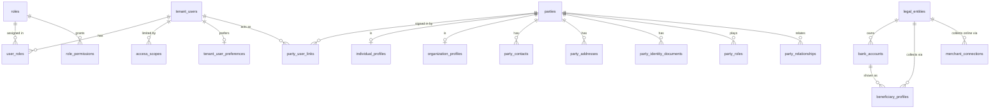
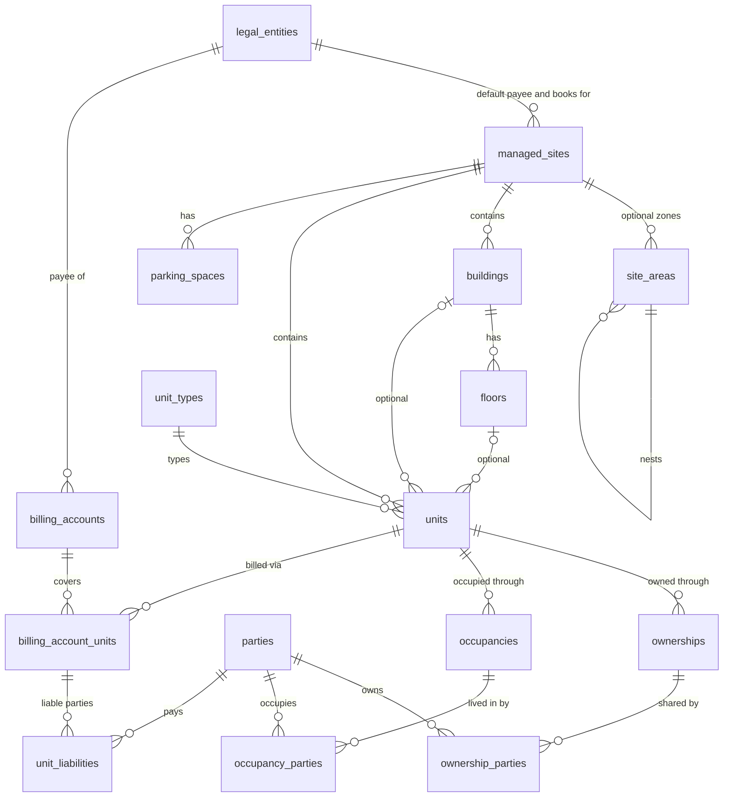
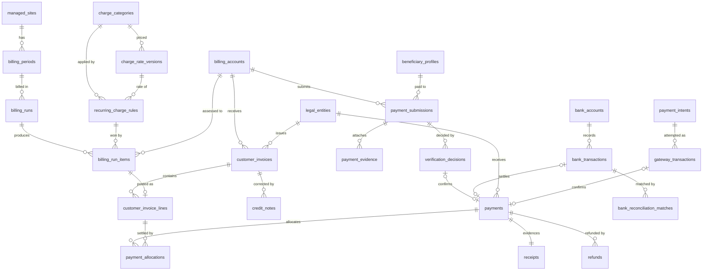

# A2. Normalized logical ERD and platform/tenant boundaries

**Gate A output item 2.**
- This is the **single normalized logical model** that reconciles V2.1 (`01_MASTER_BLUEPRINT_V2.md` §9) with V3.1 (`02_LOGICAL_ERD_AND_BOUNDARIES.md`).
- It is **not a migration schema.** Physical types, indexes and Laravel migrations wait for Gate H.
- Section 9 answers the five "Issues Gate A must resolve"; section 10 lists every V2.1/V3.1 conflict and its resolution.

## 1. Conventions

| Topic | Rule |
|---|---|
| Identifiers | ULID for every business record, generated by the application. Human numbers (`INV-2026-000123`) come from `number_sequences` per legal entity and document type |
| Two planes | **Central DB** (one) and **Tenant DB** (one per tenant). Central tables carry `tenant_id` as a real FK. Tenant tables carry **no** `tenant_id`: the resolved connection is the boundary |
| Cross-plane references | Columns named `*_ref` hold a ULID from the other plane **without an FK** (`global_user_ref`, `licensed_site_ref`). They are kept consistent by outbox events plus a nightly consistency report; dangling references are reported, never auto-deleted |
| Shared ULIDs | A site has **one ULID in both planes**: central `licensed_sites.id` = tenant `managed_sites.id`, so HQ grants and tenant operations name the same site without a cross-DB FK |
| Money | Amounts `DECIMAL(20,2)` with an explicit currency (PKR). Rates and quantities `DECIMAL(20,4)`. Rounded half-up **per line** to 2 dp; totals are sums of rounded lines. The mock uses integer paisa (already in `seed.ts percentOf`) |
| Time | Instants in UTC (`*_at`). Business dates as DATE in the site's timezone (`*_on`, `period_start`). Effective-dated rows use half-open `[effective_from, effective_to)`; no overlaps per key (service rule plus test) |
| Immutability | **Immutable after insert:** posted invoices and lines, credit notes, receipts, verification decisions, posted journals, usage snapshots, active contract versions, audit events. **Versioned:** rate versions, price versions, charge-rule versions, contract versions. **Mutable:** drafts and operational records |
| Deletion | Financial records are never deleted. Masters are archived (`archived_at`). Reversal and credit are the only corrections |

## 2. Central platform DB

```mermaid
erDiagram
  tenants ||--o{ tenant_domains : has
  tenants ||--o| tenant_branding : has
  tenants ||--o| tenant_theme_policies : has
  tenants ||--o{ licensed_sites : licenses
  tenants ||--o{ tenant_module_grants : holds
  module_catalog ||--o{ tenant_module_grants : "granted as"
  module_catalog ||--o{ feature_catalog : contains
  module_catalog ||--o{ module_dependencies : requires
  tenant_module_grants ||--o{ tenant_site_grants : "limited to"
  licensed_sites ||--o{ tenant_site_grants : in
  tenants ||--o{ tenant_feature_grants : holds
  edition_presets ||--o{ edition_preset_modules : lists
  tenants ||--o{ subscription_contracts : signs
  subscription_contracts ||--o{ subscription_components : prices
  subscription_contracts ||--o{ subscription_discounts : discounts
  rate_card_versions ||--o{ rate_card_lines : lists
  rate_card_lines ||--o{ subscription_components : "default for"
  usage_dimensions ||--o{ usage_count_definitions : "defined by"
  tenants ||--o{ usage_snapshots : measured
  usage_count_definitions ||--o{ usage_snapshots : "counted with"
  usage_snapshots ||--o{ usage_snapshot_corrections : "corrected by"
  tenants ||--o{ usage_meter_events : emits
  tenants ||--o{ platform_invoices : billed
  platform_invoices ||--o{ platform_invoice_lines : contains
  subscription_components ||--o{ platform_invoice_lines : "charged by"
  usage_snapshots ||--o{ platform_invoice_lines : "quantity from"
  platform_payments ||--o{ platform_payment_allocations : allocates
  platform_invoices ||--o{ platform_payment_allocations : settles
  platform_payments ||--o| platform_receipts : evidences
  platform_invoices ||--o{ platform_credit_notes : "corrected by"
  global_users ||--o{ tenant_memberships : "member of"
  tenants ||--o{ tenant_memberships : has
  global_users ||--o| global_user_preferences : prefers
  platform_principals ||--o{ platform_role_assignments : has
  platform_principals ||--o{ platform_support_access_grants : receives
  tenants ||--o{ platform_support_access_grants : consents
  platform_principals ||--o{ platform_audit_events : acts
```

| Entity group | Notes |
|---|---|
| `tenants` | `tenant_type` developer \| association \| portfolio_manager \| custom. `status` draft → trial → active ⇄ grace → suspended → cancelled → archived. Timezone and currency. `db_locator_ref` is a **secret reference**, not a URL |
| `licensed_sites` | The **commercial** view of a site: name, kind, licensed unit capacity. It shares its ULID with the tenant's `managed_sites`. Replaces V3.1 `tenant_site_entitlements` as a name; entitlement rows are `tenant_site_grants` |
| `module_catalog`, `feature_catalog`, `module_dependencies` (`kind` requires \| integrates), `feature_dependencies` | Code-owned catalogue, versioned with the release |
| `edition_presets` | Templates only (A1 §2). Nothing reads a preset to decide access |
| `tenant_module_grants` | Fields: `scope` (tenant \| sites), `status`, `[effective_from, effective_to)`, `source` (preset \| addon \| trial \| override), optional `subscription_component_id`. `entitlement_change_requests` hold the impact snapshot and approval |
| `rate_card_versions` / `rate_card_lines` | The operator's price list. V3.1 `plan_versions`, `rate_card_lines` and `pricing_rule_versions` are merged: a "plan" is a rate-card version plus an edition preset |
| `subscription_contracts` | Status draft → pending_approval → active → superseded \| ended \| cancelled. An **amendment creates a new version** (`supersedes_id`); an active version is immutable |
| `subscription_components` | One row per priced component (A3 §2): type, dimension, scope, pricing method, price/tiers, allowance, minimum, cap, cadence, proration rule, tax code, effective dates, override reason |
| `commercial_policies` (versioned), `contract_approvals` | Thresholds that make a contract or override need approval (A3 §7, D-14). Each approval records: contract version, reasons triggered, requested by, decided by (≠ requester), decision, comment, time |
| `platform_onboarding_policies`, `workspace_requests`, `tenant_invitations` | Signup mode (D-8, A1 §8): self-service trial \| approval required \| invitation only \| sales assisted. Optional per edition. Requests record kind, applicant, edition sought and status (new → contacted → approved \| declined → converted). Invitations are single-use codes with edition, expiry and issuer |
| `usage_dimensions`, `usage_count_definitions` (versioned rule), `usage_snapshots` (immutable), `usage_snapshot_corrections`, `usage_meter_events` (`source_event_id` unique) | A3 §4 |
| `billing_previews` | Optional non-authoritative cache; safe to drop |
| `platform_invoices` and related | SaaS money only. Never touches tenant ledgers (A4 §6) |
| `global_users` | **Tenant-side** sign-in identities (one person can be a member of several tenants). `tenant_memberships`: kind staff \| resident, status |
| `platform_principals` | **Operator staff**, a separate principal type with mandatory MFA. They are never tenant members; a support grant is the only bridge |
| `global_user_preferences` | Language, font scale, theme, contrast, motion, reading mode, sounds, haptics, Urdu font. These follow the person across tenants and devices (§9.1) |
| `platform_support_access_grants`, `platform_audit_events` | Support access: reason, consenting tenant admin (`global_user_ref`), scope (read-only by default), start, expiry, revocation |

## 3. Tenant DB: identity, people, legal entities

- **`tenant_users`**: `global_user_ref`, kind staff \| resident, status. Permissions are a code-owned catalogue synced into `permissions`.
- **`access_scopes`**: `scope_type` all \| legal_entity \| site \| building \| project \| team \| assigned. They replace the prototype's `Persona.projectScope`.
- **`party_user_links`**: replaces V3.1 `resident_portal_user_links`. Resident access needs `verified_at` and a verification method, because a resident sees data only for units reached through a **verified** link.
- **`party_roles`**: a registry for search and filters (lead, customer, buyer, owner, occupant, resident, payer, supplier, employee, broker, technician). The facts live in their own tables (ownerships, occupancies, billing-account parties, bookings), so **identity is never duplicated per module**.
- **`legal_entities`**: kind developer_company \| association \| management_company. **Books, payee identity and number sequences are per legal entity** (§9.4).
  - Every financial record carries `legal_entity_id` and can never be linked to another entity's records (§5.1, I-19). This holds even when two associations share one tenant DB.
- **`beneficiary_profiles`**: the *verified* payee details shown to payers.
  - Status: draft → pending_verification → verified → retired.
  - A change requires a **second approver** (open decision D-13).
  - The IBAN is stored encrypted; lists show the last four digits.
- **`merchant_connections`**: provider, sandbox \| live, credentials as a vault reference, enabled methods. Scoped to a legal entity and optionally a site.

## 4. Tenant DB: sites, units, ownership, occupancy, billing accounts

**4.1 The physical hierarchy is rooted at the site, not the project (D-3).**
- `managed_sites` → optional `site_areas` (phase, block, sector, cluster; may nest) → optional `buildings` (tower, block building, villa cluster) → optional `floors` → `units`.
- Plots and villas skip buildings and floors; a society skips areas.
- `units.code` is unique per site.

**4.2 `units` holds physical and operational facts only:**
- type, area, active status (active \| merged \| demolished \| archived), `handed_over_on`.
- The 12-value V2.1 unit status is **split into three independent dimensions** (D-4), because a society flat has no sales lifecycle:

| Dimension | Values | Owner module | Stored on |
|---|---|---|---|
| Inventory (sales) | draft, available, held, reserved, booked, allocated, blocked, withdrawn, disputed | inventory / sales | `unit_inventory` (developer only) |
| Delivery | planned, under_construction, handover_ready, handed_over | construction / handover | `handovers` + `units.handed_over_on` |
| Occupancy | vacant, owner_occupied, tenant_occupied | residents | derived from current `occupancies` |

**4.3 A developer project attaches to a site.**
- `projects.site_id` is required; a site may have zero projects.
- **Nothing in core, residents, receivables or dues has a foreign key to projects, opportunities or bookings** (§9.2).

**4.4 Booking ≠ ownership ≠ occupancy ≠ responsible payer.** Four separate, effective-dated facts:

| Fact | Tables | Example: Flat A-102, Al-Noor |
|---|---|---|
| Sale | `bookings` (developer only) | none (built years ago) |
| Ownership | `ownerships` + `ownership_parties` (shares sum to 100) | Owner: Mr X, 100 % |
| Occupancy | `occupancies` + `occupancy_parties` (head, member) | Tenant family Y since Mar 2026 |
| Liability | `billing_accounts` + `billing_account_units` + **`unit_liabilities`** (per unit; shares sum to 100 per unit and period) | Payer: Y from Mar 2026 by lease arrangement; X before that |

**4.5 Liability is per unit, not per account (part of D-5; corrected after the Gate A review).**

V3.1 lists `billing_account_units (liable parties with effective dates and percentages)`, which merges two facts. They are separated, and liability is attached to **each covered unit**:
- **`billing_account_units`:** which units the account covers, effective-dated.
- **`unit_liabilities`:**
  - who is liable *for that unit*, effective-dated;
  - columns: `billing_account_unit_id`, `party_id`, `role` (primary_payer \| co_payer \| guarantor), `liability_type` (proportional \| joint), `share_pct` (proportional only).

**There are no account-wide percentages.**
- A Gate A draft had `billing_account_parties` with one share across all covered units. That was ambiguous: it could split flat B's charge between flat A's payers. It is withdrawn.
- One account can still group several flats, with a **different responsible payer per flat**.

**How charges and payments follow the unit**
1. Every invoice line carries `unit_id`.
2. The line's liable parties are that unit's `unit_liabilities` on the line's period start date.
3. Payments allocate to **invoice lines** (§5), and the default allocation only touches lines the paying party is liable for. Overriding that needs a reason, which is audited.
4. Per-party statements are computed from line-level liability:
   - proportional liability: line amount × share;
   - joint liability: the full line amount, for each joint party.

A change of payer is a new `unit_liabilities` period **without rewriting history**.

**4.6 `billing_accounts.kind`**
- `dues`: society charges.
- `sales_contract`: a developer booking, linked to `booking_id`.
- `service`: ad-hoc services.

One person can therefore see their instalments and their dues as **separate accounts** in one portal.

## 5. Tenant DB: shared receivables, dues and payments

**The shared invoice engine (§9.3).**
- **`customer_invoices`** carry `source_type`:
  - `installment_schedule`: developer instalments;
  - `billing_run`: society dues;
  - `opening_balance`: imported arrears;
  - `manual`, `service` and `penalty`.
- **Lines** carry `source_type`/`source_id` and `posting_version`.
- **Shared by every charge source:** issuance, numbering, credit notes, allocation, receipts, statements, aging and GL posting. Only the *origin* differs, and it is always visible.
- **Other entities**

| Entity | Rule |
|---|---|
| `recurring_charge_rules` | `scope_level` site \| building \| unit_type \| unit. V3.1 `unit_charge_overrides` becomes `scope_level = unit`. Most specific wins; the run item stores the winning scope (A4 §2) |
| `billing_runs` | DRAFT → PREVIEWED → APPROVAL_PENDING → APPROVED → POSTED → NOTIFIED (CANCELLED only before POSTED). `posting_version` and `rules_snapshot_hash` |
| `billing_run_items` | Rule version, winning scope, quantity, rate, amount, exemption, meter reading, **`idempotency_key` unique** (§8) |
| `payment_submissions` | Payer evidence. States SUBMITTED → UNDER_REVIEW → NEEDS_INFORMATION \| REJECTED \| VERIFIED; a resubmission links `supersedes_id`. **A submission is never a payment** |
| `payments` (V3.1 `confirmed_payments`) | Exist **only once confirmed**: after verification, a verified gateway event, or an authorized office receipt. They carry `legal_entity_id` (§5.1) |
| `payment_allocations` | `payment_id`, **`invoice_line_id`**, `legal_entity_id`, amount. Allocation is at line level so unit-specific liability is respected (§4.5) |
| Unapplied credit | Derived: `payment.amount − Σ allocations` |
| Account statement | A **derived view** (opening balance, invoices, credits, payments, closing). It is stored only as a document when sent |
| `collections_cases`, `reminder_events`, `promise_to_pay` | Recovery work |

### 5.1 Financial entity isolation (D-5, required correction)

**These records carry a non-null `legal_entity_id`:**
- `customer_invoices` (+ lines), `credit_notes`, `payment_submissions`, `payments`, `payment_allocations`, `receipts`, `refunds`;
- `bank_accounts` (and through them `bank_transactions` and `bank_reconciliation_matches`);
- `beneficiary_profiles`, `merchant_connections`, `payment_intents`, `gateway_transactions`;
- `journal_entries`, `fiscal_periods`, `gl_accounts`, `number_sequences`.

**Cross-entity links are impossible by construction:**
- `payment_allocations` has composite foreign keys `(payment_id, legal_entity_id)` → `payments(id, legal_entity_id)` and `(invoice_line_id, legal_entity_id)` → `customer_invoice_lines(id, legal_entity_id)`. Each parent has a UNIQUE `(id, legal_entity_id)`. An allocation between two associations cannot be stored, even inside one tenant DB.
- A reconciliation match requires `bank_transaction.bank_account.legal_entity_id = payment.legal_entity_id`. The same composite-key technique applies.
- A submission is confirmed only against a bank transaction of the **same entity as the beneficiary that was shown** to the payer.
- Journals post only to `gl_accounts` of their own entity. Posting rules are per entity.

**Money between entities is never an allocation.**
- Examples: a portfolio manager's fee, or one association paying another for shared security.
- It is an invoice issued by one entity to the other, paid like any other invoice, and recorded in each entity's own books.
- The mock refuses any cross-entity allocation or match with `cross_entity_forbidden`.

### 5.2 Bank transaction identity and deduplication (required correction)

**A bank transaction is identified within its account, never by a reference string across all accounts.**

| Source | Identity (UNIQUE) |
|---|---|
| Bank API or provider feed | `(bank_account_id, source, provider_transaction_id)` |
| Statement file import (no provider id) | `(bank_account_id, fingerprint)`, where fingerprint = hash(booked_on, value date, amount, direction, normalized narrative, bank's line sequence or running balance). Re-importing the same file is idempotent; genuinely identical lines in one file keep distinct sequence numbers |
| Gateway settlement | `(merchant_connection_id, provider, provider_transaction_id)` in `gateway_transactions` |

**What references are for**
- The payer's reference, and the structured reference printed on bills, are **matching hints only**.
- The duplicate rule is: **one bank transaction can confirm at most one payment.** An explicit, audited split covers one transfer for several accounts.
- A second submission pointing at an already-matched transaction is refused (`bank_transaction_already_matched`).
- Two different transfers that happen to share a reference string are both valid.

**Maker-checker and verified-beneficiary safeguards are unchanged** (A4 §6, I-17):
- a submission can only be verified against a transaction in the account behind the **verified** beneficiary shown to the payer.

## 6. Tenant DB: developer extension (Gate E scope, unchanged from V2.1)

| Group | Entities |
|---|---|
| Projects | `projects` (site_id, legal_entity_id) |
| Sales inventory | `unit_inventory` (unit_id PK, project_id, inventory_status), `unit_price_versions` |
| CRM | `leads`, `opportunities`, `site_visits`, `follow_ups` / activities |
| Selling | `quotations` + `quotation_versions` (snapshot), `unit_holds`, `reservations`, `bookings`, `booking_buyers` (shares), `booking_amendments` |
| Payment plans | `payment_plan_templates`, `payment_plans`, `installment_schedule_items` → `customer_invoices` |
| Delivery | `agreements`, `construction_milestones`, `construction_updates`, `handovers` (+ clearances, inspections, snags) |
| Transfers | `ownership_transfers` (creates a new `ownerships` row; the old one ends, nothing is rewritten) |

V2.1 relationship commitments stand unchanged:
- no single mutable `customer_id` on a unit;
- quote snapshots;
- `PaymentAllocation` is many-to-many;
- booking ≠ revenue recognition.

## 7. Tenant DB: operations and accounting

| Group | Entities |
|---|---|
| Maintenance | `maintenance_categories`, `maintenance_requests` (unit, raised by party, state), `work_orders`, `technicians`, `sla_policies`, `building_assets` (lifts, generators, pumps), `preventive_maintenance_schedules`, `inspections` |
| Security and community | `visitor_passes`, `visitor_events`, `vehicles`, `parking_allocations`, `amenities`, `amenity_bookings`, `announcements` (site-scoped) |
| Communication | `communication_messages` (provider status), `notifications`, `notification_preferences`, `user_onboarding_progress` |
| Accounting | **Everything per `legal_entity_id`:** `gl_accounts`, `fiscal_periods` (lock state), `journal_entries` (draft → approved → posted → reversed; `source_type/source_id`; `reversal_of`), `journal_lines` (debit, credit, cost centre, site, project), `posting_rules`, `accounting_events` (from invoices, payments, bills, payroll) |
| AP, procurement, HR, payroll | As V2.1, per legal entity |

## 8. Invariants and how each is enforced

| # | Invariant | Enforced by (production) | Proven in the prototype by |
|---|---|---|---|
| I-1 | Every operational query runs on the resolved tenant connection; central and tenant IDs are references, not cross-DB FKs | Tenancy middleware; no tenant tables in the central schema | Mock transport resolves the tenant before handlers; a cross-tenant read test |
| I-2 | A site, building or flat can exist with no project, opportunity or booking | No FK from core or dues to developer tables | The Al-Noor fixture has zero projects; the dues mock runs without `projects` |
| I-3 | Party is one identity with many roles | `party_roles` registry; facts in their own tables | A people-directory filter test: the same party appears as owner and payer |
| I-4 | Booking ≠ ownership ≠ occupancy ≠ payer | Four effective-dated tables | A-102 fixture: owner X, occupant and payer Y |
| I-5 | Liability changes do not rewrite past invoices; liability is resolved **per unit and line**, never by account-wide shares | New `unit_liabilities` period; invoice lines keep `unit_id` and period | Payer-change test: October still shows the old payer. Multi-flat account test: flat A's payer is never allocated flat B's charge |
| I-6 | Rate versions are effective-dated; run items snapshot rule version, rate, eligibility, meter reading, exemption | Versioned tables; snapshot columns | Rate-change test: November uses the new rate, October unchanged |
| I-7 | **No duplicate billing on retry** | `billing_run_items.idempotency_key` unique = (site, billing account, unit, period, charge rule, posting version); invoice-line unique (source_type, source_id, posting_version) | Post twice → second call returns the same invoices; counts unchanged |
| I-8 | Posted invoices and journals are never edited; correct by credit note or reversal | No update path; DB trigger optional | The edit action is absent on posted records; the credit-note test |
| I-9 | Σ allocations of a payment ≤ payment amount; Σ allocations to an invoice line ≤ line amount; unapplied credit allowed | Service transaction with row locks | Partial and over-payment tests |
| I-10 | **Submitted ≠ paid.** A payment exists only after authorized verification against bank evidence, or a verified gateway event | `payments` only created by a verification decision, a verified webhook or an office receipt | Existing 1.5R test (never Paid) extended to dues |
| I-11 | Gateway webhooks: signature verified; unique provider event id; no PAN/CVV stored | Webhook service; unique index | Mock webhook replay test (Gate D) |
| I-12 | Debits = credits; posted journals are immutable; period locks apply | Posting service; period check | Gate E |
| I-13 | One active hold per unit; holds expire | MySQL 8 has no partial unique index: a generated column `active_unit_id = IF(status='active', unit_id, NULL)` with a UNIQUE index, plus a scheduled expiry job | Existing 1.5R hold (session); expiry in Gate E |
| I-14 | Platform invoice lines use **immutable usage snapshots**, not live counts | Line FK to `usage_snapshots`; corrections are adjustment lines | Gate B preview shows the snapshot id and definition version |
| I-15 | SaaS money and tenant money never share a ledger or a default account | Separate DBs, separate legal entities, separate merchant credentials | Destination map test (A4 §6): resident payment instructions never show the platform's bank |
| I-16 | Support access is authorized, time-limited and audited | Grant table + middleware + audit | Gate B: the support persona is denied tenant records without a grant |
| I-17 | Maker ≠ checker for billing-run approval and beneficiary changes | Service check `approved_by ≠ created_by` | Gate C role test |
| I-18 | Ownership shares = 100 %; proportional `unit_liabilities` shares = 100 % per unit and period | Service validation | Import validation test |
| I-19 | **Financial entity isolation:** no allocation, reconciliation match, verification or journal line links records of two legal entities | Composite `(id, legal_entity_id)` foreign keys (§5.1); posting service checks | Gate C: two-association fixture; a cross-entity allocation returns `cross_entity_forbidden` |
| I-20 | **Bank transaction identity** is scoped to its account (provider id or import fingerprint); one transaction confirms at most one payment | UNIQUE keys (§5.2); verification service | Gate C: same reference on two accounts accepted; re-import idempotent; reuse refused |
| I-21 | **Suspended tenant:** only explicitly permitted reads (financial history) and explicitly allow-listed settlement actions; all other mutations refused | Access decision layer 1 (A1 §4) | Gate B: access vectors |
| I-22 | **Commercial approval:** a contract or override above a configured threshold cannot activate without an approver who is not its author | Contract service; `commercial_policies` thresholds (A3 §7) | Gate B: pending-approval state shown and enforced in the mock |

## 9. Answers to "Issues Gate A must resolve" (V3.1 doc 02)

**9.1 Central vs tenant identity identifiers (D-17)**
- **Three principal types:**
  - `platform_principals`: operators, central only.
  - `global_users`: one sign-in identity per person, central.
  - `tenant_users`: a tenant-local profile with `global_user_ref`; roles and scopes are tenant-local.
- **Resident identity:** a `party_user_links` row joins a tenant user to the `parties` person record, with verification.
- **Preferences:** accessibility and language live in central `global_user_preferences`, so they work before choosing a tenant and across tenants. Tenant-specific appearance (palette within the tenant policy, density, dashboard layout) lives in tenant `tenant_user_preferences`.
- **Sign-in flow:** after sign-in, the user chooses a tenant if they have several memberships (AUTH-005). The tenant connection is resolved, and the tenant user is looked up by `global_user_ref`.

**9.2 A maintenance-only site does not depend on project-sales foreign keys**
- The hierarchy is rooted at `managed_sites` (§4.1).
- The developer `projects` table attaches *to* a site.
- Sales state moved to `unit_inventory` (§4.2).
- Dues, receivables and residents reference sites, units and billing accounts only.

**9.3 One invoice engine for ERP and community dues, without confusing charge sources (D-5)**
- One `customer_invoices` table with `source_type` and line-level `source_type/source_id`.
- `billing_accounts.kind` separates a developer sales account from a society dues account.
- The portal and statements group by billing account, so instalments and dues never mix in one balance.
- Charge categories map to separate income accounts.

**9.4 Site settlement, legal entities, taxes, support access (D-6, D-9, D-10)**
- **Payee.** Every invoice names its issuing `legal_entity_id`, and the payer instructions come from that entity's **verified** `beneficiary_profiles` for that site.
- **Portfolio managers.**
  - Each association is its own legal entity with its own books (`gl_accounts` and `fiscal_periods` per entity), bank accounts and beneficiary.
  - The manager's own fee is invoiced by the manager's legal entity.
  - **No commingling inside a tenant either.**
- **Taxes.** Tax codes are per legal entity and jurisdiction, effective-dated. Pakistan's sales tax on services is provincial, so the code depends on where the site is; actual rates are configured, never hard-coded, and must be confirmed by the owner's tax adviser (D-10).
- **Support access:** see A1 §4 and I-16.

**9.5 Versioning, meter correction, proration, posted-entry reversal**
- **Versions.** Every priced object is versioned (contract, rate card, charge rule, unit price). Posted documents keep the version they used.
- **Usage meters.** A correction creates a `usage_snapshot_corrections` row and an **adjustment line** on the next platform invoice, or a credit note. Issued invoices are not edited.
- **Proration** is declared per component (A3 §3).
- **Posted entries** are corrected by credit notes (invoices), reversals (journals) or refunds (payments), each with approval and audit.

## 10. V2.1 ↔ V3.1 conflicts and resolutions

| # | V2.1 said | V3.1 says | Resolution |
|---|---|---|---|
| R-1 | `Tenant → Project → … → Unit` (project-rooted) | `ManagedSite → Building → Floor → Unit` | Site-rooted; project attaches to a site (§4.3) |
| R-2 | One unit state machine (12 states) | Society flats have no sales cycle | Three dimensions: inventory / delivery / occupancy (§4.2) |
| R-3 | SaaS "plans & feature limits" | Component pricing, any combination | Contracts with components; a "plan" = rate-card version + edition preset (A3) |
| R-4 | Fixed sidebar of 11 modules | Module-aware navigation | Navigation derived from grants (A1 §7) |
| R-5 | "Recurring community charges" inside Residents; FIN-012 "Maintenance billing" as one screen | Dues as a first-class edition | `dues` module + BILL family (A4, A5) |
| R-6 | Safepay adapter and payment settings tenant-wide (ADM-015..018) | Site-specific settlement and beneficiaries | Merchant connections and beneficiaries per legal entity and site |
| R-7 | Dark mode not required | Light / Dark / System / High contrast + palettes | Expose the authored night palette after validation; add palettes (Gate D) |
| R-8 | Accessibility preferences per device (current code: `localStorage pref:a11y`) | Persist across devices per user | `global_user_preferences`; prototype labelled "saved on this device" until Gate H |
| R-9 | Party roles: lead, buyer, co-owner, resident, supplier, employee, broker | Adds payer, occupant, household member | `party_roles` + occupancy and billing-account party tables |
| R-10 | Header "tenant switcher" | Portfolio manager: many sites in one tenant | Header shows the **site/project context**; the tenant switcher appears only for people with several memberships |
| R-11 | — | `billing_account_units` with parties and percentages | Split units and parties (§4.5) |
| R-12 | — | `user_interface_preferences` in the tenant DB | Split global (accessibility, language) and tenant (appearance) (§9.1) |
| R-13 | — | Both `platform_users` and `global_users` | `platform_principals` (operators) vs `global_users` (tenant-side people) |
| R-14 | — | `tenant_site_entitlements` central, sites in the tenant DB | One shared site ULID; central `licensed_sites` + `tenant_site_grants` |
| R-15 | — | Accounting listed under "operations" | Moved to finance, per legal entity |
| R-16 | — | "meter" used for both SaaS usage and utilities | Names kept apart: `usage_*` (central SaaS) vs `utility_meter_*` (tenant utilities) |
| R-17 | Money DECIMAL(20,2) | Per-sqft and per-unit rates | Amounts (20,2), rates and quantities (20,4), rounding per line |
| R-18 | Stages 0–7 (Stage 2 = all routes) | Gates A–H | Gates replace the stage order from here; "Stage 2" is withdrawn (report §8) |
| R-19 | Stage 1.5R "Set up my developer workspace" (self-serve) | Tenants are created and licensed by Supreme Admin | The platform's **onboarding policy** decides what Get started offers: self-service trial, approval-required request, invitation code or sales-assisted contact (D-8, as corrected) |

## 11. What changes in the current prototype contracts (nothing is removed)

| Today (`packages/contracts`) | Becomes | Effect on built screens |
|---|---|---|
| `Tenant { id, name }` | Adds `type`, `status`, `grants` (from central) | None for Larkspur (all modules granted) |
| `Project` | Adds `siteId` | None |
| `Unit.status` (12 combined values) | `UnitCore` + `UnitInventory.status`; the old field stays as a derived alias for developer screens | None |
| `Invoice.evidence` | Evidence moves to `PaymentSubmission`; the invoice shows a derived "awaiting verification" | The portal already derives `awaiting_verification`; label unchanged |
| `Persona { permissions, projectScope }` | `TenantUser` + roles + `AccessScope[]` + effective grants | Existing personas keep their ids and behaviour |
| `Preferences { motion, contrast, sound, textOnlyGuide }` (device) | + `fontScale`, `theme`, `palette`, `density`, `readingMode`, `haptics`, `urduFont` | Gate D |
