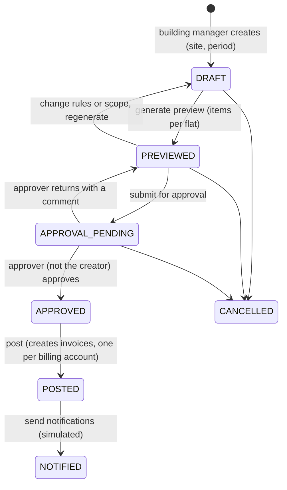
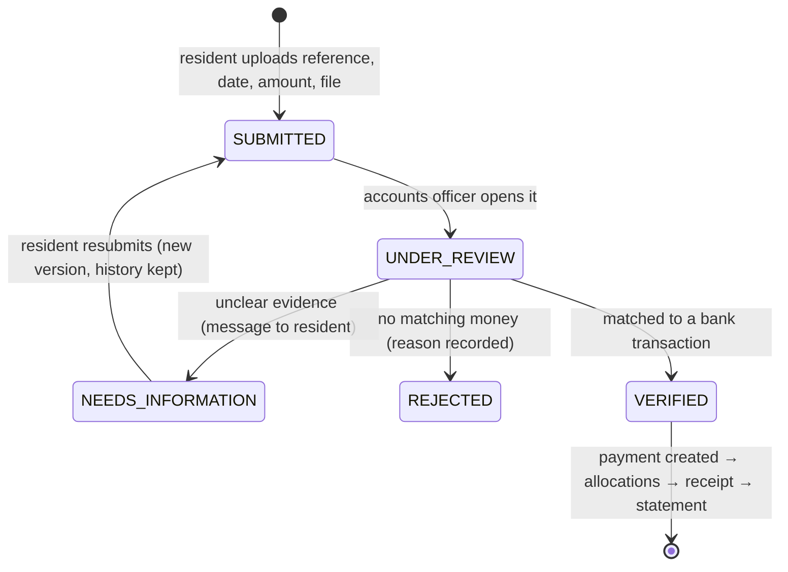
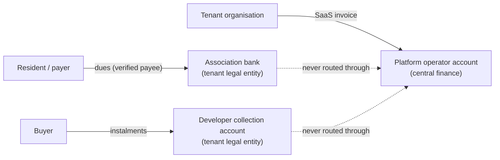

# A4. Community dues, collections and the bank/merchant destination map

**Gate A output item 5.**
- Covers **tenant money**: what a society, association or developer bills its owners and residents.
- SaaS fees are in A3. Entities are defined in A2 §4–5.

## 1. Building setup (maintenance-only tenant)

| # | Step | Produces | Validation and rules |
|---|---|---|---|
| 1 | Tenant + licensed site (by Supreme Admin, Gate B) | `tenants`, `licensed_sites`, grants | — |
| 2 | Site, blocks/buildings, floors | `managed_sites`, `buildings`, `floors` | Names unique within the parent; floor levels unique per building |
| 3 | Flats: manual or **CSV import** (upload → column mapping → validation → deduplication → preview → commit) | `units`, `unit_types` | `code` unique per site; required type and area; area > 0; floor exists; duplicate rows in the file and against existing flats are listed, not silently merged; commit is all-or-nothing and re-running the same file is idempotent (file hash + row keys) |
| 4 | People roster: owners, occupants, payers | `parties`, `ownerships`, `occupancies`, `billing_accounts` (+ units), `unit_liabilities` (payer per unit) | Owner shares = 100 %; proportional payer shares = 100 % **per unit**; effective dates; the same CNIC/phone flags a possible duplicate person for review |
| 5 | Opening balances (arrears and advances at go-live) | `customer_invoices` with `source_type = opening_balance`, or unapplied credit | Import total shown and **approved** before posting; audit of who imported what |
| 6 | Collection destination | `beneficiary_profiles` (verified), optional `merchant_connections` | Maker-checker; residents never see an unverified destination |
| 7 | Charges and rates | `charge_categories`, `charge_rate_versions`, `recurring_charge_rules` | Effective dates; no overlapping versions |
| 8 | First billing run | §3 | §3 |
| 9 | Portal invitations | `party_user_links` (pending → verified) | A resident sees nothing until the link is verified |

**UX.** The **Site onboarding checklist** (SITE-008) shows these nine steps with done, next and blocked states, and links each step to its screen. It replaces one giant wizard.

## 2. Charges and which rule wins

**Charge categories (configurable)**
- recurring: maintenance, security, lift, water, generator, parking, common electricity, sinking/reserve fund;
- metered: utilities;
- one-off: one-time assessments, repairs;
- late fees: only where lawful and contracted (D-11).

**Bases**
- fixed;
- per sq ft (by area);
- by unit type;
- by occupancy status;
- metered (reading × rate);
- percentage of another charge (e.g., sinking fund 5 % of maintenance).

**Priority (most specific wins):** site default → building/block → unit type → **unit override**. Exemptions, waivers and subsidies then apply, each with an approval.

**"Which rule won" is always visible.** For each flat and category, the preview shows the winning rule, its scope and version, and the rules it overrode.

**Al-Noor fixture rules (Gate C)**

| Category | Rule | Result |
|---|---|---|
| Maintenance | Site default PKR 3,000 / month; unit type *Penthouse* (the 8 top-floor flats of each block, A-501…A-508 and B-501…B-508) PKR 4,500 | A-101 pays 3,000; A-501 pays 4,500 |
| Security | Site default PKR 500 | All flats |
| Lift | Site default PKR 300 | All flats |
| Water | Site default PKR 400 (fixed; metering is a later feature) | All flats |
| Exemption | A-108 is the association office: 100 % exemption on all categories, approved by the treasurer | A-108 assessed 0 and shown as "Exempt", not missing |

## 3. Billing run: states, guards and idempotency

| Rule | Detail |
|---|---|
| One open run per site and period | A second DRAFT for the same site and period is refused with a link to the existing run |
| Preview is a snapshot | The items record rule version, rate, winning scope, exemption and eligibility. Changing a rule after preview marks the preview **stale** and forces regeneration |
| Maker ≠ checker | `approved_by ≠ created_by` (I-17). The treasurer approves; the building manager prepares |
| Posting is idempotent | Each item has `idempotency_key` = hash(site, billing account, unit, period, charge rule, posting version). Posting twice (double click, retry, network repeat) returns the same invoices (I-7) |
| After posting | The run is read-only. Missed flats or charges go in a **supplementary run** (posting version + 1, only the new items). Wrong amounts are corrected with **credit notes**, never by editing |
| Invoice grouping | One invoice per billing account per run. Lines per category per flat, so a multi-flat account still shows each flat |
| Notifications | Simulated in the prototype ("Would send 79 notices"; the exempt office gets no invoice). Nothing is sent |

## 4. Statement: charges are separate from the carried-forward balance

The period invoice contains **only the period's charges**. The previous balance is never an invoice line (that would double-count it); it appears on the **statement**.

**Flat A-101, November 2026** (V3.1 doc 04 example)

| Statement line | Amount (PKR) |
|---|---:|
| Opening balance (October arrears, imported) | 1,000 |
| Maintenance (invoice for Nov) | 3,000 |
| Security | 500 |
| Lift | 300 |
| Water | 400 |
| **November charges** (the invoice total) | **4,200** |
| **Total payable** | **5,200** |

**Payment outcomes** (allocation default: oldest due first, §5.4)

| Case | Allocation | Result |
|---|---|---|
| Pays 5,200 | October 1,000 + November 4,200 | Balance 0; both invoices paid; one receipt |
| Pays 3,000 | October 1,000 + November 2,000 | November **partially paid**, 2,200 outstanding |
| Pays 6,000 | October 1,000 + November 4,200 | **PKR 800 unapplied credit**, shown as an advance and applied to December when posted, if the policy allows auto-apply |

## 5. Resident payment choices

### 5.1 Bank transfer with proof (Gate C)

1. **The resident sees:**
   - the **verified** payee: legal name, bank, account title and IBAN with copy buttons;
   - a QR code, if configured;
   - a structured reference (e.g., `ALN-A101-2611`);
   - the amount, with the invoice breakdown.
2. **The resident submits** the transaction reference, date, amount and screenshot.
   - The status shows **"Pending verification"**, never "Paid", until verified.
   - Pay-online and upload-proof flows already follow this rule since Stage 1.5R.
3. **The accounts officer verifies** against the bank feed (BANK-003):
   - amount and date window;
   - reference;
   - destination account = the account behind the **verified** beneficiary shown, and the **same legal entity** as the invoice;
   - **duplicate check:** a bank transaction is identified within its account (provider id, or import fingerprint), and **one transaction confirms at most one payment** (A2 §5.2). Reference strings are matching hints only, so two genuine transfers that share a reference are both accepted.
4. **Verification creates** the `payment`, then `payment_allocations`, then the `receipt`, and updates the statement and collections figures.
5. **A rejection or request for information** keeps the full history. The resident gets a resubmission path.

### 5.2 Online (mock in Gate D; real only at Gate H)
- Checkout shows the verified payee, invoice, amount, method and reference.
- **Only a verified webhook** (signature + provider idempotency) creates the payment. A redirect to a "success" page does not.
- No card number or CVV is ever stored.
- The prototype is labelled DEMO and never contacts a provider.

### 5.3 Office: cash or cheque (Gate C, feature `receivables.office_collections`)
- Allowed only when the site's method rules allow it **and** the staff member holds the permission.
- It produces a payment and receipt immediately.
- Cheques start as `pending_clearance` and are only allocated when cleared (configurable).
- Each one is reconciled to a bank deposit later.

### 5.4 Allocation policy
- **Allocation is to invoice lines.** Each line belongs to one flat, and that flat's liable parties are known (A2 §4.5).
- **Default:** oldest due first, across the open lines **the paying party is liable for**, within the same legal entity.
  - A multi-flat account with different payers per flat never lets one payer's money settle another payer's flat by default.
  - A staff override needs a reason and is audited.
- **Never across entities:** a payment received by one association cannot be allocated to another association's invoice (`cross_entity_forbidden`, A2 §5.1).
- The verifier can change the split before confirming; the change is recorded.
- Partial allocation is normal. **Unallocated money stays as account credit**, never lost or forced onto an invoice.
- Refunds of credit need approval (Gate E).

## 6. Bank and merchant destination map (who is paid, where, in which books)

| Money | Payer | Payee (legal entity) | Paid into | Ledger | Configured by | Verified by |
|---|---|---|---|---|---|---|
| **SaaS subscription, onboarding, usage** | Tenant | Platform operator company | Platform's own collection account / merchant | **Central platform finance** (A3) | Supreme Admin | Platform finance |
| **Developer instalments, down payments, fees** | Buyer(s) on the booking | Developer company (e.g., Larkspur Estates (Pvt) Ltd) | Developer's verified collection account for that project/site | Tenant GL of that developer entity | Tenant admin, maker-checker | Tenant finance |
| **Society dues** (maintenance, security, lift, water…) | Billing-account payer(s) | Owners' association (e.g., Al-Noor Residency Owners' Association) | **The association's** verified account / merchant | Tenant GL of the **association** entity | Tenant admin, maker-checker | Accounts officer |
| **Portfolio manager's own fee** | Association | Management company | Management company's account | Management company's own books (separate entity in the same tenant) | Tenant admin | Management company finance |
| **Dues collected by a manager on an association's behalf** | Payer | Association | Association's account. The manager collects only with **written authority** (D-15) | Association's books | — | — |
| **Refunds** | — | Back to the original payer | From the account that received the money | The entity that received it | — | Approval required |

**Hard rules**
- **No tenant money touches the platform operator's accounts.** No split settlement or marketplace collection without a licensed provider, a written contract and legal sign-off (V2.1 05; V3.1 04).
- **Payer instructions always come from the invoice's issuing entity's verified beneficiary for that site.** They are never "the tenant's default bank".
- **A beneficiary change** is maker-checker. Proposed for D-13:
  - a 24-hour cooling-off before residents see it;
  - an audit entry;
  - a portal notice "Payment details changed on …";
  - a QR regenerated from the verified data.
  - This guards against the most common real-world fraud: a swapped IBAN.

## 7. Collections and reconciliation

| Area | Behaviour |
|---|---|
| Collection dashboard (COL-001) | This period billed vs collected vs **pending verification** vs outstanding; collection rate; top arrears; proofs awaiting review. All per site, with a site switcher for portfolio tenants |
| Aging (COL-005) | Buckets: current, 1–30, 31–60, 61–90, 90+ days past due, by billing account and by flat. Unapplied credit shown separately |
| Reminders | Simulated in the prototype; channel and template recorded; never sent |
| Reconciliation (BANK-004) | Bank feed lines (mock import) are matched to payments with suggestions (amount + reference + date window): matched, suggested, unmatched. Unmatched incoming money → "unidentified receipts" list |

## 8. Ownership and occupancy changes must not rewrite dues

- **Change of payer** (new tenant moves in):
  - a new `unit_liabilities` period for **that flat** from the **next billing period** by default; other flats on the same account are unaffected;
  - existing invoices stay with the account;
  - the statement shows who was liable for each period.
  - **Default policy D-16**: a split of a period's charges between the old and new payer is a staff action, not automatic.
- **Change of ownership** (flat sold): the old ownership ends and a new one starts. Arrears stay on the billing account; a clearance letter (later gate) can require them settled before transfer.
- **Vacant flats:** the owner is the default payer; charges continue unless an exemption rule says otherwise.

## 9. Roles in the society demo (Gate C)

| Role | Can | Cannot |
|---|---|---|
| Building manager | Set up the site and flats, import, manage people and billing accounts, create and preview billing runs, submit for approval, record office payments (if allowed) | Approve own runs; change a verified beneficiary alone |
| Committee treasurer | Approve or return billing runs, approve exemptions, second-approve beneficiary changes | Verify proofs (separation) |
| Accounts officer | Review and verify or reject proofs, allocate, issue receipts, reconcile, view aging | Change rates; approve runs |
| Security guard | Visitors only (Gate D) | See any billing or personal finance |
| Resident (owner, A-101) | See own flats, bills, statement, receipts, payee; submit proof | See other flats |
| Resident (tenant-payer, A-102) | See the bills of the account they are liable for, from when they became liable | See the owner's earlier periods |
