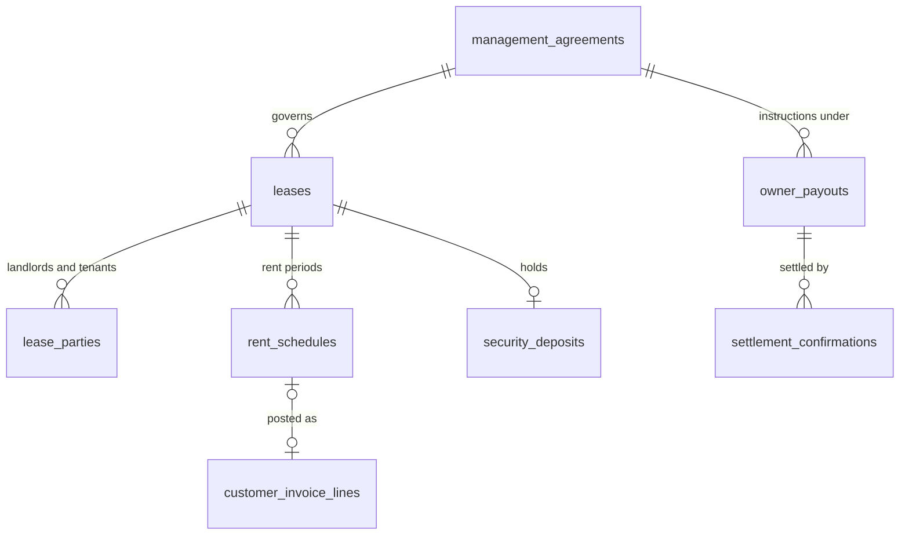

# V3.2 proposal: logical ERD changes (revision 3)

**Status:** PROPOSAL. **This is a conceptual logical model, not an approved physical schema.**
- Physical design, indexes and Laravel migrations wait for Gate H.
- Before Gate H, the whole model needs a separate architecture review.
- The frontend prototype is completed first.

**Extends:** [`A2_NORMALIZED_ERD.md`](../v3.1/gate-a/A2_NORMALIZED_ERD.md) and the V2.1 domain model (`01_MASTER_BLUEPRINT_V2.md` §8–9). All A2 conventions hold:
- ULIDs;
- two planes;
- `DECIMAL(20,2)` money with currency;
- half-open effective dating;
- immutability of financial and audit records;
- financial entity isolation (I-19).

**Revision 2** answers GPT review Issue #3:
- **P0-1/2:** cashbook source of truth; instruction vs settlement.
- **P0-3:** cheques.
- **P1-6:** deduplication against V2.1/V3.1.
- **P1-7:** legal-entity separation in rentals.
- **P1-8:** chat revocation.
- **P1-9:** governance and export scope.
- **P1-10:** safety parked.

**Revision 3** answers GPT's re-review of `3f018d0`:
- **Official notices** reuse A2's `announcements` and `notifications` and depend on no add-on (§2.13).
- **Audience rules** become shared core (`audience_rules`, was `chat_audience_rules`), so notices, polls and chat never depend on another add-on's licence.
- **Offline revocation** is limited to what a disconnected device allows (§2.1).
- **The privacy threshold** also resists differencing (§2.4, §2.9).

The table counts are unchanged.

## 1. Classification of every proposed entity

**Classes**
- **NEW:** a concept that exists in neither V2.1 nor V3.1.
- **FORMALISED:** V2.1/V3.1 already names the domain or screen, but no logical model defined it. Defined here once and shared.
- **EXTENDED:** an existing logical entity gains columns or enum values.
- **VIEW:** derived, not stored. Some views are stored only as a document when issued, like the A2 account statement.
- **REUSED:** an existing entity used as-is.
- **PARKED:** belongs to the restricted `safety` module. Not part of any milestone until the safety design is approved.

**Result after deduplication**
- Revision 1 proposed 63 tenant tables + 1 central table.
- Revision 2 proposes **38 NEW + 8 FORMALISED** tables, and 3 PARKED.
- Everything else is EXTENDED, REUSED or a VIEW.

| Area | NEW | FORMALISED | EXTENDED / REUSED | VIEW | PARKED |
|---|---|---|---|---|---|
| Chat (§2.1) | `chat_groups`, `chat_memberships`, `chat_messages` | — | `audience_rules`, `content_reports`, `user_blocks` (shared, §2.11) | unread counts (from `chat_memberships.last_read_message_id`) | — |
| Safety (§2.2) | — | — | `party_relationships` (kind = emergency contact), `party_contacts` | responders (settings + roster) | `safety_settings`, `sos_incidents`, `sos_incident_events` |
| Portal adoption (§2.3) | `portal_invitations` | — | V2.1 identity **sessions** (central; device label, revoke) | login status; portal activity (date level) | — |
| Community issues (§2.4) | `request_affirmations` | — | `maintenance_requests` (kind, visibility, area, merge); `record_comments` (shared) | affected counts (privacy threshold) | — |
| Committee and approvals (§2.5) | `committees`, `committee_offices`, `committee_terms`, `committee_resolutions` | `approval_policies`, `approval_policy_rules`, `approval_requests`, `approval_decisions`, `approval_delegations` (V2.1 "central approvals" and "temporary delegation"; register APR-001…005) | `documents` (minutes) | — | — |
| HR and payroll (§2.6) | `shift_templates`, `shift_assignments` | `attendance_records`, `leave_requests` (V2.1 attendance; HR-005/006) | V2.1 employees (resident visibility and consent); V2.1 **advances** gain kind = loan and instalments (HR-007/008); V2.1 salary components gain bonus and loan-recovery types | — | — |
| Rentals (§2.7) | `management_agreements`, `leases`, `lease_parties`, `rent_schedules`, `security_deposits`, `owner_payouts` | — | `billing_accounts.kind` + `lease`; `customer_invoices.source_type` + `lease_schedule`; `unit_liabilities.basis`; `legal_entities.kind` + `client_owner`; `bank_accounts.purpose` | owner statement (stored as a document when issued); owner sub-ledger | — |
| Finance operations (§2.8) | `cash_vouchers`, `settlement_confirmations`, `cheque_instruments`, `cash_counts`, `office_collection_batches`, `office_collection_lines`, `reminder_policies` | `funds_transfers` (register BANK-006, no logical model yet) | `bank_accounts` (kind, purpose); `fiscal_periods` (moved to the finance core); V2.1 expense categories (+ income categories); `reminder_events`; `party_contacts` and `notification_preferences` (consent) | **cashbook**; cash in transit; period-close checklist | — |
| Community hub (§2.9) | `service_categories`, `directory_listings`, `listing_recommendations`, `polls`, `poll_options`, `poll_responses`, `marketplace_listings` | — | `parties` + `party_roles` (service provider); `documents` (resources, published financial summaries); `content_reports` | poll results (privacy threshold) | — |
| Visitors and vehicles (§2.10) | — | — | `visitor_passes` (origin = gate request; waiting/approved/denied/expired); `visitor_events`; `vehicles` (approval status) | — | — |
| Shared core (§2.11) | `audience_rules` (revision 3: was `chat_audience_rules`), `generated_file_jobs`, `privacy_requests`, `content_reports`, `user_blocks`, `record_comments` | — | `documents` | — | — |
| Transfers (§2.12) | `clearance_certificates` | — | `charge_categories` / `charge_rate_versions` (transfer fee with bylaw reference); `ownership_transfers` | — | — |
| Official notices (§2.13, revision 3) | — | — | A2 `announcements` (versions, audience, acknowledgement, withdrawal); A2 `notifications` (per-recipient read and acknowledgement); A2 `communication_messages` (simulated SMS/WhatsApp); `notification_preferences` | delivered, read and acknowledged counts (staff only) | — |
| **Totals** | **38** | **8** | | | **3** |

**Removed as duplicates in revision 2**

| Revision-1 entity | Now |
|---|---|
| `chat_audience_rules` (revision 3) | `audience_rules`, shared core |
| `cash_movements` | VIEW (cashbook) |
| `cash_categories` | V2.1 expense/income categories |
| `chat_message_reads` | A column on memberships |
| `chat_reports`, `provider_reports`, `listing_reports` | `content_reports` |
| `chat_blocks` | `user_blocks` |
| `safety_responders` | VIEW |
| `emergency_contacts` | `party_relationships` |
| `portal_activity_summaries` | VIEW |
| `request_comments` | `record_comments` |
| `committee_meetings` + `committee_decisions` | `committee_resolutions` (with meeting date and minutes document) |
| `staff_public_profiles` | Employee columns |
| `employee_loans`, `loan_repayments` | V2.1 advances |
| `pay_components` | V2.1 salary components |
| `owner_statements` | VIEW / document |
| `document_batches`, `data_export_jobs` | `generated_file_jobs` |
| `contact_consents` | `party_contacts` / `notification_preferences` |
| `published_financial_summaries` | `documents` |
| `visitor_gate_requests` | `visitor_passes` |
| `transfer_fee_policies` | Charge categories and rate versions |
| `service_providers` | `parties` + `directory_listings` |

**Owner module for each NEW or FORMALISED entity:** the area's module, except:
- the shared core entities (`core`);
- `funds_transfers`, `cash_vouchers`, `settlement_confirmations` and `cash_counts` (`banking`);
- `cheque_instruments`, office batches and `reminder_policies` (`receivables`).

## 2. Entities by area

### 2.1 Chat (`community_chat`)

| Entity | Key columns | Rules |
|---|---|---|
| `chat_groups` | site_id, kind (smart \| custom \| direct), audience_rule_id? (shared `audience_rules`, §2.11), name, posting_policy (all \| staff_only \| committee_only), archived_at | Direct groups exist only if the tenant enables direct messages (D-25; off by default for residents) |
| `chat_memberships` | group_id, tenant_user_id, source (rule \| manual), joined_at, **ended_at**, **visible_from**, muted, role, last_read_message_id | `visible_from = joined_at`: no history before joining. Membership ends on the effective end of the fact behind it (move-out, role change, committee term end) |
| `chat_messages` | group_id, author_user_id, kind (text \| system \| link_card), body, link_ref?, reply_to_id?, created_at, deleted_at, moderation_state, legal_hold | Soft delete leaves a tombstone. A link card shows a record only if the reader may open it |

**When a membership ends (P1-8; revision 3 wording)**

*Immediately, on the server:*
1. Reads, posts and sync for the group are refused from that moment.
2. Deliveries queued for that member are dropped.
3. Pending notifications for the group are withdrawn.
4. Attachment and link URLs stop resolving for them.

*When the device next connects or syncs:*

5. Messages the person wrote offline are rejected and never delivered.
6. The client honours `ended_at` and removes the group's downloaded messages and attachments.

*Not enforceable, and never promised:*
- **Offline devices.** Content already downloaded to a device that is offline or unreachable cannot be erased at the moment membership ends. It goes only on the next connection.
- **Already-seen content.** Content a person has read, copied or captured cannot be recalled.
- **Wording.** UI and documentation say "removed from this device the next time it connects", never "deleted immediately".
- **Optional mitigation (D-25).** The client hides cached content when its last membership check is older than a tenant-set limit. This hides the content without erasing it; no default is proposed.

**Moderation and retention**
- **Moderation:** only through `content_reports`. Moderators see the reported message and its immediate context, never private conversations.
- **Retention:** a legally configurable tenant setting. There is **no presumed statutory period**. It has:
  - deletion exceptions (legal hold, open reports);
  - user notice before deletion takes effect.

### 2.2 Safety (`safety`): PARKED

These three tables are recorded for completeness only:
- `safety_settings` (versioned, maker-checker);
- `sos_incidents` (unit-level location, no GPS);
- `sos_incident_events` (append-only).

Responders are a view over settings and the duty roster. Emergency contacts reuse `party_relationships` with consent.

**No screen, overlay, global control or contract is built until the separate safety design is approved (D-26).** Emergency numbers are verified and region-specific at implementation time, and nothing implies live dispatch.

### 2.3 Portal adoption (`resident_portal`)

| Entity | Plane | Key columns | Rules |
|---|---|---|---|
| `portal_invitations` | tenant | party_id, unit_id, channel, status (created \| sent \| opened \| accepted \| expired \| revoked), token_hash, expires_at, sent_by, resend_count | Only for verified owner, occupant or payer links. Acceptance creates or verifies the `party_user_link`. Not the central `tenant_invitations` (that is platform signup, A2 §2) |
| V2.1 identity sessions (EXTENDED) | central | + device_label, platform, last_seen_at (approximate), ip_hash, revoked_at, revoked_by | Self-revoke, and admin revoke (audited) |

**Login status and activity are views:**
- **Vacant:** no current occupancy.
- **Never:** no accepted link.
- **Invited:** an open invitation.
- **Active:** active within 30 days, at date granularity.
- **Inactive:** none of the above.

### 2.4 Community issues (`maintenance`)

**`maintenance_requests` (EXTENDED):**
- `kind`: unit_repair \| community_issue
- `visibility`: private \| community
- `area_ref`
- `merged_into_id`
- `public_summary`

**`request_affirmations` (NEW):** request_id, party_id, created_at, withdrawn_at.

**Rules**
- Residents see a count only when it passes the **privacy threshold**: both the count and the eligible audience at or above the configured minimums (D-47). Otherwise the status reads "Reported".
- **Differencing (revision 3).** A single-cell check is not enough. Residents see counts only in fixed groupings (the site, or a block that qualifies), with no free filters or date ranges.
  - A grouping is suppressed when the difference between it and any other shown count (for example, site minus block) falls below the threshold.
  - Resident-visible counts are a scheduled snapshot (VIEW), not a live tally, so consecutive views cannot time one household's affirmation.
  - The same snapshot is used wherever the count appears.
- Staff see identities.
- A merge moves affirmations to the surviving request.
- Comments use `record_comments` (§2.11): public vs staff-internal, moderated.

### 2.5 Committee and approvals (`residents.committee`, core)

| Entity | Class | Key columns | Rules |
|---|---|---|---|
| `committees` | NEW | legal_entity_id, site_id?, name, kind | One managing committee per legal entity |
| `committee_offices` | NEW | committee_id, office, single_holder, role_id? | Linking an office to a role gives its holder that role's permissions |
| `committee_terms` | NEW | office_id, party_id, from, to, appointment_document_id? | Effective-dated; a single-holder office has no overlaps |
| `committee_resolutions` | NEW | committee_id, meeting_on?, minutes_document_id?, subject, outcome, votes_summary, recorded_by, published_at? | Residents see only published resolutions |
| `approval_policies` | FORMALISED | legal_entity_id, version, status (draft \| pending \| active \| retired), effective_from, created_by, approved_by | See the rules below |
| `approval_policy_rules` | FORMALISED | policy_id, subject (expense \| work_order \| vendor_bill \| funds_transfer \| owner_payout \| cash_voucher \| refund \| period_reopen \| data_export), amount band, category?, site_id?, approver office or role, approvals_required | No hardcoded amounts. The applied rule is snapshotted on the request |
| `approval_requests` / `approval_decisions` | FORMALISED | subject, policy version, rule, status; approver, decision, reason | The approver is never the requester (checked by principal) |
| `approval_delegations` | FORMALISED | from_user_id, to_user_id, scope, from, to | Time-bound, audited. **A delegate can never approve their own request** |

**How a policy version gets approved (P1-9)**
- **A draft never governs its own approval.** It is approved under the version in force, by someone other than its creator.
- **It may not make its creator an approver of the creator's own requests.**
- Billing-run (C.1) and beneficiary (C.2) maker-checker stay as built.

### 2.6 HR and payroll (`hr`, `payroll`)

**NEW**
- `shift_templates`: site_id, name, starts_at, ends_at, crosses_midnight.
- `shift_assignments`: employee_id, shift_template_id, on_date, status. No overlaps per employee.

**FORMALISED**
- `attendance_records`: + shift_assignment_id, method (manual \| supervisor), status.
- `leave_requests`.

**EXTENDED (V2.1)**
- **Employees:** + resident_visibility, display_role, consent_at. Residents see staff only through these columns, and only with consent.
- **Advances:** + kind (advance \| loan), instalment plan. Settlements are deducted in payroll or repaid manually.
- **Salary components:** + types bonus and loan_recovery. Statutory lines are labelled placeholders until an adviser confirms them.

**Payroll money (P0-2)**
- A posted payroll run is an **obligation**.
- Disbursement is an instruction.
- Only a `settlement_confirmation` makes it settled cash.

### 2.7 Rentals (`rentals`): legal-entity separation (P1-7)

| Entity | Key columns | Rules |
|---|---|---|
| `management_agreements` | owner_party_id, manager_legal_entity_id, **model (agent \| principal)**, client_money_account_id? (agent), client_legal_entity_id? (principal), fee_rule, fee_value, authority_document_id, from, to | No agreement means no collection on behalf of the owner. The model is chosen per agreement and **is not assumed** (D-33) |
| `leases` | site_id, unit_id, management_agreement_id, issuing_legal_entity_id (derived from the model), status, start_on, end_on, rent_amount, frequency, escalation_rule, due_day, version, supersedes_id? | Changes are versions |
| `lease_parties` | lease_id, party_id, role (landlord \| tenant \| co_tenant \| guarantor), share_pct | Landlord shares = 100 |
| `rent_schedules` | lease_id, lease_version, period_start, period_end, amount, posting_version, invoice_line_id? | A snapshot. The idempotency key is (lease, period, posting_version). It follows the schedule-item pattern but has **no dependency on developer tables** (A2 §4.3) |
| `security_deposits` | lease_id, amount, payment_id?, held_in_account_id, status | A **liability** to the tenant. It is held in a client-money or deposit-holding account of the right entity, and is never income of the manager or the SaaS company. A refund is an approved instruction plus a settlement |
| `owner_payouts` | management_agreement_id, owner_party_id, amount, status (draft \| awaiting_approval \| **approved_instruction** \| settled \| failed \| rejected), prepared_by, approved_by | **An approved instruction is not a payment.** Only a `settlement_confirmation` makes it settled |

**The two issuing models (both built as labelled fictional alternatives until D-33)**
- **Agent model.**
  - The manager's legal entity issues the rent invoice **as agent** for the owner.
  - Rent is collected into a **client-money account** (`bank_accounts.purpose = client_money`) with an **owner sub-ledger**: every movement carries `owner_party_id`.
  - The manager's fee moves from the client account to the manager's operating account only as an approved fee transfer, plus a settlement. Both accounts belong to one entity, so I-19 holds.
- **Principal model.**
  - The owner is set up as a **client legal entity** (`legal_entities.kind = client_owner`) with its own numbering and verified beneficiary.
  - The owner entity issues the invoices, and the tenant pays into the owner's account.
  - The manager's fee is an invoice from the manager entity to the owner entity, settled by evidence. No allocation crosses entities.

**Owner statement (a VIEW)**
- Rent collected − management fee − approved owner expenses − **settled** payouts = closing payable.
- Approved, unsettled instructions are shown separately as "Pending payout".
- One owner's money never settles another owner's payable.

### 2.8 Finance operations: source of truth (P0-1, P0-2, P0-3)

**Principle:** there is **one set of source events and no second ledger**.
- Settled cash changes only through:
  - **confirmed payments** (C.2 verification, or confirmed office cash);
  - **posted cash vouchers**;
  - **settled transfer legs**;
  - **settled disbursements** (owner payouts, payroll, supplier payments at Gate E, refunds), each through a `settlement_confirmation`.
- The **cashbook** is a VIEW over these events.

| Entity | Class | Key columns | Rules |
|---|---|---|---|
| `cash_vouchers` | NEW | legal_entity_id, account_id, direction (receipt \| payment), category_id, amount, on_date, evidence_document_id, status (draft \| submitted \| approved \| posted \| reversed), prepared_by, approved_by, posted_at, reversal_of?, period_id | The **only** way to record cash that no other module owns: other income, bank charges, and small expenses **only when `payables` is not granted**. Maker ≠ checker under the approval policy. Posted vouchers are immutable; a correction is a reversal voucher in an open period |
| `funds_transfers` | FORMALISED | legal_entity_id, from_account_id, to_account_id, amount, kind (deposit \| withdrawal \| transfer), status (draft \| awaiting_approval \| approved_instruction \| in_transit \| settled \| failed), maker, checker | See the rules below |
| `settlement_confirmations` | NEW | subject_type (transfer_leg \| owner_payout \| payroll_disbursement \| deposit_refund \| cheque \| fee_transfer), subject_id, leg?, evidence_type (bank_transaction \| witnessed_deposit_slip \| **simulated_demo**), bank_transaction_id?, document_id?, settled_on, confirmed_by | See the rules below |
| `cheque_instruments` | NEW | legal_entity_id, payer_party_id, billing_account_id, drawer_bank, cheque_number, cheque_date, amount, source (office_collection_line \| office_payment), status (received \| deposited \| cleared \| returned \| cancelled), deposit_slip_document_id?, returned_reason?, payment_id? | See the rules below |
| `office_collection_batches` / `office_collection_lines` | NEW | batch: legal_entity_id, site_id, collected_by, collected_on, declared_total, status (draft \| submitted \| confirmed \| returned), confirmed_by. Line: billing_account_id, party_id, unit_id, method (cash \| cheque), amount, cheque_instrument_id? | See the rules below |
| `cash_counts` | NEW | account_id, on_date, counted_amount, denominations, counted_by, witnessed_by | Required by month close for cash accounts |
| `reminder_policies` | NEW | site_id, version, steps, quiet_hours, monthly_cap, status | `reminder_events` (EXTENDED) records the policy version, channel, consent result and skip reason |
| `fiscal_periods` | EXTENDED (moved) | legal_entity_id, period, state (open \| closing \| closed \| reopened), closed_by, reopen_request_id? | Moves to the finance core: one lock per legal entity and period, used by the cashbook with or without `accounting`. Reopening is an approval request |
| `bank_accounts` | EXTENDED | + kind (bank \| cash \| petty_cash), purpose (operating \| client_money \| deposit_holding) | Client money is never mixed with operating money |

**`funds_transfers` rules**
- Both accounts belong to one legal entity (I-19).
- Each leg is settled by evidence.
- **A cash deposit:** the cash leg settles on a witnessed deposit slip (cash leaves custody, shown as "cash in transit"). The bank leg settles on the matched bank line.

**`settlement_confirmations` rules**
- **Only this record changes settled cash** for instructions.
- One bank transaction confirms at most one settlement leg (extends I-20).
- `simulated_demo` is available only from a visible demo control, is labelled "Simulated bank confirmation" everywhere, and is never automatic.

**`cheque_instruments` rules**
- A cheque that has not cleared creates **no payment, no allocation and no final receipt**. Only an acknowledgement ("Cheque received — not a receipt of payment") is issued.
- **Cleared** (by settlement evidence): this creates the payment, allocates it to this payer's lines (C.2 rules) and issues the receipt.
- **Returned:** nothing is settled and the payer is notified. A bank charge applies only if a configured, lawful policy exists (off by default).
- **A reversal after clearing:** the payment, allocations and receipt are reversed (receipt marked reversed, never deleted), invoice lines reopen, and the reversal is audited.

**Office collection batch rules**
- **Cash lines:** the counted total = the sum of cash lines; a second person confirms. Confirmed cash is recognised **per site policy (D-46)**, creating payments, allocations and receipts.
- **Cheque lines:** handled by `cheque_instruments`.
- A confirmed cash line can be corrected only by an approved reversal.

**A4 §5.3 alignment.** A4 §5.3 says office payments "produce a payment and receipt immediately" and cheques are allocated when cleared "(configurable)". Revision 2 tightens this:
- cheques produce **no payment until cleared**, and this is not configurable;
- C.2's office-payment states are re-checked against this rule once C.2 is committed.

**Cashbook behaviour by add-on**

| Add-ons granted | Expenses come from | Cash vouchers allowed for | Journals |
|---|---|---|---|
| `banking` only | Cash vouchers (payment) | Other income, bank charges, small expenses | None. Reports are built from source events |
| `banking` + `payables` | Payables (EXP / supplier payments, settled by evidence) | Other income and bank charges only (expense vouchers disabled) | None |
| `banking` + `accounting` | Cash vouchers | As "banking only" | Every source event feeds `accounting_events`; same period lock |
| `banking` + `payables` + `accounting` | Payables | As "+ payables" | As above |

**Idempotency**
- Each source event contributes to the cashbook once, keyed by (source_type, source_id, posting_version).
- Each settlement is unique per (subject_type, subject_id, leg).
- Bank transactions keep A2 §5.2 identity.

### 2.9 Community hub (`community_hub`)

| Entity | Key columns | Rules |
|---|---|---|
| `service_categories` | site_id?, name | |
| `directory_listings` | party_id (a `parties` record with role service_provider), category_id, site_id, vetting_status (pending \| vetted \| suspended), vetted_by, contact_consent_at, listed_from, listed_to, supplier_ref? | Only vetted listings are shown; contact details only with consent |
| `listing_recommendations` | listing_id, party_id, created_at, withdrawn_at | Counts only; no free text |
| `polls` / `poll_options` / `poll_responses` | poll: site_id, audience_rule_id, kind, unit_of_response, anonymity, opens_at, closes_at, results_visibility, status. Response: poll_id, respondent_key, option_ids | One response per respondent key. Anonymous polls store a one-way token. Results below the privacy threshold (D-47) show "Not enough responses to show". **Revision 3:** `results_visibility` defaults to after close (no running tally); results are shown only for groupings that pass D-47, including the difference between any two shown groupings; `audience_rule_id` points to the shared core `audience_rules`, so polls do not need `community_chat` |
| `marketplace_listings` | site_id, party_id, title, description, price_text, status (pending_review \| published \| removed \| expired), expires_at | Off by default; no payments; contact in-app only |

**Reused:**
- **resources:** `documents` published to an audience;
- **published financial summaries:** `documents` with an aggregate snapshot, never per person or per unit;
- **reports:** `content_reports`.

### 2.10 Visitors and vehicles

- **`visitor_passes` (EXTENDED):**
  - `origin` (pre_registered \| gate_request);
  - states waiting \| approved \| denied \| expired \| withdrawn;
  - `decided_by_party_id`.

  Only current occupants may decide. Approval creates the check-in `visitor_events` row.
- **`vehicles` (EXTENDED):** status (pending \| approved \| rejected \| retired), approval fields. A plate is unique per site among approved vehicles.

### 2.11 Shared core

| Entity | Key columns | Rules |
|---|---|---|
| `audience_rules` (revision 3; was `chat_audience_rules`) | site_id, rule_type (site \| building \| floor \| units \| staff_role \| committee \| custom), recipient_roles (owner \| occupant \| liable_payer \| staff), params, version, effective_from | A query over verified facts, never a stored member list. Owned by `core` so that notices (§2.13), polls (§2.9), documents and chat smart groups (§2.1) share it without depending on each other's licence. Resolved when a message is sent and **again when it is read** |
| `generated_file_jobs` | kind (invoice_pack \| dues_notices \| owner_statement \| data_export), requested_by, scope (datasets, sites, legal entities), purpose, approval_request_id?, status, file_document_id?, expires_at | **Data exports (P1-9):** the content is the granted modules ∩ the **requester's own** effective permissions and data scopes, re-checked at generation and at download. **Approval can narrow the scope, never widen it.** Approver ≠ requester. Contact data follows consent purpose. Files expire |
| `privacy_requests` | party_id, kind (access \| correction \| deletion), status, decision, retention_outcome, decided_by | Financial records are retained by law: anonymised, never deleted |
| `content_reports` | subject_type (chat_message \| comment \| listing \| directory_listing), subject_id, reporter, reason, status, decided_by | The only route for moderators to see reported content |
| `user_blocks` | blocker, blocked | Chat and marketplace |
| `record_comments` | subject_type, subject_id, author, body, visibility (public \| internal), moderation_state | Issues, and later other records |

### 2.12 Transfers and clearance

- **Transfer fee:** a charge category with **versioned, effective-dated rates** (EXTENDED `charge_categories` / `charge_rate_versions`) and a required bylaw document reference.
- **`clearance_certificates` (NEW):** unit_id, ownership_transfer_id?, number (per legal entity), issued_on, valid_until, balance_checked_at, outstanding_amount, waiver_approval_id?, issued_by, document_id. Issued only at a zero liable balance or with an approved waiver.

### 2.13 Official notices (revision 3; included modules only)

No new table. The journey reuses A2's communication entities, extended. The owner modules are all included in every edition:
- `announcements`: `residents`, as RES-005 in the live register;
- `notifications`: `core`;
- `communication_messages`: `communications`.

| Entity | Class | Key columns added | Rules |
|---|---|---|---|
| `announcements` | EXTENDED (A2, site-scoped) | version, audience_rule_id (shared `audience_rules`), requires_acknowledgement, publish_at, expires_at, withdrawn_at, withdrawn_reason, posted_via (notice \| quick_broadcast), created_by, published_by | One-way: no replies. An edit is a new version; nothing is deleted; withdrawal leaves a dated tombstone. Publishing needs `notices.publish`. Never references `community_hub` or `community_chat` entities |
| `notifications` | EXTENDED (A2, `core`) | source_type (announcement \| …), source_id, source_version, deep_link (`/customer/portal/community-notices/:id`), read_at, acknowledged_at, withdrawn_at, dismissed_at | One per recipient per published version that asks to notify. Withdrawing the notice withdraws its notifications. "Clear" sets `dismissed_at` and never deletes a row while its notice is retained, so acknowledgements stay provable |
| `communication_messages` | EXTENDED (A2) | channel (sms \| whatsapp), source ref, consent_check, status (simulated) | Only with recorded consent for that channel and purpose; carries the same deep link; simulated until Gate H |

**Rules**
- **Who sees a notice.** The audience is resolved from verified links at publish time and **re-checked at read time**. Someone outside the audience at read time (moved out, link ended) sees "not available to you".
- **Counts.** Delivered, read and acknowledged counts are a staff-only VIEW. Residents never see who else read or acknowledged.
- **Community home (D.3)** reads the same `announcements` for its summary. It never stores a copy.

## 3. Invariants

These replace revision 1's I-23 to I-34.

| # | Invariant | Proven in the prototype by |
|---|---|---|
| I-23 | No resident sees another resident's debt, login activity, contact details, poll choice or affirmation identity. Small counts follow the privacy threshold, **including differences between shown groupings and between consecutive snapshots** (revision 3) | No-leak vectors (A-201/A-202, two blocks, one small floor); differencing vectors (site − block, adjacent groupings, consecutive snapshots, affirm–withdraw toggling) |
| I-24 | Chat visibility starts at membership. On membership end, the server revokes access, queued deliveries and notifications at once. A device's downloaded copy is removed when it next connects; immediate remote deletion is never promised (revision 3) | Membership vectors; a revocation E2E with an offline device; wording tests |
| I-25 | *(Parked with safety)* Incident timelines are append-only; no wording implies dispatch | After the safety design |
| I-26 | **Settled cash changes only through confirmed payments, posted vouchers or settlement confirmations.** An instruction never changes settled cash | Cashbook = sources test; instruction-without-settlement test |
| I-27 | A closed period refuses postings dated in it; reopening needs an approval under the version in force | Period-lock tests on vouchers, payments, transfers and settlements |
| I-28 | Each source event appears in the cashbook exactly once; each settlement leg is confirmed once; one bank transaction confirms at most one settlement | Idempotency vectors |
| I-29 | An uncleared cheque settles nothing and yields no final receipt. Returned and reversed cheques leave history and reopen lines | Cheque vectors: received → returned; cleared → reversed |
| I-30 | Rent and dues liability never mix; lease invoices use `lease` accounts | Separation vectors |
| I-31 | **Rental money separation:** the issuing entity follows the management agreement model; client money stays in client accounts with an owner sub-ledger; deposits are liabilities; one owner's money never settles another owner's payable; nothing reaches the SaaS company | Two owners, one manager; agent and principal variants |
| I-32 | An export never exceeds the requester's own effective access; approval narrows only; exports are audited and expire | Scope vectors (approver with wider rights cannot widen) |
| I-33 | Switching apps never carries the other app's scope or cache | Cross-app no-leak E2E |
| I-34 | Contact needs recorded consent for that channel and purpose | Consent refusal tests |
| I-35 | No approval policy, delegation or draft lets a person approve their own request or activate their own policy | Self-approval vectors |
| I-36 | *(Revision 3)* Official notices, their notifications and their routes need only included modules. No `community_hub` or `community_chat` grant, permission or entity is ever on that path. A notice is shown only to someone in its audience at read time | Notice journey E2E with a grant set without both add-ons; audience vectors (owner, occupant, tenant-payer, moved out) |

## 4. Contracts (only when each milestone is authorised)

- Contract files will gain:
  - module keys;
  - feature keys;
  - permissions (see the matrix);
  - types for the NEW and FORMALISED entities above.
- Fixtures stay fictional and pass the A6 §7 rules.
- Nothing is added to the code in this revision.

## 5. Data classification

| Data | Sensitivity | Who reads it | Retention |
|---|---|---|---|
| Chat messages | Personal; may be sensitive | Members from joining until membership ends; moderators via reports | **Tenant-configured with legal review; no presumed period;** deletion exceptions and user notice |
| Login activity | Personal (behavioural) | Permitted staff, date level | Proposed 12 months of summaries; legal review |
| Official notices and their read/acknowledgement records | Operational; acknowledgements may be evidence | Notices: the audience at read time. Read and acknowledgement records: permitted staff only | Tenant-configured with legal review; acknowledgements kept as long as their notice |
| Staff attendance, payroll, advances | Personal and financial | HR and payroll roles; the person | Statutory (adviser) |
| Leases, deposits, owner sub-ledgers | Financial, client money | Rentals roles; landlord and tenant for their own records | Statutory (adviser) |
| Poll responses | Personal (opinion) | Aggregates above the threshold, or named polls to staff | Poll archive + 12 months (proposed) |
| Exports | Bulk personal | Requester and approver | Files expire in 7 days; the job is kept for audit |
| *(Parked)* SOS incidents | Sensitive (safety) | Defined by the safety design | Defined by the safety design |
