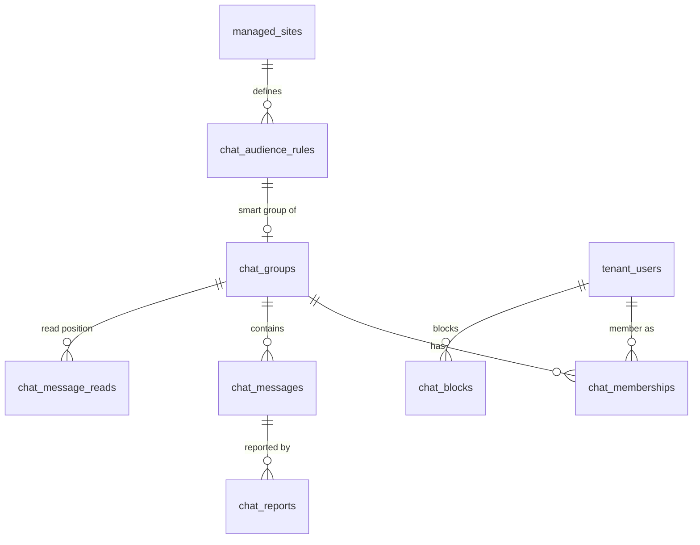
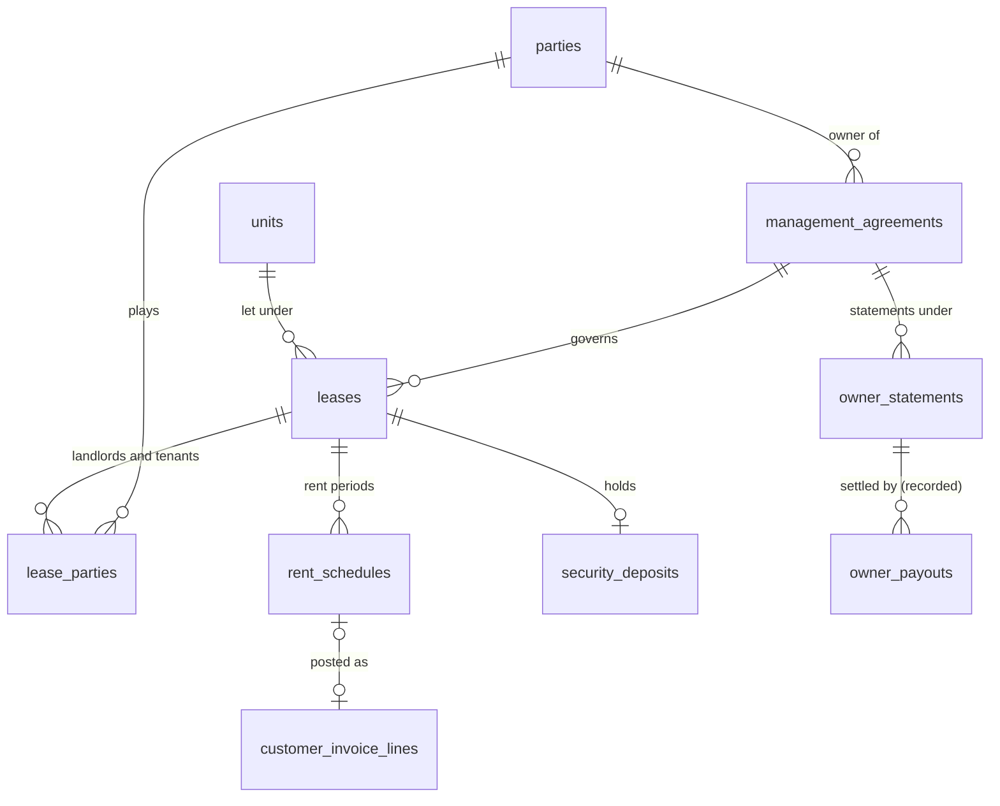

# V3.2 proposal: logical ERD changes

**Status:** PROPOSAL. This is a logical model, not a migration schema. Physical types, indexes and Laravel migrations wait for Gate H, exactly as in A2.

**What it extends:** [`A2_NORMALIZED_ERD.md`](../v3.1/gate-a/A2_NORMALIZED_ERD.md). All A2 conventions hold:
- **ULIDs** for every record.
- **Two planes.** Central tables carry `tenant_id`; tenant tables carry none.
- **Money** in `DECIMAL(20,2)` with currency. The mock uses integer paisa.
- **Effective dating** with half-open `[from, to)` ranges.
- **Immutability** of financial and audit records.
- **Financial entity isolation** (`legal_entity_id`, I-19).

## 1. Placement summary

| Group | Plane | New tables | Changed tables |
|---|---|---|---|
| 2.1 Chat | Tenant | 7 | — |
| 2.2 Safety | Tenant | 5 | — |
| 2.3 Portal adoption | Tenant (+ central sessions) | 2 (+1 central) | `party_user_links` (invitation link) |
| 2.4 Community issues | Tenant | 2 | `maintenance_requests` |
| 2.5 Committee and approvals | Tenant | 9 | — |
| 2.6 HR shifts, attendance, loans | Tenant | 7 | V2.1 HR/payroll entities (components) |
| 2.7 Rentals | Tenant | 7 | `billing_accounts.kind`, `customer_invoices.source_type`, `unit_liabilities.basis` |
| 2.8 Finance operations | Tenant | 9 | `bank_accounts.kind`, `fiscal_periods` (moves to finance core), `reminder_events` |
| 2.9 Community hub | Tenant | 10 | `documents` (publication) |
| 2.10 Visitors and vehicles | Tenant | 1 | `vehicles` |
| 2.11 Transfers and clearance | Tenant | 2 | `ownership_transfers`, `customer_invoices.source_type` |
| 2.12 Core: export and privacy requests | Tenant | 2 | — (sessions are counted in 2.3) |
| **Total** | | **63 tenant + 1 central** | |

Exact counts can move during each milestone's design. The rules in §4 cannot.

## 2. New and changed entities

### 2.1 Community chat (`community_chat`)

| Entity | Key columns | Rules |
|---|---|---|
| `chat_audience_rules` | site_id, rule_type (site \| building \| floor \| staff_role \| committee \| custom), params, version, effective_from | A rule is a query over verified facts, never a stored member list. Also reused for poll audiences (§2.9) |
| `chat_groups` | site_id, kind (smart \| custom \| direct), audience_rule_id?, name, posting_policy (all \| staff_only \| committee_only), archived_at | Direct groups exist only if the tenant enables direct messages (D-25) |
| `chat_memberships` | group_id, tenant_user_id, source (rule \| manual), joined_at, left_at, **visible_from**, muted, role (member \| moderator) | Derived from the rule on each relevant change (move-in, move-out, role change, term end). `visible_from = joined_at`: no history before joining |
| `chat_messages` | group_id, author_user_id, kind (text \| system \| link_card), body, link_ref?, reply_to_id?, created_at, deleted_at, moderation_state (visible \| hidden) | Soft delete with a tombstone. System messages are produced by events (a staff member joins) |
| `chat_message_reads` | group_id, tenant_user_id, last_read_message_id | Unread counts |
| `chat_reports` | message_id, reporter_user_id, reason, status (open \| actioned \| dismissed), decided_by | Moderators reach a message only through a report |
| `chat_blocks` | blocker_user_id, blocked_user_id | Hides the blocked person's messages for the blocker |

### 2.2 Safety (`safety`, blocked until the safety review)

| Entity | Key columns | Rules |
|---|---|---|
| `safety_settings` | site_id, version, escalation_chain, ack_timeout_s, emergency_numbers, resident_guidance, status (draft \| pending \| active), created_by, approved_by, effective_from | Versioned; maker ≠ checker |
| `safety_responders` | site_id, shift_template_id?, tenant_user_id, priority | Linked to the duty roster (§2.6) when `hr` is granted |
| `sos_incidents` | site_id, unit_id?, raised_by_user_id, party_id?, raised_at, status (raised \| acknowledged \| responding \| resolved \| false_alarm \| cancelled), closed_at, closure_reason | Unit-level location only; no GPS |
| `sos_incident_events` | incident_id, at, kind (raised \| notified \| acknowledged \| escalated \| note \| resolved \| cancelled), actor_user_id, payload | **Append-only**; the incident status is derived from it |
| `emergency_contacts` | party_id, name, relation, phone (encrypted), consent_at | Shown to responders only during an incident |

### 2.3 Portal adoption and invitations (`resident_portal`)

| Entity | Plane | Key columns | Rules |
|---|---|---|---|
| `portal_invitations` | tenant | party_id, unit_id, channel (sms \| whatsapp \| email \| printed_code), status (created \| sent \| opened \| accepted \| expired \| revoked), token_hash, expires_at, sent_by, resend_count | Only for parties with a verified owner, occupant or payer link. Acceptance creates or verifies the `party_user_link` |
| `portal_activity_summaries` | tenant | party_user_link_id, last_active_on (DATE), platform (web \| pwa \| android \| ios), active_30d | Derived from sessions at **date** granularity. No event log is kept in the tenant DB |
| `global_user_sessions` | **central** | global_user_id, device_label, platform, created_at, last_seen_at, ip_hash, revoked_at, revoked_by | Identity is global (D-17). Shared with F17 |

**Login status is a view, not a table:**
- **Vacant:** no current occupancy.
- **Never:** no accepted link.
- **Invited:** an open invitation.
- **Active:** active within 30 days.
- **Inactive:** none of the above.

### 2.4 Community issues (`maintenance`)

**Changes to `maintenance_requests`:**
- `kind`: unit_repair \| community_issue
- `visibility`: private \| community
- `area_ref`: a site area, building or asset
- `merged_into_id`
- `public_summary`: moderated

| Entity | Key columns | Rules |
|---|---|---|
| `request_affirmations` | request_id, party_id, created_at, withdrawn_at | "Affects me too". Residents see the count only; staff see identities |
| `request_comments` | request_id, author_user_id, body, visibility (public \| staff_internal), moderation_state | Moderated; internal notes never reach residents |

A merge moves affirmations to the surviving request. The merged request keeps its history.

### 2.5 Committee and approval policies (`residents.committee`, core)

| Entity | Key columns | Rules |
|---|---|---|
| `committees` | legal_entity_id, site_id?, name, kind (managing \| sub_committee) | An association may have one managing committee per legal entity |
| `committee_offices` | committee_id, office (president \| secretary \| treasurer \| member \| custom), single_holder, role_id? | Linking an office to a tenant role gives its holder that role's permissions |
| `committee_terms` | office_id, party_id, from, to, appointment_document_id? | Effective-dated; a single-holder office has no overlaps |
| `committee_meetings` | committee_id, held_on, minutes_document_id?, attendee_party_ids | Minutes are documents |
| `committee_decisions` | committee_id, meeting_id?, subject, outcome, votes_summary, recorded_by, published_at? | Residents see only published decisions |
| `approval_policies` | legal_entity_id, version, status (draft \| pending \| active \| retired), effective_from, created_by, approved_by | Same pattern as HQ `commercial_policies`. Maker ≠ checker |
| `approval_policy_rules` | policy_id, subject (expense \| work_order \| vendor_bill \| funds_transfer \| owner_payout \| refund \| period_reopen \| data_export), min_amount?, max_amount?, category?, site_id?, approver_office?, approver_role?, approvals_required | No hardcoded amounts. The rule that applied is snapshotted on the request |
| `approval_requests` | subject_type, subject_id, policy_id, policy_version, rule_id, status (pending \| approved \| rejected \| withdrawn \| expired), requested_by | One open request per subject |
| `approval_decisions` | request_id, approver_user_id, office?, decision, reason, at | Immutable. The approver is never the requester (checked by principal) |

**Not migrated.** Billing-run approval (C.1) and beneficiary changes (C.2) keep their own built maker-checker. Moving them onto the generic engine is optional and later.

### 2.6 HR shifts, attendance and loans (`hr`, `payroll`)

| Entity | Key columns | Rules |
|---|---|---|
| `shift_templates` | site_id, name, starts_at, ends_at, crosses_midnight | Morning, evening, night are examples, not fixed values |
| `shift_assignments` | employee_id, shift_template_id, on_date, site_id, status (planned \| swapped \| cancelled) | No overlapping assignments per employee |
| `attendance_records` | employee_id, shift_assignment_id?, on_date, check_in_at, check_out_at, method (manual \| supervisor), status (present \| late \| absent \| leave) | The prototype has manual or supervisor entry only; biometric and GPS are out of scope |
| `leave_requests` | employee_id, type, from, to, status, decided_by | Feeds attendance. Merge with the V2.1 leave entity if it already covers this (HR-006) |
| `staff_public_profiles` | employee_id, show_to_residents, display_role, display_name?, photo_document_id?, consent_at | Residents see staff only through this table |
| `employee_loans` | employee_id, legal_entity_id, principal, issued_on, instalment, status (active \| settled \| written_off) | Beside V2.1 advances |
| `loan_repayments` | loan_id, payroll_run_item_id?, amount, on_date | A deduction in payroll, or a manual repayment |

**Payroll components.** V2.1 payroll run items gain `pay_components` lines: earning \| bonus \| allowance \| deduction \| statutory_placeholder. Statutory lines are labelled placeholders until an adviser confirms them.

### 2.7 Rentals (`rentals`)

| Entity | Key columns | Rules |
|---|---|---|
| `management_agreements` | owner_party_id, manager_legal_entity_id, fee_rule (pct_of_collected \| fixed_monthly \| per_letting), fee_value, collects_on_behalf, authority_document_id, from, to | Collecting on behalf needs `authority_document_id` (extends D-15) |
| `leases` | site_id, unit_id, management_agreement_id?, status (draft \| active \| renewal_due \| renewed \| terminated \| expired), start_on, end_on, rent_amount, frequency, escalation_rule, due_day, version, supersedes_id? | Changes are new versions. **The issuing legal entity of rent invoices is an open decision (D-33)** |
| `lease_parties` | lease_id, party_id, role (landlord \| tenant \| co_tenant \| guarantor), share_pct (landlords) | Landlord shares = 100 |
| `rent_schedules` | lease_id, lease_version, period_start, period_end, amount, posting_version, invoice_line_id? | A snapshot. Idempotency key = (lease, period, posting_version) |
| `security_deposits` | lease_id, amount, payment_id?, held_in_account_id?, status (expected \| held \| partially_refunded \| refunded \| forfeited) | A liability, never income. A refund needs approval (§2.5) |
| `owner_statements` | management_agreement_id, owner_party_id, period, opening_payable, rent_collected, fees, owner_expenses, payouts, closing_payable, status (draft \| issued), document_id? | Lines are derived from source records; stored when issued |
| `owner_payouts` | owner_statement_id, amount, status (draft \| awaiting_approval \| recorded \| rejected), prepared_by, approved_by, bank_reference?, recorded_on | **Never "sent".** A recorded payout creates a cash movement (§2.8) |

**Changes to existing tables:**
- `billing_accounts.kind` gains `lease`.
- `customer_invoices.source_type` gains `lease_schedule`.
- `unit_liabilities` gains `basis` (dues \| lease), so rent liability and dues liability for the same unit never mix.

### 2.8 Finance operations (`banking`, `receivables`, `dues`, `communications`)

| Entity | Key columns | Rules |
|---|---|---|
| `bank_accounts` (changed) | + kind (bank \| cash \| petty_cash) | Cash is an account, not a module |
| `fiscal_periods` (moved) | legal_entity_id, period, state (open \| closing \| closed \| reopened), closed_by, closed_at, reopen_request_id? | Moves from accounting-only to the **finance core**, so the cashbook can close a month without the accounting module. One lock per legal entity and period |
| `cash_movements` | legal_entity_id, account_id, direction (in \| out), amount, on_date, category_id?, source_type (payment \| expense \| supplier_payment \| payroll \| owner_payout \| funds_transfer \| manual), source_id?, period_id, created_by, reversal_of? | **A projection.** One row per source event. `manual` only for "other income/expense" when `payables` is not granted |
| `cash_categories` | legal_entity_id, name, direction | For manual movements and reports |
| `funds_transfers` | legal_entity_id, from_account_id, to_account_id, amount, on_date, kind (deposit \| withdrawal \| transfer), status (draft \| awaiting_approval \| recorded \| rejected), maker, checker, evidence_document_id?, bank_transaction_id? | Both accounts in one legal entity (I-19). Matched to the bank feed when reconciled |
| `cash_counts` | account_id, on_date, counted_amount, denominations, counted_by, witnessed_by | Required by the close-month checklist for cash accounts |
| `office_collection_batches` | legal_entity_id, site_id, collected_by, collected_on, method (cash \| cheque), declared_total, status (draft \| submitted \| confirmed \| returned), confirmed_by | Confirmation creates `payments` and `receipts` (I-10 holds) |
| `office_collection_lines` | batch_id, billing_account_id, party_id, unit_id, amount, cheque_number? | Allocation follows C.2 rules: this payer's lines only |
| `document_batches` | kind (invoice_pack \| dues_notices \| owner_statements), source_type, source_id, status, page_count, file_document_id?, requested_by | Print packs |
| `reminder_policies` | site_id, version, steps (offset_days, channel, template_id), quiet_hours, monthly_cap, status | Versioned |
| `reminder_events` (changed) | + policy_id, policy_version, channel, consent_result, skip_reason | Existing A2 table, extended |
| `contact_consents` | party_id, channel (sms \| whatsapp \| email \| push), purpose (transactional \| community \| marketing), granted_at, withdrawn_at, source | Checked by reminders, invitations, chat notifications and the services directory |

**No wallet tables.** Unapplied credit stays derived (`payment.amount − Σ allocations`). A site policy `credit_auto_apply` decides whether credit settles future invoices on posting (A4 already anticipates this).

### 2.9 Community hub (`community_hub`, `resident_portal`)

| Entity | Key columns | Rules |
|---|---|---|
| `service_categories` | site_id?, name | |
| `service_providers` | site_id, category_id, display_name, contact (encrypted), contact_consent_at, vetting_status (pending \| vetted \| suspended), vetted_by, listed_from, listed_to, supplier_id? | Only vetted providers are listed. Contact shown only with consent |
| `service_recommendations` | provider_id, party_id, created_at, withdrawn_at | Counts only. No free text in this phase |
| `provider_reports` | provider_id, reporter_party_id, reason, status | |
| `polls` | site_id, audience_rule_id, question, kind (single \| multiple \| survey), unit_of_response (person \| unit), anonymity (named \| anonymous), opens_at, closes_at, results_visibility (live \| after_close \| staff_only), status | Informal only |
| `poll_options` | poll_id, label, order | |
| `poll_responses` | poll_id, respondent_key, option_ids, at | One per respondent key. Anonymous polls store a one-way token, so staff cannot see who voted |
| `marketplace_listings` | site_id, party_id, title, description, price_text, category, photo_document_ids, status (pending_review \| published \| removed \| expired), expires_at, removed_reason? | No payments. Contact goes through in-app messages only |
| `listing_reports` | listing_id, reporter_party_id, reason, status | |
| `published_financial_summaries` | legal_entity_id, period, figures (aggregate only), approved_by, published_at | **No per-person or per-unit figures**, by design |

**Change to `documents`:** they gain `published_to_residents` and an audience (an audience rule).

### 2.10 Visitors and vehicles

| Entity | Key columns | Rules |
|---|---|---|
| `visitor_gate_requests` | site_id, unit_id, visitor_name, purpose, photo_document_id? (consented), requested_by_user_id, requested_at, status (waiting \| approved \| denied \| expired \| withdrawn), decided_by_party_id, decided_at, expires_at, visitor_event_id? | Only current occupants of the unit may decide. Approval creates the check-in `visitor_events` row |

**Changes to `vehicles`:**
- `status`: pending \| approved \| rejected \| retired
- `submitted_by_party_id`, `approved_by`, `decided_at`

A plate is unique per site among approved vehicles.

### 2.11 Transfers and clearance (`residents`, `dues`)

| Entity | Key columns | Rules |
|---|---|---|
| `transfer_fee_policies` | site_id, version, fee_type (fixed \| by_unit_type \| pct_of_declared_value), amount_or_rate, bylaw_document_id, effective_from, status | No fee without a bylaw reference (D-42) |
| `clearance_certificates` | unit_id, ownership_transfer_id?, number (from `number_sequences` per legal entity), issued_on, valid_until, balance_checked_at, outstanding_amount, waiver_approval_id?, issued_by, document_id | Issued only if outstanding = 0 or an approved waiver exists |

**Changes:**
- `ownership_transfers` gains `fee_invoice_id` and `clearance_certificate_id`.
- `customer_invoices.source_type` gains `transfer_fee`.

### 2.12 Core: data export and privacy requests

| Entity | Plane | Key columns | Rules |
|---|---|---|---|
| `data_export_jobs` | tenant | requested_by, datasets, site_ids, legal_entity_ids, format, status (requested \| approved \| generating \| ready \| expired \| rejected), approved_by, file_ref, expires_at, row_counts | Datasets ⊆ granted modules ∩ the requester's permissions. Maker ≠ checker |
| `privacy_requests` | tenant | party_id, kind (access \| correction \| deletion), status, decision, retention_outcome, decided_by | Financial records are retained by law: anonymise, never delete |
| `global_user_sessions` | central | see §2.3 | Self-revoke, and admin revoke (audited) |

## 3. Changes to existing contracts (prototype, when each milestone starts)

| Contract file (proposed) | Adds |
|---|---|
| `packages/contracts/src/access.ts` | 4 module keys; `SITE_SCOPED_MODULES` gains `community_chat`, `community_hub`, `safety`, `rentals`; new feature keys; `PERMISSION_MODULE` entries |
| `packages/contracts/src/permissions.ts` | The §5 permissions of the matrix (illustrative) |
| `chat.ts`, `safety.ts`, `rentals.ts`, `community.ts`, `hr.ts`, `cashbook.ts` (new) | Types for the entities above; status unions; mock endpoint signatures |
| `billing.ts`, `portal.ts`, `sites.ts` (extended) | Account kind `lease`; source types `lease_schedule` and `transfer_fee`; office batches; reminders; gate requests; invitations |
| Fixtures | Al-Noor: committee, chat groups, issues, staff roster, cashbook month. Riverbend: two leases, one landlord, one tenant. All fictional, passing the existing fictional-data rules (A6 §7) |

## 4. New invariants

| # | Invariant | Enforced by (production) | Proven in the prototype by |
|---|---|---|---|
| I-23 | No resident sees another resident's debt, login activity, contact details, poll choice or affirmation identity | Query layer + response shaping per audience | No-leak vectors with A-201/A-202 and two blocks |
| I-24 | Chat visibility starts at membership; membership follows verified, effective-dated facts | Membership derivation service; `visible_from` filter | Membership vectors (join, move-out, term end, tenant vs owner) |
| I-25 | SOS incident timelines are append-only. The product never asserts that help was dispatched | No update path; wording rules | Wording tests; append-only test (after the safety review) |
| I-26 | Bulk cash creates payments only on confirmation by a different principal, and only for the liable payer's lines | Batch service | Collector ≠ confirmer test; allocation vectors |
| I-27 | A closed period refuses new or changed financial records dated in it; reopening needs an approval | Period check in every posting path | Period-lock tests on the cashbook, payments, transfers and payouts |
| I-28 | The cashbook equals the sum of its sources; one source event yields exactly one movement | Projection with a unique (source_type, source_id) | Reconciliation test: cashbook vs payments, expenses and transfers |
| I-29 | Owner payouts are recorded, never executed, until Gate H. Payout ≤ statement closing payable | Payout service | Payout vectors; wording test ("Recorded, not sent") |
| I-30 | Rent liability and dues liability never mix (`unit_liabilities.basis`); lease invoices use `lease` accounts | Engine validation | Separation vectors with one unit holding both |
| I-31 | An export contains only granted modules, permitted datasets and selected legal entities; it is approved, audited and expires | Export service | Scope vectors; expiry test |
| I-32 | One poll response per respondent key; anonymous polls cannot be linked back to a voter | Unique key; token design | Poll vectors |
| I-33 | Switching apps never carries the other app's scope or cache | App-scoped sessions | Cross-app no-leak E2E |
| I-34 | Contact through reminders, invitations, chat notifications or the directory requires recorded consent for that channel and purpose | Consent check in the delivery service | Consent refusal tests |

## 5. Data classification for the new entities

| Data | Sensitivity | Who reads it | Retention (proposed; confirmed with legal at Gate H) |
|---|---|---|---|
| Chat messages | Personal; may include sensitive content | Group members from their join date; moderators via reports | Tenant-set, default 24 months; removed on request where lawful |
| SOS incidents and emergency contacts | Sensitive (safety) | Responders and reviewers | Set in the safety review |
| Login activity | Personal (behavioural) | Permitted staff only, date granularity | 12 months of summaries |
| Staff attendance, payroll, loans | Personal and financial | HR and payroll roles; the person | Statutory (adviser) |
| Leases, deposits, owner statements | Financial | Rentals roles; landlord and tenant for their own | Statutory (adviser) |
| Poll responses | Personal (opinion) | Aggregate only, or named polls to staff | Until the poll is archived, plus 12 months |
| Exports | Bulk personal | Requester and approver | File expires in 7 days; the job record is kept for audit |
