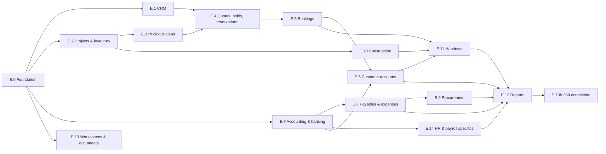

# Gate E (Developer ERP): implementation plan

**Status: PLANNING ONLY. Nothing in this folder authorises Gate E or any slice of it.**
- The owner authorised this planning pass only (coordinator brief, 2026-11-06). No application code, no live register (`docs/ui/screen-register.csv`) and no other branch was changed.
- Gate E is step 10 of the V3.2 sequence. The sequence decision D-23 (each milestone bounded, individually authorised, stopping for review) is recorded as owner-approved in `docs/status/gate-d1/GATE_D1_REPORT.md` line 4. That approval covers the order, not the start of Gate E.
- Every owner question this plan raises is in [`OPEN_DECISIONS.md`](OPEN_DECISIONS.md) with a fail-closed default. **None of those defaults is approved.**
- The per-screen planning copy is [`GATE_E_SCREEN_INVENTORY.csv`](GATE_E_SCREEN_INVENTORY.csv). It is generated from the live register and is never a substitute for it.

**Base.** Branch `docs/gate-e-plan`, created from `a0d4a70` (Gate S.2b, payroll), in the worktree `D:\laragon2\www\propertyos-gate-e-plan`.

**Sources read**
- Register: `docs/ui/screen-register.csv` (439 rows) and `packages/contracts/src/screens/register.generated.ts`.
- V2.1: `docs/blueprint/v2.1/01_MASTER_BLUEPRINT_V2.md` (§7 IA and 360 tabs, §9 states and relationships, §11 journeys J1–J4), `05_PAYMENT_AND_FINANCE_RULES.md`, `06_SCREEN_REGISTER.csv`.
- V3.1 and Gate A: `docs/blueprint/v3.1/02_LOGICAL_ERD_AND_BOUNDARIES.md`, `06_SCREEN_MAP_AND_UI_GATES.md`, `gate-a/A2_NORMALIZED_ERD.md` (§4.2–4.6, §5, §5.1, §5.2, §6, §7, §8), `gate-a/A4_DUES_COLLECTIONS_AND_SETTLEMENT.md`.
- V3.2 revision 4 (worktree `D:\laragon2\www\propertyos-v32-docs\docs\blueprint\v3.2\`): `FRONTEND_ONLY_EXECUTION_PLAN.md` (§1 step 10, §2 definition of done), `MODULE_AND_LICENSING_MATRIX.md` (§2, §5, §6, §7), `OWNER_DECISIONS.md` (D-29, D-34, D-35, D-37, D-42, D-46, D-48), `SCREEN_REGISTER_DELTA.csv`, `SCREEN_COUNT_RECONCILIATION.md`, `PRODUCT_SCOPE_EXPANSION.md` (F10, F20, F21, R-22, R-24), `ERD_PROPOSED_CHANGES.md` (§2.8).
- Code at `a0d4a70`: `apps/backoffice/src/**`, `apps/customer-web/src/pages/portal/**`, `packages/ui/src/**`, `packages/contracts/src/*`, `packages/fixtures/src/**`, `tests/**`.
- Gate reports: `docs/status/gate-c1`, `gate-c2`, `gate-s1`, `gate-d1`, `gate-d2`, `gate-d3`, `gate-s2a`, `gate-s2b`.
- GitHub Issue #16 (GPT's review of `a0d4a70`: nested-history leakage and unbound idempotency), read through the public API.

---

## 1. Verified counts

Every figure below was recomputed from the files with a CSV parser that handles quoted fields (method in Appendix A).

| Measure | Value | Source |
|---|---:|---|
| Register rows / distinct screens | 439 / 354 | `screen-register.csv` (canonical rows) |
| Distinct status (whole register) | 135 BUILT, 39 PARTIAL, 180 PLANNED | same |
| **Rows whose gate is exactly `E`** | **117** (115 PLANNED, 2 PARTIAL) | same |
| Of those, canonical (distinct) | 117 (every row is its own canonical id) | same |
| Matches V3.2 | Yes: "E 145 → 117; 28 moved to D and S" (`FRONTEND_ONLY_EXECUTION_PLAN.md` §1) | — |
| Entries labelled `E` in `register.generated.ts` | 121 = 117 + 4 merged rows that display their canonical gate (RPT-007→ACC-006, RPT-008→ACC-007, RPT-009→ACC-008, RPT-014→EXP-009) | `register.generated.ts` |
| Shared rows whose gate mentions E ("developer specifics") | 23 (12 BUILT, 11 PARTIAL): OWN-003/004, FIN-001, BANK-001/002/006, HR-001…009, PAY-001…007, DOC-001 | `screen-register.csv` |
| Built screens of other gates whose developer edition is not built | 39 (21 BUILT, 18 PARTIAL), listed as `dev-edition-gap` in the CSV | routes and register notes (§3, F-6) |

**The 117 by module.** core 12 · crm 12 · projects 5 · inventory 6 · sales 13 · residents 1 · receivables 4 · accounting 10 · banking 1 · payables 17 · procurement 8 · construction 6 · handover 9 · reports 11 · resident_portal 2.

**By surface.** 96 pages, 15 workspaces, 6 drawers. **By app.** 115 backoffice, 2 customer-web (PORTAL-013, PORTAL-014). **By edition.** DEV 61, DEV+COMM 34, ALL 11, "per source module" 11.

**The two PARTIAL rows.** CRM-016 (hold drawer: the 48 h hold works from the unit quick view in CRM-003) and INV-002 (unit quick view drawer reachable from CRM-003).

**The register rows are thin.** For all 117 rows the columns `linked_records`, `actions`, `validation`, `states` and `mock_api` are empty. `tabs` reads "Specified at Gate E" on 114 rows, is empty on 2 (CRM-016, INV-002), and is filled only on PRJ-002. Each slice must fill these columns when its rows are adopted, as S.2b did for PAY-001…007.

**One unadopted V3.2 delta row touches Gate E.** ACC-009 has a MODIFY (feature F10) adding the note "Shares the period lock with the cashbook (BANK-007): one period record per legal entity". The live ACC-009 note is still empty.

---

## 2. What already exists (reuse map)

### 2.1 Developer surfaces already built (Stage 1, Stage 1.5R, Gate B)

| Area | Files | Mock API (method, path, access) | Register screens |
|---|---|---|---|
| Sales home, leads, Lead 360 | `apps/backoffice/src/pages/crm/SalesHome.tsx`, `LeadsList.tsx`, `LeadWorkspace.tsx`, `LeadCard.tsx`, `ContactSheet.tsx`; drawers `packages/ui/src/crm/NewLeadDrawer.tsx`, `ScheduleVisitDrawer.tsx` | `packages/fixtures/src/crm-handlers.ts`: `GET /crm/summary`, `GET/POST /leads`, `GET /leads/:id`, `POST /leads/:id/{activity,status,follow-up}`, `GET/POST /visits`, `POST /visits/:id/status` | CRM-001…004, CRM-010 BUILT |
| Unit quick view and hold | `pages/crm/UnitQuickView.tsx` | `GET /units/:id` (`inventory`, `unit.view`), `POST /units/:id/{hold,release}` (`sales`, `unit.hold`) | INV-002, CRM-016 PARTIAL |
| Projects, structure, units, parties, search | — | `packages/fixtures/src/handlers.ts`: `GET /projects`, `/projects/:id/towers`, `/projects/:id/blocks`, `/towers/:id/floors`, `/units`, `/parties`, `/search`, `/access/record`, `/dashboard/summary` | — |
| Developer invoices (read only) | `pages/fin/InvoicesPage.tsx` | `finance-handlers.ts`: `GET /finance/invoices` (`receivables`, `invoice.view`, `history_read`) | FIN-002 (developer list read only) |
| Management dashboard | `pages/home/ManagementDashboard.tsx`, `ProjectShowcase.tsx`, `PortfolioCards.tsx`, `ActionCentre.tsx`, `PerformanceCharts.tsx`, `KpiRow.tsx`; read model `packages/fixtures/src/dashboard.ts` | `/dashboard/summary` | HOME-001 |
| Buyer portal (developer edition) | `apps/customer-web/src/pages/portal/PortalHomePage.tsx`, `PaymentsPage.tsx`, `PayPage.tsx`, `ReceiptPage.tsx`, `DocumentsPage.tsx`, `ConstructionPage.tsx`, `ServicesPage.tsx`; model `packages/fixtures/src/portal.ts` | `portal-handlers.ts`: `/portal/home`, `/portal/payments`, `POST /portal/instalments/:id/proof`, `POST /portal/instalments/:id/simulate-online` (labelled, never paid), `/portal/receipts/:id`, `/portal/construction`, `/portal/documents`, `/portal/services` | PORTAL-001, -004, -008, -010, -011, -012 |
| Fixtures | `inventory.ts` (2 Larkspur projects, 3 towers, 496 units), `records.ts` (120 leads, 60 invoices, notifications), `crm-data.ts` (visits, history, `unitDetail` plan), `people.ts` (personas), `tenants/crescent.ts`, `datasets.ts` (`LARKSPUR`, party links) | — | — |
| Tenants | `tenant-directory.ts`: Larkspur Estates (2 sites, all developer-preset modules + `online_payments` on Heights), Crescent Bay (Towers vs Plaza: inventory, construction, handover only on Towers; maintenance only on Plaza) | — | — |
| Roles and personas | `role-templates.ts` developer starters: administration, sales, project_management, inventory, finance, construction. Larkspur holders: Nadia Rahman (`manager`, administration, all projects), Bilal Ahmed (`sales`, Heights only), Farah Javed (`finance`); Usman Tariq (`resident`); Crescent: Zain Abbasi (`cb_manager`) | — | — |

### 2.2 Engines built for societies that Gate E should reuse (not copy)

| Engine | Where | Reuse in Gate E |
|---|---|---|
| Shared invoice contract with `sourceType` (`installment_schedule` already listed) | `packages/contracts/src/billing.ts` (`InvoiceSource`, `InvoiceLine`, `CustomerInvoice` with `legalEntityId`) | E.5/E.6 instalment invoices |
| Allocation (line level, oldest first, same payer, unapplied credit) | `packages/fixtures/src/society/allocate.ts` | E.6 |
| Statement-line matching, destination check, dedupe | `society/matching.ts` (`candidatesFor`, `destinationOf`, `newLines`, `lineKey`) | E.6 proofs, E.7 BANK-005, E.8/E.6 outgoing settlement |
| Statements, aging, numbering | `society/statement.ts`, `society/aging.ts`, `society/numbering.ts` (per-entity patterns, `DOCUMENT_KINDS`) | E.6, E.8, E.12 |
| Proofs, payments, receipts | `society/collections.ts`, `society/collections-handlers.ts`, `collections-read.ts` | E.6 |
| Cashbook (derived), periods and month close, vouchers, transfers, cheques, office batches, settlement | `society/finance/cashbook.ts`, `settle.ts`, `handlers-books.ts`, `handlers-collect.ts`, `handlers-dues.ts` | E.7, E.8 |
| Approval policies, requests, delegation | `society/finance/approvals.ts` (`policyOn`, `ruleFor`, `eligibleFor`, `evaluate`, `raiseApproval`), pages `society/finance/ApprovalPages.tsx` | E.0 (all editions), E.3, E.4, E.5, E.6, E.8, E.9 |
| Transfers and clearance | `society/finance/OwnershipPages.tsx`, OWN-006 | E.5 developer sales transfers, E.11 finance clearance |
| HR scope and multi-site test fixture | `packages/fixtures/src/hr/scope.ts`, `hr/multisite.fixture.ts` | Pattern for `developer/scope.ts` and a multi-entity fixture |
| Payroll obligation → instruction → no settlement | `packages/fixtures/src/payroll/*`, pages `society/payroll/*` | E.14, and the wording for E.6 refunds and E.8 supplier payments |
| Versioned commercial policies (HQ) | `packages/fixtures/src/platform/config.ts`, `approvals.ts`, `rate-card.ts`, `pricing.ts` | E.3 pricing policy versions |

### 2.3 UI building blocks

- **Layout and data:** `PageHeader`, `WorkspaceHeader`, `RelatedDrawer`, `UrlTabs`/`Tabs`, `FilterPills`, `SegmentedControl`, `PlannedScreenView`, `AccessOutcomeView`; `Money`, `Reference`, `DateTime`, `StatusLabel`, `Stepper`, `KeyValueList`, `ActivityTimeline`, `StatTile`, `MetricCard`, `AmountStrip` (`packages/ui/src/layout`, `packages/ui/src/data`).
- **Charts:** `FunnelChart`, `StackedBarList`, `ColumnTargetChart`, `ProgressRing`, `Sparkline`, `ChartCard` (`packages/ui/src/charts`).
- **Forms:** `CurrencyField`, `DateField`, `UnitPickerField`, `AsyncSelectField`, `FileUploadField`, `MultiSelectField` (`packages/ui/src/forms`).
- **Society kits worth lifting into shared UI when a second edition uses them:**
  - `society/finance/fkit.tsx`: `ApprovalPanel`, `InstructionNotice`, `ChequeNotice`, `SampleNotice`, `EvidenceText`, `HistoryList`, `WrapMoney`;
  - `society/collections/ckit.tsx`: `ProofPreview`, `AllocationTable`, `SubmissionStepper`, `MatchBadge`;
  - `society/parts.tsx`: `StatementView`, `AuditList`;
  - `society/payroll/pkit.tsx`: `NotSettled`, `Boundary`;
  - `society/hr/hkit.tsx`: `unbroken`, `PersonName`, `useFieldError`;
  - `society/operations/okit.tsx`: `PhotoPicker`, `PhotoList`.
- **Missing:** no calendar or scheduler component exists (`grep` finds none). CRM-009, HND-008 and PORTAL-014 need one accessible calendar with an agenda-list alternative; HR's `RosterPage.tsx` week grid (one day with a radio day-picker on phones) is the closest pattern.

### 2.4 Test assets

- E2E that already exercise developer flows: `tests/e2e/crm.spec.ts`, `permissions.spec.ts` (J9), `security.spec.ts` (Crescent Bay two-site grants; Larkspur/Crescent no-leak switching; Cedar Hills suspension), `portal.spec.ts` ("never Paid"), `dashboard.spec.ts`, `register.spec.ts` (opens every concrete register address as the Larkspur manager).
- Vectors to keep passing unchanged: `society/collections.vectors.json`, `society/dues.vectors.json`, `society/finance/finance-ops.vectors.json`, `society/finance/approvals.vectors.json`, `payroll/payroll.vectors.json`, `contracts/src/access.vectors.json`.
- Layout and access helpers: `tests/support/layout.ts` (`layoutProblems`, `focusWalk`), `tests/support/axe.ts`, `tests/support/viewports.ts`, `tests/support/society.ts` (`become`, `societyApi`, `addSharedGuard`).

---

## 3. Findings that shape Gate E (verified in the code at `a0d4a70`)

| # | Finding | Evidence | Consequence |
|---|---|---|---|
| F-1 | **Seeded developer money pre-dates the C.2 evidence rules.** Down-payment invoices are generated as `settlement: 'paid'`, `evidence: 'verified'`; instalments are randomly `paid`. The buyer portal seeds paid instalments and receipts "verified by Farah Javed" with no statement line | `packages/fixtures/src/records.ts` lines 100–101 (and the weighted settlement below); `packages/fixtures/src/portal.ts` lines 144, 182, 424 | Conflicts with D-48 and Issue #4 once Gate E shows developer collections. Decision E-04 |
| F-2 | **Id oracle in CRM.** `findLead` answers 404 for an unknown id but **403 `forbidden`** for an existing lead outside the persona's projects | `crm-handlers.ts` lines 140–145 | Violates the S.2a/S.2b rule "out of scope = never issued". Fix in E.0 |
| F-3 | **CRM writes are guarded by a read permission.** `POST /leads/:id/activity`, `/status` and `/follow-up` require `lead.view` | `crm-handlers.ts` lines 308–343 | Add write permissions (E-07) |
| F-4 | **Holds are a session map without expiry or ownership.** Any holder of `unit.hold` can release another person's hold; `until` is stored but never enforced; no idempotency | `crm-handlers.ts` lines 423–447 | A2 I-13 schedules expiry for Gate E. E.0/E.4 |
| F-5 | **Unbound idempotency is wider than payroll.** S.1's `replay()`/`remember()` store `key → id` with no binding to operation, principal, scope, target or input — the pattern Issue #16 P0-2 flagged in payroll (`payroll/handlers.ts` lines 86–90 at `a0d4a70`) | `packages/fixtures/src/society/finance/common.ts` lines 46–52, used in `handlers-books.ts`, `handlers-collect.ts`, `handlers-dues.ts` | Gate E reuses S.1 banking for developers (multi-entity), so the gap would become cross-entity. Decision E-29 |
| F-6 | **Shared screens are society-only in code.** Route wrappers `SocietyOrPlanned`, `SocietyScreen`, `S1Screen` (features Larkspur does not hold) and `OpsScreen` (`opsSite` answers 404 unless society or Shalimar) send developer organisations to the planned page; nav items for approvals, collections, bank, portal access and data export name module `dues` | `apps/backoffice/src/prototype/routes.tsx` lines 38, 81, 124, 137, 246; `packages/fixtures/src/operations/site.ts` line 57; `packages/ui/src/workspace/tenantWorkspace.ts` lines 22, 23, 32, 63, 68 | 39 built screens need a developer edition (CSV `dev-edition-gap`). The S.1 report (`docs/status/gate-s1/GATE_S1_REPORT.md` §6, item 8) already says "Gate E brings approvals to every edition" |
| F-7 | **Two data worlds.** Developer records live in `TenantDataset` (Stage 1 shapes: one 12-value `UnitStatus`, `Invoice.paid`); the C.1–S.2b engines run on `SocietyState`, which is Al-Noor-specific (one site, one entity) | `packages/fixtures/src/datasets.ts`, `records.ts`, `inventory.ts`; `packages/fixtures/src/society/state.ts`, `society/model.ts` | Decision E-03 (adapter vs extraction). A2 §4.2 splits unit status into inventory, delivery and occupancy dimensions (E-10) |
| F-8 | **Register permissions do not exist in the prototype catalogue.** Gate E rows name `project.view`, `pricing.manage`, `party.view`, `ownership.view`, `gl.view`, `expense.view`, `document.view`, `handover.view`; none is in `PERMISSIONS`. There is no approve permission for any developer maker-checker pair | `packages/contracts/src/permissions.ts`; `PERMISSION_MODULE` in `packages/contracts/src/access.ts` line 257 | E-07. S.2a lesson: an unmapped permission falls back to `core` in `decideTarget` |
| F-9 | **Too few developer people for maker-checker.** One finance person and one manager at Larkspur; one manager at Crescent Bay | `packages/fixtures/src/people.ts`; `role-templates.ts` line 169 | E-06 |
| F-10 | **One legal entity per developer tenant** (`le_larkspur`, `le_crescent`) | `inventory.ts`, `tenants/crescent.ts` | Entity isolation (A2 I-19) cannot be shown in accounting or AP. E-08 |
| F-11 | **Gate G owns the administration screens Gate E needs data from**: ADM-008 legal entities, ADM-012 cost centres, ADM-013 finance settings, ADM-014 numbering, ADM-021 audit explorer (all PLANNED, gate G) | `screen-register.csv` | Seed the data read-only (E-37) |
| F-12 | **Developer proofs have no staff path.** The buyer portal stores proofs as `awaiting_verification`; FIN-008/009 serve societies only | `portal.ts`, `portal-handlers.ts`; `routes.tsx` (FIN-008/009 via `SocietyScreen`/`SocietyRecord`) | E.6 joins developer proofs to the C.2 verification and statement-matching path |
| F-13 | **The demo payment plan is hardcoded and truncates.** `unitDetail` uses 10 % down and 36 instalments with BigInt division; it sums exactly today only because fixture prices are whole thousands | `packages/fixtures/src/crm-data.ts` `unitDetail` | E.3 replaces it with versioned templates and an explicit rounding rule |
| F-14 | **Approvals know only society subjects and approver kinds.** `APPROVAL_SUBJECTS` = cash_voucher, funds_transfer, period_reopen, payment_reversal, clearance_waiver, approval_policy; approver refs are committee offices or roles | `packages/contracts/src/finance.ts` line 680 | E.0 extends subjects; developer approvers are roles |
| F-15 | **Planned Gate E pages are already linked.** The dashboard and Action centre link to `/backoffice/crm/hold-list`, `/backoffice/inv/unit-matrix`, `/backoffice/prj/project-360-workspace`, `/backoffice/col/receivables-list` (COL-002 merges into FIN-002) | `packages/fixtures/src/dashboard.ts` lines 188–195; `pages/home/ActionCentre.tsx` lines 14–15 | Each slice turns a planned link into a working one; `register.spec.ts` will then expect the built page |
| F-16 | **`register.spec.ts` opens every register address as the Larkspur manager** and asserts the planned page for PLANNED rows | `tests/e2e/register.spec.ts` | Gate E is the first gate whose new screens belong to that persona; status flips must come with the build |

---

## 4. Rules every Gate E slice must meet

These extend the V3.2 definition of done (`FRONTEND_ONLY_EXECUTION_PLAN.md` §2) with the lessons of C.2, S.1, S.2a, S.2b and Issue #16.

### 4.1 Access and licensing
- Every handler declares `requires(module, permission, suspension[, feature])`; every nav item, quick-create entry, widget and tour step declares `requires: { modules, permission }`.
- Record checks go through `projectRecord`/`authorize` (`packages/fixtures/src/handler-types.ts`): the module grant for the record's site, the permission and the data scope. A site-scoped record without a site is refused (`site_context_missing`), as Crescent Bay's `CB-IMPORT-001` shows today.
- **Data scopes in the register:** CRM "project + assigned"; projects, inventory, bookings, construction, handover "project"; ownership "site"; receivables "legal entity + site"; accounting and banking "legal entity"; payables "legal entity" or "legal entity + cost centre"; procurement "legal entity + project"; documents "per linked record"; reports "per source module"; portal "own verified units and billing accounts".
- **Rule R** for PORTAL-013/014: `resident_portal` + `portal.use` for the buyer's verified link and site, then `handover` for the same site and unit (as `/portal/construction` already does with `construction`).
- Suspended organisations (Cedar Hills pattern): history reads only; every Gate E change is `operational`.

### 4.2 Order of checks in every changing handler (S.2b §2.5, Issue #14)
1. Module, feature and permission (transport).
2. Authority over the scope: legal entity, project or site, cost centre.
3. The record's state (frozen, posted, approved, closed period).
4. Ids from the path or body. **Out of scope answers exactly like never issued** (same status, code and body).
5. Maker ≠ checker by principal; nobody approves their own request or their own money.
6. Validation of every field before anything is stored. **A validation message never names a record the reader cannot see.**
7. Mutate, then audit.

A refusal leaves the stored state byte-identical; every negative API test asserts that.

### 4.3 No id oracle
- Unknown and out-of-scope ids give the same 404 for every resource (leads, opportunities, quotes, holds, reservations, bookings, buyers, invoices, suppliers, bills, POs, journals, documents, handovers).
- Picker endpoints (assignees, suppliers, accounts, cost centres, buyers) list only what the caller may use; an invented id and a hidden one are refused alike.
- Licensing outcomes for **routes without ids** keep the Gate B access-outcome pages ("not in your plan", "site not included"). See decision E-28 for the boundary.

### 4.4 Nested-history projection (Issue #16 P0-1)
- Every read model that embeds `history`, `versions`, `events`, `audit`, `activity`, totals or exports is projected by the reader's scope **before** it is serialized. Full-scope readers keep the full audit.
- Where a history entry would reveal a hidden project, entity, cost centre, buyer or amount, it is sanitised (action and time kept; values and names removed) or omitted. Historical totals are never recomputed from current lines or invented.
- Applies in Gate E to: opportunity and lead activity, quotation versions, hold and reservation history, booking amendments and buyer changes, payment-plan versions, project 360 activity, supplier bill and PO history, budget versions, journal audit, bank import history, handover history, report drill-downs, CSV exports, recent activity (HOME-005), search.
- **Test:** a narrow reader and a full reader read every endpoint of the slice; the narrow reader's serialized responses contain none of the hidden names, codes or amounts; the full reader still sees the legitimate audit; the projection is mutation-checked.

### 4.5 Bound idempotency (Issue #16 P0-2)
- A key is bound to operation, tenant, principal (or effective scope), target record and a fingerprint of the normalised input, and records the result id.
- A replay returns the result only for the identical authorised request, **after re-checking the current authority over the original target**; any other reuse gets a non-disclosing `409 idempotency_key_reused` and changes nothing.
- One shared helper (E.0) replaces the per-module copies. Gate E never introduces `key → id` maps.

### 4.6 Money and evidence (C.2, S.1, S.2b, D-48)
No control, seed or demo helper creates a paid, settled, received or posted state without independent evidence.

| Developer money event | Prototype state and wording | What alone may change it |
|---|---|---|
| Buyer uploads a proof (token, down payment, instalment) | "Proof received — awaiting bank evidence"; never Paid | A line from a labelled sample statement ("Sample: …", "Demo document, fictional data") imported for the **verified collection account of the issuing entity**, matched by C.2's rules; a partial match only through a second person's exception (`payment_exception.approve`); one line settles one subject once |
| Cheque (token or instalment, incl. post-dated) | "Cheque received — not a receipt of payment" | S.1 cheque rules: cleared only by a matched statement line; returned settles nothing; reversal after clearing reverses payment, allocation and receipt |
| Office cash | Per D-46 and the site's office-cash policy (S.1) | Second-person confirmation; deposit settled by a witnessed slip and a matched line |
| Reservation | "Reserved — token not verified" | Token evidenced as above (E-12) |
| Booking | "Approved — awaiting down-payment evidence" | Prerequisites of E-13 |
| Refund (FIN-010), cancellation (BKG-006) | "Approved refund instruction — not sent", then "Sent (simulated) — not settled" | A matched **debit** line of the paying verified account (E-18); a partial match through a second person |
| Supplier bill / expense / reimbursement | "Approved obligation — not paid" | Payment instruction → matched debit line (E-18) |
| Supplier payment (SUP-006) | Same as refund | Same as refund |
| Journal | "Proposed — not posted", then "Posted" | Posting only after approval by someone other than the maker, in an open period, balanced, with its source final; **cash lines only from confirmed payments or settlement confirmations** (E-17) |
| Payroll (E.14) | Unchanged from S.2b: obligation → instruction → "Not settled — no evidence" | As S.2b |
| Online payment mock | Labelled simulation, never Paid (existing `simulate-online`) | A verified mock event (D.2 BILL-011 rule) |

Other rules: instruction ≠ settlement; the cashbook = its sources; one statement line confirms at most one subject; posted documents are corrected only by credit note or reversal; period locks apply; late fees and penalties stay off (D-11); no wallet (D-37); illustrative policy values are labelled and versioned, never hardcoded (CP1).

### 4.7 Maker-checker and approval policies
- Compare principals, never names. The server refuses self-approval even when the role allows both actions.
- Thresholds come from versioned approval policies (APR-004; D-29): a draft never governs its own approval; delegates never approve their own requests; no default amounts are proposed.
- Developer approval subjects to add (E.0): `price_change`, `discount`, `plan_exception`, `quotation`, `hold_extension`, `booking`, `booking_amendment`, `booking_cancellation`, `refund`, `credit_note`, `manual_invoice`, `supplier_bill`, `supplier_payment`, `expense`, `budget`, `purchase_request`, `purchase_order`, `match_exception`, `journal`, `posting_rule`, `milestone_certification`, `publication`, `handover_waiver`, `kyc_verification`. The final list is decision E-27.

### 4.8 Legal-entity isolation (A2 §5.1, I-19)
- No allocation, match, verification, journal line, transfer, supplier payment or budget links records of two legal entities; the mock refuses with `cross_entity_forbidden` and changes nothing.
- Money between entities is an invoice from one entity to the other, never an allocation.

### 4.9 UX and accessibility (every screen)
- EN and UR with right-to-left layout at 1440, 768 and 390 px; 320 px reflow at 200 % text; dark mode and high contrast; reduced motion; personalisation from D.1 applied.
- Keyboard walks on every workspace, wizard and drawer; focus never hidden by the phone bottom bar (D.1 Issue #5).
- Axe with 0 violations in both languages; Firefox and WebKit smoke.
- Bidi isolation for references, amounts, dates and times (`<bdi>`, `unbroken()`; Urdu times use Latin AM/PM, S.2a lesson).
- S.2a/S.2b layout lessons: wrapping buttons, compact money in tiles with the full amount accessible, lists instead of tables at 320 px / 200 % Urdu, `grid-cols-1` base, `min-w-0 break-words`.
- Every KPI opens filtered records; no decorative cards; badges never rely on colour alone and never say "Paid" without evidence.
- Accessible alternatives: the unit matrix (INV-001) and calendars (CRM-009, HND-008, PORTAL-014) have a list view with the same actions; charts have an underlying data table.
- One spotlight tour per area, replayable (CRM-TOUR-001 is the pattern).

### 4.10 Tests and evidence per slice
- Typecheck, lint (incl. logical CSS and i18n parity), unit tests and golden vectors, API negatives (§4.2–4.5), E2E with retries off, evidence spec, axe, FF/WK smoke, layout checks at 320 px / 200 %.
- Mutation-check every new security and money rule (break it on purpose, confirm a test fails).
- `docs/status/gate-e<n>/`: `GATE_E<n>_REPORT.md`, `FUNCTION_MATRIX.md`, `test-results.md`, `MANUAL_VERIFICATION.md`, `SECURITY_FINDINGS.md`, `screenshots/` (names ending `…-200pct-320-xx` where relevant), `video/`.
- NVDA, VoiceOver and real devices stay open until a person does them. No WCAG claim.

### 4.11 Register adoption
- Only the authorised slice's rows change. Fill `linked_records`, `actions`, `validation`, `states`, `mock_api`, `tests`, `sr_mobile_rtl_evidence` and `notes`; set honest BUILT/PARTIAL/PLANNED; run `npm run register:sync`.
- Gate E adds no rows and merges none (E-34). Counts stay 439 rows / 354 distinct (or whatever S.3 leaves, §7.1).

---

## 5. Slice overview

Fifteen slices plus one closing pass: a foundation slice with no screens (E.0), thirteen slices that own the 117 screens (E.1…E.13), an edition-extension slice for HR and payroll (E.14), and the 360 completion pass (E.13b, no new screens). Waves follow the dependencies; slices in one wave can run in parallel.

| Slice | Name | Gate E screens | PLANNED / PARTIAL | Wave | Depends on | Edition extensions (not in the 117) |
|---|---|---:|---|:-:|---|---|
| **E.0** | Foundation and hardening | 0 | — | 0 | S.2b closure (Issue #16), S.3 (§7.1) | APR-001…005 to all editions |
| **E.1** | CRM pipeline and visits | 5 | 5 / 0 | 1 | E.0 | — |
| **E.2** | Projects and inventory | 7 | 6 / 1 | 1 | E.0 | SITE-001…005 developer composition |
| **E.7** | Accounting and banking | 11 | 11 / 0 | 1 | E.0 | BANK-001/002/006 (shared), BANK-003/004/007 |
| **E.13** | Workspaces, documents and productivity | 11 | 11 / 0 | 1 | E.0 | DOC-001 (shared), GLOBAL-013 |
| **E.3** | Pricing and payment plans | 7 | 7 / 0 | 2 | E.2 | — |
| **E.8** | Payables and expenses | 17 | 17 / 0 | 2 | E.7 | — |
| **E.10** | Construction | 7 | 7 / 0 | 2 | E.2 | — |
| **E.4** | Quotations, holds and reservations | 7 | 6 / 1 | 3 | E.1, E.2, E.3 (E.6 for token evidence) | — |
| **E.9** | Procurement | 8 | 8 / 0 | 3 | E.8 | — |
| **E.14** | Developer HR and payroll specifics | 0 | — | 3 | E.7, S.2b closure | HR-001…009, PAY-001…007 (shared) |
| **E.5** | Bookings, buyers and ownership | 10 | 10 / 0 | 4 | E.4 | OWN-003/004 (shared), CUS-001 |
| **E.6** | Customer accounts and collections | 4 | 4 / 0 | 4 | E.5, E.7 | FIN-001 (shared); FIN-002/003/005…009/011, COL-001/004/005/007, BILL-001/002/010/012/014, PORTAL-002/003/005/028/029 |
| **E.11** | Handover | 11 | 11 / 0 | 5 | E.5, E.6, E.10 | — |
| **E.12** | Reports | 12 | 12 / 0 | 5 | all source slices | — |
| **E.13b** | Connected 360 completion pass | 0 | — | 5 | all | SITE-006, CUS-003 developer tabs; PRJ-002, BKG-002, SUP-002 tabs completed |
| | **Total** | **117** | **115 / 2** | | | 23 shared + 39 gaps |

Screens per wave: wave 1 = 34, wave 2 = 31, wave 3 = 15, wave 4 = 14, wave 5 = 23.



**Reference experiences (build first in their slices, review visually; V2.1 journeys J1–J4):**
- **R1 (J1, E.1 → E.4 → E.5):** lead → opportunity → visit → quotation with a discount approved by someone else → hold → reservation with a token proof "awaiting bank evidence" → booking.
- **R2 (J2, E.5 → E.6 → E.7):** booking → schedule → instalment invoice → buyer proof in the portal → finance verification → statement line match → allocation → receipt → ledger → journal posted by a second person.
- **R3 (J3, E.9 → E.8 → E.7):** purchase request → PO → goods receipt → supplier bill → approval → payment instruction → "Not settled — no evidence" (or settled on a matched debit line if E-18 allows) → budget vs actual → GL.
- **R4 (J4, E.10 → E.11):** milestone certified → update published to buyers → finance clearance → inspection and snags → appointment in the portal → handover → ownership.

---

## 6. Slices in detail

Routes are the register's. Record screens are addressed with `?record=<id>` like S.1 (`S1Record` in `routes.tsx`); drawers are deep-linkable with `?drawer=` (the CRM pattern). "Permission" is the register's `min_permission`; the prototype permission names are decision E-07.

### E.0 Foundation and hardening (0 screens, wave 0)

**Why first.** Every later slice needs the developer state, scope helpers, permissions, personas, route guards, approvals for all editions and the two Issue #16 helpers. Doing these once avoids fifteen branches editing the same shared files (§7.4).

**Deliverables**
1. **Developer domain state** `packages/fixtures/src/developer/state.ts`: a versioned demo-store section per developer tenant (Larkspur, Crescent Bay), reset by `/demo/reset`, seeded from the existing ids (`prj_heights`, `unt_lh_*`, `led_*`, `pty_*`, `inv_*`) so current tests keep their records. Adds:
   - the inventory, delivery and occupancy dimensions per unit (A2 §4.2; E-10), with the legacy `UnitStatus` derived for existing screens;
   - legal entities, cost centres, numbering per entity and verified collection accounts per entity, seeded read-only (Gate G owns their screens; E-37);
   - approval policy versions with developer subjects (E-27);
   - a test-only multi-entity, multi-project fixture `developer/multientity.fixture.ts` (pattern: `hr/multisite.fixture.ts`; E-08).
2. **Scope helpers** `developer/scope.ts`: `projectVisible`/`projectGoverned`, `entityVisible`/`entityWhole`, `costCentreVisible`; built on `projectRecord`, `ctx.allowsProject` and persona project scope. Same "visible vs governs" split as HR's `employeeVisible`/`employeeGoverned`.
3. **Shared Issue #16 helpers** (extracted from the accepted S.2b closure, not re-invented):
   - `packages/fixtures/src/idempotency.ts` (bound replay, §4.5);
   - `packages/fixtures/src/projection.ts` (history, version and audit projection, §4.4) and a test kit that compares serialized narrow vs full responses.
4. **Hardening of existing developer handlers** (`crm-handlers.ts`): uniform 404 for out-of-scope leads (F-2); write permissions on lead mutations (F-3); hold expiry on read and write against the fixture clock, release by the holder or an override permission with a reason, bound idempotency (F-4). Existing `crm.spec.ts` journeys keep passing.
5. **Permissions, roles, personas** (E-06, E-07): new permissions with `PERMISSION_MODULE` entries; maker-checker pairs; fictional Larkspur personas for each pair (sales manager, accounts officer, finance controller, procurement officer, site engineer, project manager, handover officer). Crescent Bay keeps its single manager for the licensing demo.
6. **Edition-aware routing and navigation:** `DevScreen`/`DevRecord` wrappers (mirroring `OpsScreen`/`S1Record`), developer nav items with `requires`, quick-create entries turned live as slices land (`packages/ui/src/shell/QuickCreateMenu.tsx`: hold unit, receive payment, new expense). APR-001…005 opened to every edition (route target and nav item stop naming `dues`; F-6, F-14).
7. **Finance core adapter** (E-03): `developer/accounts/engine.ts` calls the pure society functions (`allocate.ts`, `matching.ts`, `aging.ts`, `statement.ts`, `numbering.ts`) on developer state. `SocietyState` is not changed.
8. **Fixture truthfulness** (E-04): developer paid history regenerated through the evidence path or labelled as imported history.
9. **S.1 idempotency** (E-29): only if the owner approves, S.1's `replay`/`remember` move to the bound helper with S.1 vectors and tests unchanged.

**Tests.** Access vectors for every new permission (incl. "unmapped falls back to core" guard); CRM id-oracle negatives; hold expiry, override and concurrency; idempotency and projection helper unit tests, mutation-checked; all existing suites unchanged (`crm`, `permissions`, `security`, `portal`, `register`, `s1`, `s2a`, `s2b`, collections and finance vectors).

**Done when** the developer state exists, every shared registration later slices need is in place (permissions, area nav items, per-area route modules, i18n namespace files, personas), and the full regression is green with no register change.

### E.1 CRM pipeline and visits (5 screens, wave 1)

| ID | Name | Route | Surface | Permission | Scope | Status |
|---|---|---|---|---|---|---|
| CRM-006 | Lead assignment | `/backoffice/crm/lead-assignment` | drawer | lead.view | project + assigned | PLANNED |
| CRM-007 | Opportunities pipeline | `/backoffice/crm/opportunities-pipeline` | page | lead.view | project + assigned | PLANNED |
| CRM-008 | Opportunity 360 workspace | `/backoffice/crm/opportunity-360-workspace` | workspace | lead.view | project + assigned | PLANNED |
| CRM-009 | Site visits calendar | `/backoffice/crm/site-visits-calendar` | page | lead.view | project + assigned | PLANNED |
| CRM-011 | Visit workspace | `/backoffice/crm/visit-workspace` | workspace | lead.view | project + assigned | PLANNED |

- **Reuse:** `LeadsList`, `LeadWorkspace` (`UrlTabs`, activity, visits and units tabs), `SalesHome` pipeline, `ScheduleVisitDrawer`, `FunnelChart`; contracts `PIPELINE_STAGES`, `LeadListItem`, `SiteVisit`, `VisitStatus` (`packages/contracts/src/crm.ts`); endpoints `/leads`, `/visits`, `/visits/:id/status`.
- **Missing contracts** (extend `crm.ts`): `Opportunity` (states qualified → visit → quotation → negotiation → hold/reservation → won | lost, V2.1 01 §9), `OpportunityDetail`, `LostReason`, `AssignmentInput` (lead ids, assignee principal, reason), `VisitDetail` (outcome, feedback, units shown, follow-up), `CalendarQuery`.
- **Mock API (proposed):** `GET /opportunities?stage&project&owner`; `POST /leads/:id/opportunities` (convert a qualified lead; bound idempotency); `GET /opportunities/:id`; `POST /opportunities/:id/{stage,lost,reopen}`; `POST /leads/assign`; `GET /visits/calendar?from&to&owner&project`; `GET /visits/:id`; `POST /visits/:id/{outcome,reschedule}`.
- **Access and isolation:** "project + assigned" (E-05). An assignee must hold the lead's project; unknown and out-of-scope principal ids answer alike. Calendars show other people's visits only within the agreed scope. Reassignment history is projected.
- **UX:** new accessible calendar with agenda list (shared with E.11); pipeline as columns on desktop, stage list on phones; every stage count opens the filtered list.
- **Tests:** `crm-pipeline.vectors.json` (stage transitions, conversion once, won/lost, counts equal the list); API negatives (§4.2–4.5) for assignment and conversion; E2E: assign → convert → visit outcome → follow-up; Bilal (Heights only) never sees Gardens records in lists, calendar, search or history; Urdu and 320 px / 200 % on the calendar.

### E.2 Projects and inventory (7 screens, wave 1)

| ID | Name | Route | Surface | Permission | Scope | Status |
|---|---|---|---|---|---|---|
| PRJ-001 | Projects list | `/backoffice/prj/projects-list` | page | project.view | project | PLANNED |
| PRJ-002 | Project 360 workspace | `/backoffice/prj/project-360-workspace` | workspace | project.view | project | PLANNED |
| PRJ-003 | Project setup | `/backoffice/prj/project-setup` | page | project.view | project | PLANNED |
| INV-001 | Unit matrix | `/backoffice/inv/unit-matrix` | page | unit.view | project | PLANNED |
| INV-002 | Unit quick view | `/backoffice/inv/unit-quick-view` | drawer | unit.view | project | **PARTIAL** |
| INV-008 | Live availability | `/backoffice/inv/live-availability` | page | unit.view | project | PLANNED |
| INV-010 | Storage inventory | `/backoffice/inv/storage-inventory` | page | unit.view | project | PLANNED |

- **Reuse:** `GET /projects`, `/projects/:id/towers|blocks`, `/towers/:id/floors`, `/units` (`handlers.ts`); `UnitQuickView`; `ProjectShowcase`, `PortfolioCards`; the society structure screens SITE-003/004/005/006 into which PRJ-004…007 and INV-003…005 were merged (E-09).
- **PRJ-002 tabs (register):** Overview; Leads; Units; Bookings; Collections; Finance; Expenses; Suppliers; Construction; Handover; Residents; Maintenance; Documents; Analytics; Activity. E.2 builds Overview, Units, Leads, Documents and Activity; other tabs show "planned" or "not in your plan" until their slice lands; E.13b completes them.
- **Missing contracts** (`packages/contracts/src/projects.ts`, new): `ProjectSummary`, `Project360`, `ProjectSetupDraft`, `UnitInventory` (inventory status, delivery status, occupancy), `UnitMatrix` (towers → floors → cells, plus list form), `AvailabilitySnapshot` (derived), `StorageUnit` and `StorageAllocation` (separate assets with history, V2.1 01 §9).
- **Mock API (proposed):** `GET /projects/:id`; `POST /projects` (draft); `POST /projects/:id/setup/:step`; `POST /projects/:id/{submit,activate}` (activation by someone else); `GET /inventory/matrix?project&tower`; `GET /inventory/availability?project`; `GET /inventory/storage?project`; `POST /inventory/storage/:id/{allocate,release}`.
- **Access:** inventory is site-scoped: Crescent Bay Plaza stays refused for reads, writes, search, menus and addresses (existing `security.spec.ts`), and the unassigned import stays `site_context_missing`. A project attaches to an existing licensed site and exactly one legal entity (A2 §4.3).
- **UX:** the matrix is a grid with a list alternative; status by text and pattern, not colour alone; tower/floor filters in the URL.
- **Tests:** `inventory.vectors.json` (dimension derivation; buckets equal the dashboard's `InventoryRow`; availability equals live holds, reservations and bookings); Crescent Bay parity; matrix keyboard navigation; storage allocation only to an active booking of the same project.

### E.3 Pricing and payment plans (7 screens, wave 2)

| ID | Name | Route | Surface | Permission | Scope | Status |
|---|---|---|---|---|---|---|
| COM-001 | Payment plan templates | `/backoffice/com/payment-plan-templates` | page | pricing.manage | project | PLANNED |
| COM-002 | Payment plan builder | `/backoffice/com/payment-plan-builder` | page | pricing.manage | project | PLANNED |
| COM-003 | Pricing policies | `/backoffice/com/pricing-policies` | page | pricing.manage | project | PLANNED |
| COM-004 | Fees and discounts | `/backoffice/com/fees-and-discounts` | page | pricing.manage | project | PLANNED |
| COM-005 | Approval rules | `/backoffice/com/approval-rules` | page | pricing.manage | project | PLANNED |
| INV-006 | Unit price history | `/backoffice/inv/unit-price-history` | page | unit.view | project | PLANNED |
| INV-007 | Edit price drawer | `/backoffice/inv/edit-price-drawer` | drawer | unit.view | project | PLANNED |

- **Reuse:** HQ's versioned commercial policies (draft → approved → scheduled; `platform/config.ts`, `platform/rate-card.ts`, `platform/approvals.ts`); APR-004 policies page and `approvals.ts`; S.1 transfer-fee rates (policy reference, versioned).
- **Owner rulings that apply (CP1, `docs/status/gate-b-checkpoint-1/GATE_B_CHECKPOINT_1_REPORT.md` line 15):** commercial thresholds are illustrative defaults that become configurable, versioned policies, never hardcoded; Rs 0 components stay visible in detailed quotes. They were made for HQ pricing; this plan proposes the same treatment for developer sales pricing (part of the E.3 defaults in E-30).
- **Missing contracts** (`packages/contracts/src/sales.ts`, new): `PaymentPlanTemplate` + versions (lines: down payment, instalment, on possession, balloon, construction-linked; percentage or amount; offset or milestone key), `PlanPreview`, `PricingPolicyVersion` (base rate per unit type, floor rise, premiums), `FeeRule`, `DiscountRule` (cap, policy reference), `UnitPriceVersion`, `PriceChangeRequest`.
- **Mock API (proposed):** `GET/POST /pricing/plan-templates`, `POST /pricing/plan-templates/:id/versions`, `POST /pricing/plan-templates/:id/versions/:v/{submit,approve,schedule}`; `POST /pricing/plan-preview` (pure); same shape for `/pricing/policies`, `/pricing/fees`, `/pricing/discounts`; `GET /units/:id/prices`; `POST /units/:id/price-changes`; `POST /price-changes/:id/{approve,reject}`.
- **Money rules:** a schedule sums exactly to the price under the agreed rounding rule (F-13, E-30); version chosen by date; a price change never touches sent quotations or bookings (they keep snapshots); a draft cannot approve itself or its maker's requests.
- **Tests:** `payment-plan.vectors.json` (sums to the paisa, rounding remainder placement, dates, Rs 0 lines, construction-linked lines without dates); price version by date; no self-approval; illustrative values labelled.

### E.4 Quotations, holds and reservations (7 screens, wave 3)

| ID | Name | Route | Surface | Permission | Scope | Status |
|---|---|---|---|---|---|---|
| CRM-012 | Quotation list | `/backoffice/crm/quotation-list` | page | lead.view | project + assigned | PLANNED |
| CRM-013 | Quotation builder | `/backoffice/crm/quotation-builder` | page | lead.view | project + assigned | PLANNED |
| CRM-014 | Quotation workspace | `/backoffice/crm/quotation-workspace` | workspace | lead.view | project + assigned | PLANNED |
| CRM-015 | Hold list | `/backoffice/crm/hold-list` | page | lead.view | project + assigned | PLANNED |
| CRM-016 | Hold unit drawer | `/backoffice/crm/hold-unit-drawer` | drawer | lead.view | project + assigned | **PARTIAL** |
| CRM-017 | Reservation list | `/backoffice/crm/reservation-list` | page | lead.view | project + assigned | PLANNED |
| CRM-018 | Reservation workspace | `/backoffice/crm/reservation-workspace` | workspace | lead.view | project + assigned | PLANNED |

- **Reuse:** the existing hold endpoints (hardened in E.0), `UnitQuickView`, Lead 360 units tab, E.3 plan preview, APR decision drawer, `ApprovalPanel`, `HistoryList`.
- **States (V2.1 01 §9):** quote draft → approval → sent → accepted | expired | rejected | superseded; hold active → converted | expired | released | cancelled; reservation requested → token awaiting evidence → confirmed → converted | expired | cancelled (E-12).
- **Missing contracts** (`sales.ts`): `Quotation`, `QuotationVersion` (immutable snapshot: unit, price version, plan version, fees, discounts, Rs 0 lines), `Hold`, `HoldHistory`, `Reservation`, `TokenRequest`.
- **Mock API (proposed):** `GET /quotations`; `POST /opportunities/:id/quotations`; `POST /quotations/:id/versions`; `POST /quotations/:id/{submit,approve,reject,send,accept,withdraw}`; `GET /holds?state&project`; `POST /units/:id/hold`; `POST /holds/:id/{release,extend}`; `GET /reservations`; `POST /holds/:id/reserve`; `GET /reservations/:id`; `POST /reservations/:id/{cancel,token-proof}`.
- **Rules:** one active hold per unit (A2 I-13), expiry enforced, duration and extensions per E-11; concurrent holds: one wins, the other gets the same "unit unavailable" answer; a non-holder's release is refused without revealing the holder; "send" is a simulated message with consent (D-27 pattern); a reservation is never confirmed and a token never "received" without evidence (§4.6). Token proofs enter the C.2 submission path through the E.0 adapter; until E.6 (wave 4) builds the developer staff verification, they stay "awaiting bank evidence" and no reservation is confirmed, so R1's confirmation step is exercised in wave 4.
- **Tests:** `holds.vectors.json` and `quotes.vectors.json`; concurrency and expiry at the fixture clock; discount above the policy needs an approver ≠ maker; a later price change leaves the quote unchanged; quote version history projected for narrow readers; "never Paid" wording on token screens.

### E.5 Bookings, buyers and ownership (10 screens, wave 4)

| ID | Name | Route | Surface | Permission | Scope | Status |
|---|---|---|---|---|---|---|
| BKG-001 | Bookings list | `/backoffice/bkg/bookings-list` | page | booking.view | project | PLANNED |
| BKG-002 | Booking 360 workspace | `/backoffice/bkg/booking-360-workspace` | workspace | booking.view | project | PLANNED |
| BKG-003 | New booking wizard | `/backoffice/bkg/new-booking-wizard` | page | booking.view | project | PLANNED |
| BKG-004 | Manage buyers | `/backoffice/bkg/manage-buyers` | page | booking.view | project | PLANNED |
| BKG-005 | Amend booking | `/backoffice/bkg/amend-booking` | page | booking.view | project | PLANNED |
| BKG-006 | Cancel booking flow | `/backoffice/bkg/cancel-booking-flow` | page | booking.view | project | PLANNED |
| BKG-007 | Booking payment plan | `/backoffice/bkg/booking-payment-plan` | page | booking.view | project | PLANNED |
| BKG-008 | Booking document review | `/backoffice/bkg/booking-document-review` | page | booking.view | project | PLANNED |
| CUS-004 | Identity/KYC | `/backoffice/cus/identity-kyc` | page | party.view | site/project | PLANNED |
| OWN-001 | Ownership workspace | `/backoffice/own/ownership-workspace` | workspace | ownership.view | site | PLANNED |

- **Edition extensions:** OWN-003/004 developer sales transfers (shared rows); CUS-001 People directory in its developer composition ("Customers & Buyers", CP2 wording).
- **Reuse:** wizard chrome (`pages/start/setup/*`) and `Stepper`; S.1 transfer and clearance flow (OWN-003/004/006); Person 360 (`society/people/PersonWorkspace.tsx`) for CUS-004; society ownership facts (`FlatFact`, `contracts/src/sites.ts`) for OWN-001; DOC upload and preview (E.13).
- **Booking 360 tabs (V2.1 01 §7):** overview, buyers/co-buyers, unit, commercials, payment plan versions, invoices, payments/credits, ledger, documents, approvals, amendments, handover, activity.
- **States:** booking draft → approved → confirmed → active → completed; amendment, cancellation and transfer are separate controlled actions. **Booking ≠ ownership ≠ occupancy ≠ payer** (A2 §4.4); `billing_accounts.kind = sales_contract` per booking (A2 §4.6).
- **Missing contracts** (`sales.ts`): `Booking`, `BookingBuyer` (shares sum to 100), `BookingAmendment`, `BookingCancellation` (proposal, approval, refund link), `InstalmentScheduleItem`, `KycRecord` (masked identifiers, documents, verification decision), `Ownership`, `OwnershipParty`.
- **Mock API (proposed):** `GET /bookings`; `GET /bookings/:id`; `POST /reservations/:id/booking`; `POST /bookings/:id/{submit,approve,confirm}`; `POST /bookings/:id/buyers`; `POST /bookings/:id/amendments`, `POST /amendments/:id/{approve,reject}`; `POST /bookings/:id/cancellation`, `POST /cancellations/:id/{approve,reject}`; `GET /bookings/:id/plan`; `GET /bookings/:id/documents`; `GET /parties/:id/kyc`; `POST /parties/:id/kyc/{submit,verify,reject}`; `GET /ownerships?unit`.
- **Rules:** confirmation prerequisites per E-13; schedule items post instalment invoices idempotently keyed by (booking, schedule item, posting version) — the posting itself is E.6; an amendment creates a new plan version and never edits issued invoices (credit notes correct them); cancellation proposes, never forfeits automatically (E-14); ownership starts only per E-25; KYC numbers masked, reveal audited (E-26).
- **Tests:** `bookings.vectors.json` (shares, schedule sums, amendment versions, cancellation proposal arithmetic); conversion from reservation exactly once; buyer and amendment history projected; developer transfer: dues and instalment check → fee invoice (shared engine, `transfer_fee`) → clearance → new buyers; history unchanged.

### E.6 Customer accounts and collections (4 screens, wave 4)

| ID | Name | Route | Surface | Permission | Scope | Status |
|---|---|---|---|---|---|---|
| FIN-004 | Create invoice | `/backoffice/fin/create-invoice` | page | invoice.view | legal entity + site | PLANNED |
| FIN-010 | Refund flow | `/backoffice/fin/refund-flow` | page | invoice.view | legal entity + site | PLANNED |
| COL-003 | Recovery queue | `/backoffice/col/recovery-queue` | page | collections.view | legal entity + site | PLANNED |
| COL-006 | Promise-to-pay tracker | `/backoffice/col/promise-to-pay-tracker` | page | collections.view | legal entity + site | PLANNED |

- **The larger part of this slice is the developer edition of 23 already-counted screens** (CSV rows `E-shared` and `dev-edition-gap` with slice E.6; 9 BUILT, 14 PARTIAL for societies): FIN-001 (shared), FIN-002/003/005…009/011, COL-001/004/005/007, BILL-001/002/010/012/014, PORTAL-002/003/005/028/029. Developer buyers already submit proofs through the portal (F-12), so these are proposed as part of Gate E (E-36).
- **Reuse:** the C.2 engine through the E.0 adapter: proofs (`collections.ts`), matching (`matching.ts`), allocation (`allocate.ts`), receipts, statements, aging; S.1 cheques, office collection and reminders; pages `society/collections/*` and `society/finance/*` made edition-aware rather than copied.
- **Instalment invoices:** `CustomerInvoice` with `sourceType: 'installment_schedule'` and the booking's `sales_contract` billing account; numbering per issuing entity (BILL-016 pattern); posting idempotent per schedule item and posting version (A2 I-7).
- **Missing contracts:** `RecoveryCase`, `PromiseToPay`, `RefundRequest` (proposal → approval → instruction → settlement), `ManualInvoiceInput`.
- **Mock API (proposed):** `POST /bookings/:id/schedule/post` (due items; idempotent); `GET /developer/statements/:accountId`; `POST /invoices` (manual or service, maker) and `POST /invoices/:id/{approve,issue}`; `GET /recovery/cases`, `POST /recovery/cases/:id/{assign,note,close}`; `GET /promises`, `POST /recovery/cases/:id/promises`, `POST /promises/:id/{kept,broken}` (derived from evidenced payments only); `POST /refunds`, `POST /refunds/:id/{approve,reject,send}`; settlement through the shared outgoing settlement (E-18).
- **Rules:** §4.6 in full, with cheques (including post-dated ones) per E-19. Allocations never cross payer or entity; the paying party's lines only; credit = payment − allocations; refunds of credit need approval (A4 line 155); promises are never payments; no late fees or penalties (D-11); no defaulter lists to buyers.
- **Fixture:** E-04 decides how today's seeded "paid" history is handled.
- **Tests:** existing C.2 and S.1 vectors pass unchanged; new `instalments.vectors.json` mirroring C.2's exact / partial-with-exception / over-to-credit cases on developer instalments; wrong-destination and reused lines refused; cross-entity allocation refused; refund never settled without a debit line; **Rule R negatives with the existing Larkspur links** (`datasets.ts`): Usman's verified Heights flat (allowed), his plot transferred on 2026-04-01 (refused after the end date), his unverified claimed flat (refused); E2E R2 end to end; "never Paid" wording.

### E.7 Accounting and banking (11 screens, wave 1)

| ID | Name | Route | Surface | Permission | Scope | Status |
|---|---|---|---|---|---|---|
| ACC-001 | Chart of accounts | `/backoffice/acc/chart-of-accounts` | page | gl.view | legal entity | PLANNED |
| ACC-002 | Account workspace | `/backoffice/acc/account-workspace` | workspace | gl.view | legal entity | PLANNED |
| ACC-003 | Journal entries | `/backoffice/acc/journal-entries` | page | gl.view | legal entity | PLANNED |
| ACC-004 | Create journal | `/backoffice/acc/create-journal` | page | gl.view | legal entity | PLANNED |
| ACC-005 | Reverse journal | `/backoffice/acc/reverse-journal` | page | gl.view | legal entity | PLANNED |
| ACC-006 | Trial balance | `/backoffice/acc/trial-balance` | page | gl.view | legal entity | PLANNED |
| ACC-007 | Profit and loss | `/backoffice/acc/profit-and-loss` | page | gl.view | legal entity | PLANNED |
| ACC-008 | Balance sheet | `/backoffice/acc/balance-sheet` | page | gl.view | legal entity | PLANNED |
| ACC-009 | Accounting periods | `/backoffice/acc/accounting-periods` | page | gl.view | legal entity | PLANNED |
| ACC-010 | Posting rules | `/backoffice/acc/posting-rules` | page | gl.view | legal entity | PLANNED |
| BANK-005 | Bank import | `/backoffice/bank/bank-import` | page | bank.view | legal entity | PLANNED |

- **Edition extensions:** BANK-001/002/006 (shared, developer specifics), BANK-003/004/007.
- **Why wave 1.** The ledger can start with manual journals and seeded opening positions; posting rules gain sources as E.6, E.8 and E.14 land. AP and AR then post into an existing ledger instead of waiting.
- **Reuse:** S.1 periods and month close (`cashbook.ts` `periodState`, BANK-008), the derived cashbook, Account 360 layout (`AccountsPages.tsx`), C.2 statement import and dedupe (`matching.ts` `newLines`, `BankFeedPage`).
- **Missing contracts** (`packages/contracts/src/ledger.ts`, new): `GlAccount`, `ChartVersion`, `JournalEntry` (draft → approval → posted → reversed; `source_type/source_id`; `reversal_of`), `JournalLine` (debit, credit, cost centre, site, project), `PostingRule` (versioned, per entity), `AccountingEvent`, `TrialBalance`, `ProfitAndLoss`, `BalanceSheet`, `StatementImport`. `FiscalPeriod` stays the S.1 type: one record per legal entity and period, shared with the cashbook (ACC-009 delta note).
- **Mock API (proposed):** `GET /ledger/accounts?entity`; `POST /ledger/accounts` (draft) and `/:id/approve`; `GET /ledger/accounts/:id`; `GET /ledger/journals`; `POST /ledger/journals`, `POST /ledger/journals/:id/{submit,approve,post,reverse}`; `GET /ledger/trial-balance|profit-and-loss|balance-sheet?entity&period`; `GET /ledger/periods`, `POST /ledger/periods/:id/{close,reopen-request}`; `GET/POST /ledger/posting-rules` + versions; `GET /ledger/events?status=proposed`; `POST /bank/imports` (file preview), `POST /bank/imports/:id/commit`.
- **Rules:** debits = credits; posted journals immutable; corrections by reversal in an open period; period lock per entity; posting rules versioned by date; idempotent by (source, posting version); no journal line in another entity; no revenue recognition until E-15; chart labelled illustrative (E-16); proposals vs posting per E-17; statements imported only for a verified account and labelled as samples.
- **Tests:** `ledger.vectors.json` (balanced entries; TB = Σ posted lines; P&L and BS tie: assets = liabilities + equity + current result; reversal symmetry; period lock refusal; rule version by date; idempotent posting); BANK-005 re-import idempotent; cross-entity refusal with the E.0 multi-entity fixture; journal audit projected for narrow readers.

### E.8 Payables and expenses (17 screens, wave 2)

| ID | Name | Route | Surface | Permission | Scope | Status |
|---|---|---|---|---|---|---|
| SUP-001 | Suppliers list | `/backoffice/sup/suppliers-list` | page | supplier.view | legal entity | PLANNED |
| SUP-002 | Supplier 360 workspace | `/backoffice/sup/supplier-360-workspace` | workspace | supplier.view | legal entity | PLANNED |
| SUP-003 | Supplier bills list | `/backoffice/sup/supplier-bills-list` | page | supplier.view | legal entity | PLANNED |
| SUP-004 | Supplier bill workspace | `/backoffice/sup/supplier-bill-workspace` | workspace | supplier.view | legal entity | PLANNED |
| SUP-005 | New supplier bill | `/backoffice/sup/new-supplier-bill` | page | supplier.view | legal entity | PLANNED |
| SUP-006 | Supplier payment drawer | `/backoffice/sup/supplier-payment-drawer` | drawer | supplier.view | legal entity | PLANNED |
| SUP-007 | Supplier ledger | `/backoffice/sup/supplier-ledger` | page | supplier.view | legal entity | PLANNED |
| SUP-008 | Utilities bills register | `/backoffice/sup/utilities-bills-register` | page | supplier.view | legal entity | PLANNED |
| EXP-001 | Expenses list | `/backoffice/exp/expenses-list` | page | expense.view | legal entity + cost centre | PLANNED |
| EXP-002 | New expense | `/backoffice/exp/new-expense` | page | expense.view | legal entity + cost centre | PLANNED |
| EXP-003 | Expense workspace | `/backoffice/exp/expense-workspace` | workspace | expense.view | legal entity + cost centre | PLANNED |
| EXP-004 | Expense approvals | `/backoffice/exp/expense-approvals` | page | expense.view | legal entity + cost centre | PLANNED |
| EXP-005 | Petty cash | `/backoffice/exp/petty-cash` | page | expense.view | legal entity + cost centre | PLANNED |
| EXP-006 | Employee expenses | `/backoffice/exp/employee-expenses` | page | expense.view | legal entity + cost centre | PLANNED |
| EXP-007 | Budget list | `/backoffice/exp/budget-list` | page | expense.view | legal entity + cost centre | PLANNED |
| EXP-008 | Budget workspace | `/backoffice/exp/budget-workspace` | workspace | expense.view | legal entity + cost centre | PLANNED |
| EXP-009 | Budget vs actual | `/backoffice/exp/budget-vs-actual` | page | expense.view | legal entity + cost centre | PLANNED |

- **Can split into two parallel sub-slices** if needed: E.8a suppliers and bills (SUP-001…008), E.8b expenses and budgets (EXP-001…009).
- **Reuse:** S.1 voucher form, transfer instruction states, petty-cash account kind, witnessed cash counts; `NotSettled`, `ApprovalPanel`, `HistoryList`, `StatementView`; Party model for suppliers. EXP-006 links claims to staff principals (E.0 personas); the HR employee link and the Employee 360 tab come with E.14. Budget vs actual shows commitments from open POs once E.9 lands.
- **Supplier 360 tabs (V2.1 01 §7):** overview, bills, payments, purchase orders, contracts, projects, ledger, documents, activity.
- **States (V2.1 01 §9):** supplier bill approval, accounting posting and settlement are tracked separately.
- **Missing contracts** (`packages/contracts/src/payables.ts`, new): `Supplier`, `SupplierBill` (lines with cost centre and project), `SupplierPaymentInstruction`, `SupplierLedger`, `UtilityBill`, `Expense`, `ExpenseClaim`, `PettyCashFloat`, `Budget` + versions, `BudgetVsActual`.
- **Mock API (proposed):** `GET/POST /suppliers`; `GET /suppliers/:id`; `GET/POST /supplier-bills`; `POST /supplier-bills/:id/{submit,approve,reject,post}`; `POST /supplier-bills/:id/payments` (instruction), `POST /supplier-payments/:id/{approve,send,cancel}`; `GET /suppliers/:id/ledger`; `GET/POST /utility-bills`; `GET/POST /expenses`, `POST /expenses/:id/{submit,approve,reject}`; `GET /petty-cash`, `POST /petty-cash/:id/{count,top-up}`; `GET/POST /budgets` + versions; `GET /budgets/:id/vs-actual`.
- **Rules:** expense vouchers stay disabled when `payables` is granted (S.1 rule; developers hold `payables`); approved bill = obligation; payment = instruction; settlement only per E-18; ledger = bills − credit notes − settled payments; actual = posted only, commitments (open POs) apart; approver ≠ claimant; cost-centre readers see only their cost centres, and approval history is projected accordingly.
- **Tests:** `payables.vectors.json` (bill states, ledger arithmetic, one line one subject, partial via exception, reversal restores the liability); `budgets.vectors.json`; negatives for cross-entity bills and payments; R3 E2E.

### E.9 Procurement (8 screens, wave 3)

| ID | Name | Route | Surface | Permission | Scope | Status |
|---|---|---|---|---|---|---|
| PROC-001 | Procurement overview | `/backoffice/proc/procurement-overview` | page | procurement.view | legal entity + project | PLANNED |
| PROC-002 | Purchase request list | `/backoffice/proc/purchase-request-list` | page | procurement.view | legal entity + project | PLANNED |
| PROC-003 | Purchase request workspace | `/backoffice/proc/purchase-request-workspace` | workspace | procurement.view | legal entity + project | PLANNED |
| PROC-004 | RFQ list | `/backoffice/proc/rfq-list` | page | procurement.view | legal entity + project | PLANNED |
| PROC-005 | Supplier quotation comparison | `/backoffice/proc/supplier-quotation-comparison` | page | procurement.view | legal entity + project | PLANNED |
| PROC-006 | Purchase orders list | `/backoffice/proc/purchase-orders-list` | page | procurement.view | legal entity + project | PLANNED |
| PROC-007 | Purchase order workspace | `/backoffice/proc/purchase-order-workspace` | workspace | procurement.view | legal entity + project | PLANNED |
| PROC-008 | Goods/service receipt | `/backoffice/proc/goods-service-receipt` | page | procurement.view | legal entity + project | PLANNED |

- **Reuse:** APR approvals for PR and PO thresholds; E.8 suppliers and bills (3-way match in SUP-005); the nav item `procurement` already exists in `tenantWorkspace.ts`.
- **Missing contracts** (`payables.ts` or `procurement.ts`): `PurchaseRequest`, `Rfq`, `SupplierQuote`, `QuoteComparison` (selection with a reason), `PurchaseOrder` + amendments, `GoodsReceipt`, `MatchResult`.
- **Mock API (proposed):** `GET/POST /purchase-requests`, `POST /purchase-requests/:id/{submit,approve,reject}`; `GET/POST /rfqs`, `POST /rfqs/:id/quotes`; `POST /rfqs/:id/select`; `GET/POST /purchase-orders`, `POST /purchase-orders/:id/{approve,issue,amend,close}`; `POST /purchase-orders/:id/receipts`; `GET /purchase-orders/:id/match`.
- **Rules:** requester ≠ approver; issued PO immutable (amendments only); receipt never exceeds the order; match exceptions approved by a second person (E-31); suppliers and POs belong to one entity.
- **UX:** the comparison table has a list alternative at 320 px.
- **Tests:** `procurement.vectors.json` (3-way match; commitments; over-receipt refusal); R3 E2E.

### E.10 Construction (7 screens, wave 2)

| ID | Name | Route | Surface | Permission | Scope | Status |
|---|---|---|---|---|---|---|
| PRJ-008 | Project construction overview | `/backoffice/prj/project-construction-overview` | page | project.view | project | PLANNED |
| CON-001 | Construction dashboard | `/backoffice/con/construction-dashboard` | page | construction.view | project | PLANNED |
| CON-002 | Milestones | `/backoffice/con/milestones` | page | construction.view | project | PLANNED |
| CON-003 | Construction update list | `/backoffice/con/construction-update-list` | page | construction.view | project | PLANNED |
| CON-004 | New update | `/backoffice/con/new-update` | page | construction.view | project | PLANNED |
| CON-005 | Customer publication preview | `/backoffice/con/customer-publication-preview` | page | construction.view | project | PLANNED |
| CON-006 | Media timeline | `/backoffice/con/media-timeline` | page | construction.view | project | PLANNED |

- **Reuse:** `ProjectMilestone` and `ConstructionUpdate` (`contracts/src/dashboard.ts`), the portal's construction model (`portal.ts` `HEIGHTS_MILESTONES`, `PortalConstructionUpdate`) and `ConstructionPage.tsx` for the preview; `PhotoPicker`/`PhotoList`; fictional images in `packages/assets`; `ProgressRing`.
- **Missing contracts** (`projects.ts`): `MilestonePlan` + versions, `MilestoneCertification` (evidence document, certifier ≠ engineer), `ConstructionUpdateDraft` (draft → review → published → withdrawn), `PublicationAudience`.
- **Mock API (proposed):** `GET /construction/:projectId/dashboard`; `GET/POST /construction/:projectId/milestones` + versions; `POST /milestones/:id/{progress,certify}`; `GET/POST /construction/updates`; `POST /construction/updates/:id/{submit,approve,publish,withdraw}`; `GET /construction/updates/:id/preview`; `GET /construction/:projectId/media`.
- **Rules:** progress comes from certified milestones only; a construction-linked instalment becomes due only per E-20; publication per E-21, audience = verified buyers of the project or tower (bookings in force), never cancelled or transferred-out buyers; withdrawal leaves a tombstone; no people or real places in demo media. `construction` is site-scoped (Crescent Bay Plaza refused).
- **Tests:** `publication.vectors.json` (audiences: tower B buyers only; cancelled booking excluded; transferred buyer excluded; co-buyers included); Rule R on the existing PORTAL-012 after publication (resident_portal or construction revoked closes it); certification maker-checker.

### E.11 Handover (11 screens, wave 5)

| ID | Name | Route | Surface | Permission | Scope | Status |
|---|---|---|---|---|---|---|
| HND-001 | Handover dashboard | `/backoffice/hnd/handover-dashboard` | page | handover.view | project | PLANNED |
| HND-002 | Handover queue | `/backoffice/hnd/handover-queue` | page | handover.view | project | PLANNED |
| HND-003 | Handover 360 workspace | `/backoffice/hnd/handover-360-workspace` | workspace | handover.view | project | PLANNED |
| HND-004 | Finance clearance | `/backoffice/hnd/finance-clearance` | page | handover.view | project | PLANNED |
| HND-005 | Legal clearance | `/backoffice/hnd/legal-clearance` | page | handover.view | project | PLANNED |
| HND-006 | Inspection checklist | `/backoffice/hnd/inspection-checklist` | page | handover.view | project | PLANNED |
| HND-007 | Snag board | `/backoffice/hnd/snag-board` | page | handover.view | project | PLANNED |
| HND-008 | Handover scheduler | `/backoffice/hnd/handover-scheduler` | page | handover.view | project | PLANNED |
| HND-009 | Complete handover flow | `/backoffice/hnd/complete-handover-flow` | page | handover.view | project | PLANNED |
| PORTAL-013 | Handover status | `/customer/portal/handover-status` | page (customer-web) | portal.use | own verified units and billing accounts | PLANNED |
| PORTAL-014 | Handover appointment | `/customer/portal/handover-appointment` | page (customer-web) | portal.use | own verified units and billing accounts | PLANNED |

- **States (V2.1 01 §9):** clearances → inspection → snags → ready → scheduled → handed over. Delivery status moves to `handed_over`; inventory status stays as it is (A2 §4.2).
- **Reuse:** S.1 clearance rule (OWN-006: zero balance or approved waiver); D.2 `IssuesBoard`/`RequestWorkspace` layout for snags; E.1 calendar; the portal shell and home cards.
- **Missing contracts** (`projects.ts`): `Handover`, `Clearance` (finance, legal), `InspectionChecklist` + versions, `Snag`, `HandoverSlot`, `HandoverAppointment`, `HandoverCompletion` (keys, access cards, meter readings, acknowledgement).
- **Mock API (proposed):** `GET /handovers?project&state`; `GET /handovers/:id`; `POST /handovers/:id/clearances/{finance,legal}` and `/:kind/{approve,waive}`; `POST /handovers/:id/inspections`; `GET/POST /handovers/:id/snags`, `POST /snags/:id/{assign,resolve,verify}`; `GET /handover-slots?project&from&to`; `POST /handovers/:id/appointment`; `POST /handovers/:id/complete`; portal: `GET /portal/handover`, `POST /portal/handover/appointment`.
- **Rules:** finance clearance from evidenced payments only; pending proofs and uncleared cheques do not count; waivers by approval policy (E-22); snags owned by handover (E-23); no double-booked slot; completion needs all clearances and the buyer's acknowledgement; ownership and occupancy start per E-25.
- **Portal (Rule R):** PORTAL-013/014 need `resident_portal` + `portal.use` for the buyer's verified link, then `handover` for the same site and unit. Negatives: `resident_portal` revoked, `handover` revoked for the site, another buyer's unit, transferred-out buyer, unverified claim.
- **Tests:** `handover.vectors.json` (clearance refused with a pending proof, with an uncleared cheque, with a cleared balance short by one paisa; allowed with a waiver approved by someone else); appointment concurrency; R4 E2E across both apps.

### E.12 Reports (12 screens, wave 5)

| ID | Name | Route | Surface | Permission | Scope | Status |
|---|---|---|---|---|---|---|
| PRJ-009 | Project analytics | `/backoffice/prj/project-analytics` | page | project.view | project | PLANNED |
| RPT-001 | Report center | `/backoffice/rpt/report-center` | page | reports.view | per source module | PLANNED |
| RPT-002 | Sales funnel | `/backoffice/rpt/sales-funnel` | page | reports.view | per source module | PLANNED |
| RPT-003 | Inventory availability | `/backoffice/rpt/inventory-availability` | page | reports.view | per source module | PLANNED |
| RPT-005 | Collection report | `/backoffice/rpt/collection-report` | page | reports.view | per source module | PLANNED |
| RPT-006 | GL detail | `/backoffice/rpt/gl-detail` | page | reports.view | per source module | PLANNED |
| RPT-010 | Cash flow | `/backoffice/rpt/cash-flow` | page | reports.view | per source module | PLANNED |
| RPT-012 | AP aging | `/backoffice/rpt/ap-aging` | page | reports.view | per source module | PLANNED |
| RPT-013 | Project profitability | `/backoffice/rpt/project-profitability` | page | reports.view | per source module | PLANNED |
| RPT-015 | Payroll summary | `/backoffice/rpt/payroll-summary` | page | reports.view | per source module | PLANNED |
| RPT-016 | Construction progress | `/backoffice/rpt/construction-progress` | page | reports.view | per source module | PLANNED |
| RPT-017 | Maintenance SLA | `/backoffice/rpt/maintenance-sla` | page | reports.view | per source module | PLANNED |

- **Merged here, not separate screens:** RPT-004 and RPT-011 → COL-005; RPT-007/008/009 → ACC-006/007/008; RPT-014 → EXP-009.
- **Reuse:** read models of the source slices (never a second calculation), charts with data tables, C.2 collections read models, S.1 cashbook, D.2 SLA read model, PAY dashboard read model.
- **Rules:** each report needs `reports.view` **and** its source module's grant, permission and record scope; RPT-015 also needs `payroll.view` and Issue #16 projection; exports never widen scope; drill-through opens records; RPT-013 shows "management view — revenue recognition policy not set" until E-15; RPT-017 depends on E-24.
- **Tests:** `reports.vectors.json`: each report equals its source (funnel = CRM counts; availability = matrix; collected = evidenced payments; GL detail = posted lines; cash flow = settled events; AP aging = supplier ledgers; construction = certified milestones); narrow-reader totals exclude hidden records without a differencing leak across groupings; export scope.

### E.13 Workspaces, documents and productivity (11 screens, wave 1; E.13b in wave 5)

| ID | Name | Route | Surface | Permission | Scope | Status |
|---|---|---|---|---|---|---|
| GLOBAL-002 | Unified search results | `/backoffice/global/unified-search-results` | page | (signed in) | own user | PLANNED |
| GLOBAL-005 | Recent records | `/backoffice/global/recent-records` | page | (signed in) | own user | PLANNED |
| GLOBAL-006 | Favorites | `/backoffice/global/favorites` | page | (signed in) | own user | PLANNED |
| HOME-002 | My tasks | `/backoffice/home/my-tasks` | page | (signed in) | own user + granted modules | PLANNED |
| HOME-004 | Work queue | `/backoffice/home/work-queue` | page | (signed in) | own user + granted modules | PLANNED |
| HOME-005 | Recent activity | `/backoffice/home/recent-activity` | page | (signed in) | own user + granted modules | PLANNED |
| DOC-002 | Document preview | `/backoffice/doc/document-preview` | page | document.view | per linked record | PLANNED |
| DOC-003 | Upload drawer | `/backoffice/doc/upload-drawer` | drawer | document.view | per linked record | PLANNED |
| DOC-004 | Document versions | `/backoffice/doc/document-versions` | page | document.view | per linked record | PLANNED |
| DOC-005 | Expiring documents | `/backoffice/doc/expiring-documents` | page | document.view | per linked record | PLANNED |
| DOC-006 | Templates and policies | `/backoffice/doc/templates-and-policies` | page | document.view | per linked record | PLANNED |

- **Edition extensions:** DOC-001 full centre (shared; D.3 built only "Published to residents"); GLOBAL-013 developer project switcher. HOME-003 is merged into APR-001 (E.0).
- **Reuse:** `GET /search` with `TENANT_SEARCH_SCOPES` (the same effective-access rule as GLOBAL-001); `ActionCentre`, society tasks, `cashCountTasks`; `ActivityTimeline`; HR-009 expiry pattern; APR-004 versioned-policy pattern; `FileUploadField`, `ProofPreview`.
- **Missing contracts** (`packages/contracts/src/productivity.ts`, `documents.ts`, new): `TaskItem` with a provider registry (each slice registers its tasks with `requires`), `WorkQueueItem`, `RecentRecord`, `Favourite`, `DocumentRecord`, `DocumentVersion`, `DocumentTemplate` + versions.
- **Mock API (proposed):** `GET /search?q&type&page`; `GET /me/tasks`; `GET /work-queue?module&project`; `GET /activity?scope`; `GET /documents?record`; `POST /documents` (upload, demo files only); `GET /documents/:id/versions`; `POST /documents/:id/versions`; `GET /documents/expiring?within`; `GET/POST /document-templates` + versions. Recent records and favourites live in a browser store partitioned per tenant, app and principal, and each entry is re-resolved through `GET /access/record` before display.
- **Rules:** no count of hidden results, tasks or favourites; no leak across tenant or app switch (D.1); storage and retention per E-35; activity projected (§4.4); document visibility follows the linked record; versions immutable.
- **E.13b (wave 5, no new screens):** complete the 360 tabs: PRJ-002 (all 15), BKG-002, SUP-002, Person 360 developer composition (CUS-003 with its states CUS-005…008: relationships, owned properties, communications, ledger), Unit 360 developer tabs (SITE-006: pricing versions, availability, holds, reservations, booking, owners, invoices, documents, construction, handover). Each tab checks its own module; unlicensed tabs say "not in your plan".
- **Tests:** search, recent and favourites no-leak E2E (tenant switch, app switch, access narrowed); task providers each gated; document visibility per linked record; 360 tab gating matrix (each tab with its module revoked).

### E.14 Developer HR and payroll specifics (0 new screens, wave 3)

- **Rows:** HR-001…009 and PAY-001…007 (shared; gate "S.2 (society slice); E (developer specifics)" and "S.2 (optional, after HR); E (developer specifics)").
- **Today:** a developer organisation has HR and payroll in its preset, but society HR answers it "not found" and its HR screens stay planned (`docs/status/gate-s2a/SECURITY_FINDINGS.md`); payroll answers `permission_missing` because no developer role holds a payroll permission (`docs/status/gate-s2b/GATE_S2B_REPORT.md` §3, flow 4).
- **Scope:** employees assigned to projects and cost centres; several legal entities as employers; Employee 360 tabs incl. expenses (E.8 EXP-006); payroll proposals into the E.7 ledger only per E-17; RPT-015.
- **Prerequisite:** the S.2b Issue #16 closure accepted (projection and bound idempotency), and E-33.
- **Unchanged:** PAY-006 and HR-008 stay PARTIAL until an outgoing settlement exists (E-18).
- **Tests:** S.2a/S.2b suites unchanged; developer multi-entity payroll projection (the Issue #16 test design applied to two entities); a narrow project reader sees no other project's pay.

---

## 7. Integration order, branches and conflicts

### 7.1 Prerequisites outside Gate E
- **S.2b closure (Issue #16).** At the time of writing, the closure is in progress, uncommitted, in `D:\laragon2\www\propertyos-s2b` (branch `feature/gate-s2b-society-payroll`). Its diff introduces a payroll-local bound replay (`replayOf(p, op, target, input)`, `409 idempotency_key_reused`) and scope projection of payroll history. **Not verified here; Gate E must take the accepted version, not this snapshot.**
- **S.3 rentals.** Branch `feature/gate-s3-rentals` at `a0d4a70`, no commits yet at the time of writing. S.3 will add the `rentals` module, the `lease` billing account kind, client-money accounts and the first **outgoing** settlement (owner payouts on a matched statement line). Gate E's refunds and supplier payments (E-18) should reuse that design once accepted. S.3 also adds 8 register rows (V3.2), so `register.spec.ts`'s constants (439 rows, 354 distinct) change before Gate E starts.
- **Recommended base:** the integrated head of S.2b closure + S.3, once both are accepted (E-02). If the owner wants Gate E sooner, E.0, E.1, E.2, E.13 and E.10 touch no money and could start on the S.2b closure alone; E.6, E.7, E.8 and E.14 wait for S.3.

### 7.2 Waves and checkpoints

| Wave | Slices | Screens | Exit |
|---|---|---:|---|
| 0 | E.0 | 0 | Full regression green; no register change |
| 1 | E.1, E.2, E.7, E.13 | 34 | R1 up to visits; ledger with manual journals |
| 2 | E.3, E.8, E.10 | 31 | Plans; AP and expenses; construction publication |
| 3 | E.4, E.9, E.14 | 15 | R1 to reservation; R3 |
| 4 | E.5, E.6 | 14 | R1 to booking; R2 |
| 5 | E.11, E.12, E.13b | 23 | R4; reports; 360s complete |

Each wave ends with the complete combined regression (retries off, two consecutive green runs), evidence and a report. Whether each wave stops for review is decision E-01.

### 7.3 Parallel tracks and file ownership
- **Tracks:** sales (E.1 → E.3 → E.4 → E.5), property (E.2 → E.10 → E.11), finance (E.7 → E.8 → E.9, then E.14), customer money (E.6 after E.5), workspaces (E.13 from wave 1, E.13b last), reports (E.12 last).
- **One worktree and branch per slice**, e.g. `feature/gate-e1-crm`, all from the same E.0 head; each wave merged into an integration branch (`integration/gate-e-wave<n>`), as `integration/d1-s1` was.
- **Each slice owns its files:** `apps/backoffice/src/pages/developer/<area>/`, `packages/fixtures/src/developer/<area>/`, `packages/contracts/src/<area>.ts`, `packages/i18n/locales/{en-PK,ur-PK}/<namespace>.json`, `tests/e2e/e<n>-<area>.spec.ts`, `tests/evidence/gatee<n>.evidence.spec.ts`, `docs/status/gate-e<n>/`.

### 7.4 Conflict hotspots and mitigation

| Shared file | Touched by | Mitigation |
|---|---|---|
| `packages/contracts/src/permissions.ts`, `access.ts` (`PERMISSION_MODULE`) | every slice; S.3 | E.0 registers all Gate E permissions at once |
| `packages/fixtures/src/role-templates.ts`, `people.ts` | E.0; S.3 | E.0 adds all personas and role changes |
| `packages/fixtures/src/platform/catalog.ts`, `tenant-directory.ts` | S.3 (rentals), E.0 | Rebase E.0 on S.3 |
| `packages/contracts/src/finance.ts` (`APPROVAL_SUBJECTS`, account kinds, settlement subjects), `billing.ts` (`InvoiceSource`, account kinds) | E.0, E.6, E.7, E.8; S.3 | E.0 adds developer subjects and kinds; settlement subjects follow S.3 |
| `packages/fixtures/src/society/finance/*`, `society/*.ts` | E.0 adapter (read only), E-29 (if approved) | Adapter calls pure functions; no edits unless E-29 |
| `apps/backoffice/src/prototype/routes.tsx`, `packages/ui/src/workspace/tenantWorkspace.ts`, `QuickCreateMenu.tsx` | every slice; S.3 | Unbuilt addresses already resolve to the planned page through the `*` route (`RegisterResolver`). E.0 adds one route module per area (for example `prototype/routes.developer.tsx` importing `pages/developer/<area>/routes.tsx`) and the area nav items; each slice then edits only its own area module |
| `packages/i18n/locales/*/nav.json`, `common.json`, `status.json` | every slice | E.0 adds nav labels; slices use their own namespaces |
| `docs/ui/screen-register.csv`, `register.generated.ts`, `tests/e2e/register.spec.ts` | each slice's adoption; S.3 | Adopt only at wave integration, by a script run after the full E2E (as S.2a and S.2b did), then `npm run register:sync` |
| HQ "Preview as client" (`tests/e2e/hq-tenant360.spec.ts`) | nav changes | Expect developer menus to grow; assert by `requires`, not by count |

---

## 8. Test assets added by Gate E

| Asset | Slice | Checks |
|---|---|---|
| `access.vectors.json` additions | E.0 | Every new permission maps to its module; maker-checker pairs split across roles |
| `idempotency` and `projection` helper tests | E.0 | §4.4, §4.5; mutation-checked |
| `crm-pipeline.vectors.json` | E.1 | Opportunity transitions; counts equal lists |
| `inventory.vectors.json` | E.2 | Dimension derivation; buckets; availability |
| `payment-plan.vectors.json` | E.3 | Sums to the paisa; rounding; dates; Rs 0 lines |
| `holds.vectors.json`, `quotes.vectors.json` | E.4 | One active hold; expiry; snapshots; approvals |
| `bookings.vectors.json` | E.5 | Shares; schedule; amendments; cancellation proposals |
| `instalments.vectors.json` | E.6 | C.2-style exact / partial / over on instalments; refunds |
| `ledger.vectors.json` | E.7 | Balanced; TB/P&L/BS tie; reversal; period lock; idempotent posting |
| `payables.vectors.json`, `budgets.vectors.json` | E.8 | Bill and payment states; ledger arithmetic; actual vs commitment |
| `procurement.vectors.json` | E.9 | 3-way match; over-receipt |
| `publication.vectors.json` | E.10 | Buyer audiences |
| `handover.vectors.json` | E.11 | Clearance with pending proof, cheque, waiver |
| `reports.vectors.json` | E.12 | Each report equals its source |
| API negative matrix per slice | all | Unknown vs out-of-scope ids identical; cross-entity; maker = checker; closed period; frozen/posted state; key reuse; byte-identical state after refusal |
| E2E per slice, evidence per slice, FF/WK smoke | all | Reference experiences, Rule R, no-leak, layout at 320 px / 200 %, dark/high contrast, keyboard |
| Unchanged | all | `collections`, `dues`, `finance-ops`, `approvals`, `payroll` vectors; all existing E2E |

**Machine notes (from the team's run log):** kill stale preview servers before E2E, use 3 workers and a per-worktree `E2E_PORT_OFFSET`, keep `TEMP` on D:, serve both 127.0.0.1 and ::1. The full combined run took 40.1 minutes at S.2b; Gate E will roughly double the suite, so per-wave rather than per-slice full runs are proposed (E-32).

---

## 9. Risks

| Risk | Effect | Mitigation |
|---|---|---|
| Gate E is 117 screens plus 62 edition extensions | Schedule; review fatigue | Waves; reference experiences first; per-wave evidence |
| Reusing society engines on a second data model | Regressions in C.1–S.2b | Adapter (E-03); society vectors unchanged as a gate |
| Unbound idempotency reused from S.1 (F-5) | Cross-entity disclosure in a multi-entity developer | Shared bound helper; E-29 |
| History leaks in new 360s (Issue #16 class) | Hidden amounts or names exposed | §4.4 test design in every slice |
| Seeded "paid" history (F-1) | Demo contradicts D-48 | E-04 before E.6 |
| Accounting policy questions (revenue recognition, chart, posting) | Wrong numbers presented as accounting | Proposed vs posted; labels; E-15…E-17 need an adviser |
| Outgoing settlement not designed yet | SUP-006, FIN-010, PAY-006 stay PARTIAL | E-18; reuse S.3 when accepted |
| Shared-file conflicts with S.3 and between slices | Merge pain | §7.4 |
| Machine load during long E2E runs | Flaky evidence | §8 notes; per-wave full runs |

---

## 10. Not in Gate E
- Laravel, migrations, tenant databases, real bank feeds, payment providers, SMS/WhatsApp, e-signature, statutory tax or payroll rules (Gate H).
- Public project websites and 3D/2D unit viewers (Gate F).
- Administration screens (ADM-008, -012, -013, -014, -021 and others; Gate G). Gate E seeds their data read-only.
- Rentals (S.3), SOS (parked), Issue #13, the VPS and Bingoo.
- Resident operations for developer-managed buildings unless the owner decides otherwise (E-24).
- Broker commissions and campaigns (no register rows).

---

## Appendix A. How the counts were verified
1. Parse `docs/ui/screen-register.csv` with a CSV reader that honours quoted fields (the file has commas inside names, e.g. "Structure explorer (blocks, buildings, floors, units)").
2. Gate E rows: `gate === 'E'` → 117; check `canonical_id === screen_id` for all; group by `status`, `module`, `surface`, `application`, `tenant_edition`.
3. Shared rows: `gate !== 'E'` and the gate text contains the word `E` → 23.
4. Distinct register: rows with `canonical_id === screen_id` → 354 (135 / 39 / 180).
5. Generated file: parse the `SCREENS` array in `register.generated.ts`; entries with `gate === 'E'` → 121; the 4 with `canonicalId !== id` are RPT-007/008/009/014.
6. V3.2 delta: rows of `SCREEN_REGISTER_DELTA.csv` whose `screen_id` is one of the 117 → only ACC-009 (MODIFY, notes).
7. `GATE_E_SCREEN_INVENTORY.csv` was generated from the same parse; it has 183 rows: 117 `E` (`counted_in_gate_e_117 = yes`), 23 `E-shared`, 4 `E-merged`, 39 `dev-edition-gap`.

## Appendix B. Proposed file layout (for the build, not created now)
```
packages/contracts/src/  sales.ts  projects.ts  ledger.ts  payables.ts  documents.ts  productivity.ts  (+ crm.ts, finance.ts, billing.ts extended)
packages/fixtures/src/   idempotency.ts  projection.ts
packages/fixtures/src/developer/  state.ts  scope.ts  multientity.fixture.ts
                                   crm/ inventory/ pricing/ selling/ bookings/ accounts/ ledger/ payables/ procurement/ construction/ handover/ reports/ workspace/
apps/backoffice/src/pages/developer/  crm/ projects/ pricing/ selling/ bookings/ accounts/ ledger/ payables/ procurement/ construction/ handover/ reports/ workspace/ documents/
apps/customer-web/src/pages/portal/  HandoverStatusPage.tsx  HandoverAppointmentPage.tsx
packages/i18n/locales/{en-PK,ur-PK}/  sales.json  projects.json  ledger.json  payables.json  procurement.json  construction.json  handover.json  reports.json  documents.json
tests/e2e/  e1-crm.spec.ts … e13-workspaces.spec.ts      tests/evidence/  gatee<n>.evidence.spec.ts      tests/smoke/  e.smoke.spec.ts
docs/status/  gate-e0/ … gate-e14/
```
